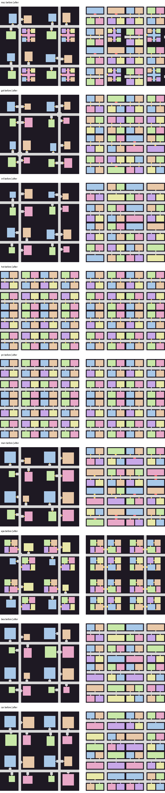

# Infinite endless route

Infinite is the primary player-facing route. New solo and ENet rooms default
to it, and normal staging no longer shows a finite-map scale button. The old
Standard route remains in code as an internal regression and legacy-save
fallback; it is not the direction of new map work.

## Implemented runtime

- The route is a single level. Deterministic 45×45 chunks use `(x, 0, z)` ids
  (the level component stays for save/replication compatibility but only 0
  exists), canonical doorway seams, and the room-and-three-cell-corridor fabric of
  the finite maze language; perimeter rooms own outward seams. The floor is
  horizontally unbounded. There are no stair links, stairwells, floor/ceiling
  voids, ladders or hunter floor transfers.
- The renderer keeps a collidable 3×3 horizontal window. Old geometry, pickup
  nodes, hunter views, navigation caches, and generator cache entries are
  bounded as the runner travels.
- Every biome (Maze, Mansion, Hotel, Apartment, Beach, Gothic, Prison, Carnival,
  Inferno) can appear on the one floor, with deterministic room/corridor layouts
  and authored regional GLB dressing. Hotel and prison chunks use long halls
  serving multiple rooms; landmark rooms reach 15×15 cells.
- Room height varies (see `RefLook.ceiling_height`): corridors 3.7 m, ordinary
  rooms 4.6 m (one wall-texture storey), halls/warehouses/chapels 9.2 m, and
  greenhouse rooms (Beach cove / tide pool / hut / boardwalk) 13.8 m with a
  glass-and-iron roof. Walls repeat the storey texture upward; lintel faces close
  the gap above a low doorway entering a tall room.
- Safe chunks are temporary checkpoints. The origin has a real safe-zone
  marker in the world and on the discovered map. Integrity persists after
  unloading, hunters can breach them, and crowbars/rescue axes can repair them.
- Rooms deliberately carry multiple authored props, hiding fixtures, relays,
  batteries, coins, tools, and backpack upgrades. Props choose room-facing
  45-degree rotations instead of pointing into walls. Their authored front
  axis is normalized at placement, floor props are seated from their combined
  imported bounds, and residential seating uses the full-width couch model
  rather than its small single-seat variant. Pickup ids are stable: exactly one runner receives a
  contested item, and the claim remains spent after unload/reload.
- The quick bar stays at five slots. Authored small/medium/large backpacks add
  5/10/15 storage slots to the movable Tab inventory. Q drops the held tool;
  E or right click claims a dropped tool with its remaining durability, and
  late join snapshots retain world drops. T and `/` open host-relayed room
  chat. Settings groups controls into tabs and supports multiple bindings per
  action.
- The minimap contains discovered geometry from the current floor only.
  Entering a room reveals that room's still-available relays, pickups, and
  useful props; corridor objects reveal only at nearby interaction distance.
  The full map uses the same persistent discovery ledger, supports local
  click-to-place teal waypoints that clear within five grid cells of the
  player, and adds white, direction-aware up/down stair icons. Debug map reveal expands a bounded survey rather than pretending
  infinity can be revealed all at once. Fresh co-op runners use distinct blue
  markers on both maps only while they share the viewer's current floor.
- Each ordinary generated room owns exactly one canonical hallway threshold.
  A final perimeter pass seals accidental secondary or corner openings left by
  later circulation/stair carving. Region seams use their normal structural
  floor; only authored non-solid room rugs render as floor dressing.
- Residential room doors are authored regional models with synchronized hinge
  animations, blocking collision while closed, and durable late-join state.
  Players and ordinary hunters open them; Loxelle visibly charges and tears a
  closed door from its frame while chasing.
- Hunters activate immediately on Hard, at relay one on Standard, and at relay
  three on Relaxed. Further relay recovery grows the desired population at the
  difficulty cadence with no fixed population ceiling; only nearby bodies and
  navigation stay loaded, while every admitted hunter keeps durable state.
- Gray Void owns the anti-AFK pressure role. If every runner stays stationary
  (Relaxed 180s, Standard 120s, Hard 75s), or the room makes no relay progress
  (Relaxed 300s, Standard 210s, Hard 120s), the host wakes one safely placed
  Gray Void. A successful pressure spawn or recovered relay resets both clocks.
  The arrival warning is audio-only and the clocks are included in snapshots.
  Sparse A–Z and deeper-floor Void hunters have stable entity ids and durable
  position/state/stun data. Capture returns the affected runner to the latest
  intact shared checkpoint.
- Hunter perception separates immediate direct sight from retained pursuit.
  A visible flashlight extends sight, hearing reuses one routed grid path, and
  turning a corner keeps the hunter chasing the last live route for three
  seconds instead of cancelling pursuit. Sense and replan work is interval-
  limited so distant hunters do not rebuild paths every rendered frame.
- Vents eject a runner one full clearance radius into the fixture's room-facing
  opening, then ask streamed navigation for the nearest valid open position.
  The entrance grate, neighboring vent cell, and wall-adjacent cells are all
  excluded so transit cannot finish inside a wall or the vent model.
- A-Z hunter eye glows use the authored face attachments but render as aligned
  2x2-pixel blocks. Heads can scan independently of the body, Kathy owns a
  visible yellow eye beam, and the dark world profile makes unlit traversal
  deliberately impractical. Held co-op flashlights replicate their real beam
  on peers and turn off when the item is put away.

## ENet authority

Every peer renders the same deterministic base around its own runner. Peer 1
alone owns contested pickup results, checkpoints, safe-room damage/repair,
hunter simulation, target selection, taser hit tests, and capture decisions.
Guests send intent-only interaction packets; the host validates the sender's
fresh replicated level, position, inventory, range, and generated entity data.
Late joiners remain input-frozen until the world mutation ledger and current
hunter report are adopted. The host keeps authority windows around every fresh
runner rather than only around its own camera.

Named route archives use the same authority split. Offline and online-solo
hosts can save and load. A host with connected guests may archive the shared
world plus her own player state, but cannot replace the live room from a slot
until those guests leave; guests cannot write or load host-authoritative saves.

`scripts/validate_streamed_world.gd` covers topology, all regions, authored
dressing, collisions, physical stairs, bounded long-distance streaming,
persistent pickups/checkpoints/hunters, authority callbacks, and snapshot
shape. `scripts/enet_smoke.gd` runs two processes and verifies Infinite room
configuration plus streamed interaction, hunter, durable-event, targeted
effect, and snapshot packets over real ENet.

## Deliberately retained boundaries

Standard remains available internally as a legacy/regression surface. Its
objective guardians, vent-network hunters, coins, and relay sabotage now have
streamed equivalents. The public relay backend already supports host-promotion
frames, but the Godot client still returns guests to staging if peer 1
disappears; client-side reconnect/authority handoff remains a separate room
reliability task and is not presented as completed here.

## Rooms and connectors (ref-look)

Rooms are at least 9x9 (9x9, 9x11, 11x9, 11x13 and larger); each sits at the inner corner of its sector so the connector to the main hall is a few cells, not a long hallway. Hotel and prison corridors serve linear rows of 9-deep rooms, and apartment sectors are four-room suites. Checked by `validate_streamed_world`.

## Layout rules (DONE5)
- **Hallways are 3 wide, end to end.** Main halls are the three-wide cross of each chunk. Seams between chunks meet the cross: in hotel and prison chunks (and their neighbours) the seam opening is always the centre row/column, so no perimeter lane runs through a room bank and leaves 1-2 wide slivers. (Per-hallway 5-wide halls were not added: a hallway crosses chunk boundaries into other districts, so its width has to stay the same everywhere.) Validator `hallways` scans 145 chunks and fails on any open non-room cell with fewer than three cells across, and on a blocked main-hall cell; before the fix 649 hotel cells were narrower than 3.
- **Per-district density** (`StreamedRouteGenerator.DENSE_DISTRICTS`, hotel and prison): `_dense_linear_layout` puts four rows of four 9x9 rooms per chunk in banks that share walls, each opening straight onto one of three east-west halls (rows 1-3, 21-23, 41-43) with a one-cell door and no connector. Other districts keep their spacious sector layout (rooms anchored toward the inner corner with a 1-3 cell connector). Validator `density` measures "dead mass" (solid cells with no open cell within two cells) per district: hotel and prison went from 57% to 9%; every dense district must stay under 35% with rooms within 2 cells of a hall.
- **Wall humps:** `_remove_wall_humps` deletes one-cell wall stubs and opens one wall cell of diagonal pinches (never a room perimeter, doorway or chunk border). The apartment kitchen door moved next to the wall below it so it no longer leaves a one-cell wall piece. Validator `humps` counts stubs, one-cell pockets and diagonal pinches over 194 chunks: 20 before, 0 after.
- Prison cells and cafeterias are 9x9 rooms (bunk, toilet and a walking aisle fit).

## Bank layout in every district (DONE7)

All districts use the compact bank layout: shared walls, one hallway between banks, 21x9 hall rooms or two 11x9
rooms per bank, doorways at the room centre, seams on rows 10/22/34. Maze keeps its office suite quarter and
apartments keep their unit suites. Before/after per district (left old, right new):

Density limits (validate_density): dense districts < 15% dead mass, mean door-to-hall <= 2.5 cells; apartments < 40%.
