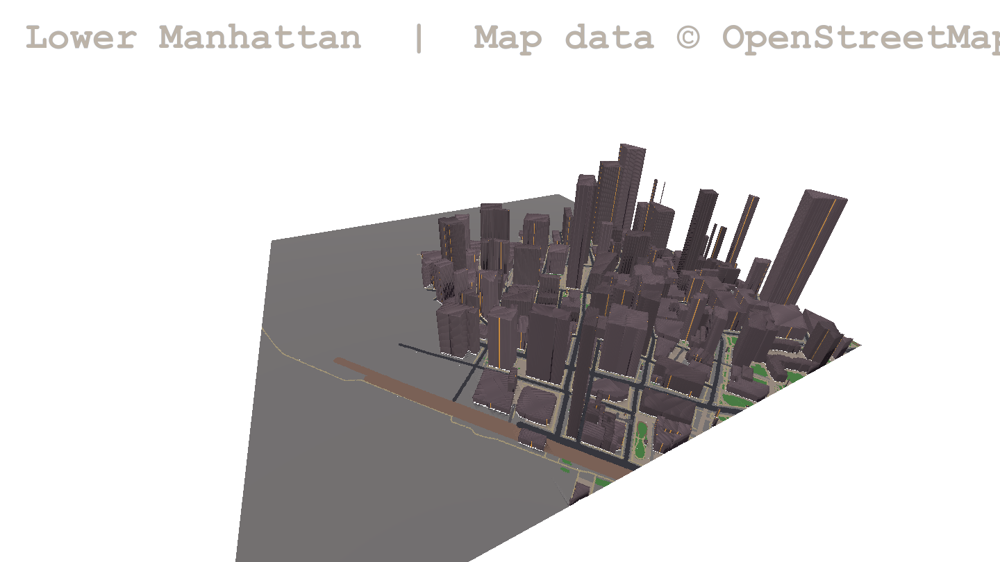

# KYTTU: The City — real-world OSM maps (online only)

Status: **design + offline proof of concept**. Nothing here is deployed; every server step in section 9 is
**[KT OK]** and waits for KT's approval. The City lane (`claude/city-lane`) owns City gameplay code; this work
lives only in new files (`tools/osm/`, `src/osm_city/`, `scenes/osm_city_preview.tscn`, this doc) and asks the
City lane for the integration points listed in section 6.

Goal: small real areas (a few blocks up to ~2 km², e.g. Lower Manhattan, South Miami Beach) become selectable City
maps. They are **online only**: never bundled in a build, never written to disk on the client, never playable
without a live, authenticated server session.



## 1. Licence: ODbL and attribution

* OSM data is © OpenStreetMap contributors under the **Open Database License 1.0**. Our converted map files are a
  *derived database* and stay ODbL. The game itself (code, art) is a *produced work* and keeps its own licence.
* **Attribution in game** (required, "reasonably calculated to make any person aware"):
  * map select card for every OSM map: "Map data © OpenStreetMap contributors" + link `openstreetmap.org/copyright`;
  * a line in the run's pause menu / map overlay while an OSM map is loaded;
  * the credits screen and `docs/CREDITS` get a "Map data" entry (OSM via Geofabrik).
  * The manifest carries the attribution string (`attribution`, `licence`) so the client never hard-codes it.
* **Share-alike**: if we publicly use a derived database we must offer it under ODbL. Simplest compliant route:
  publish the converter (this repo's `tools/osm/`) and offer the exact converted files on request / on a plain
  download page (`/api/city-maps/<id>/<ver>/source` behind the same login is not enough for ODbL; an unauthenticated
  ODbL download page on the website is). Online-only is a *gameplay* rule, not a way to withhold the data.
* Geofabrik extracts are free to use; credit "Geofabrik" in the credits.
* No OSM tiles are fetched at runtime (no tile usage policy issue); no Overpass at runtime.

## 2. Data flow

```
Geofabrik (daily)  ──►  VPS 2 /srv/osm            ──►  VPS 3 lastroute-godot2      ──►  client (Godot)
new-york-latest.pbf     1 clip  (osmium extract)       curated list + file API         download after login + live
florida-latest.pbf      2 export (osmium geojsonseq)   session-gated, signed            session; RAM only; refuse
                        3 convert (tools/osm, py3)     versioned, cached               otherwise
                        4 sign + publish versioned dir
```

### 2.1 VPS 2 (processing, never client-facing)

1. **Extracts**: `/srv/osm/extracts/<region>-latest.osm.pbf` from Geofabrik (already present: New York, Florida).
   Refresh at most weekly with `curl -z` (only when newer); keep the previous file until the new one passes
   `osmium fileinfo`.
2. **Clip**: `osmium extract -b W,S,E,N --strategy=complete_ways -o clips/<id>.osm.pbf <extract>` with a 300 m
   margin around the map bbox so ways crossing the edge are complete (done for the two test clips).
3. **Export**: `osmium export --geometry-types=point,linestring,polygon -f geojsonseq -a type,id` (multipolygons
   are assembled by osmium, so buildings with courtyards and park relations come out right). No pyosmium needed.
4. **Convert**: `python3 -I tools/osm/osm_city_convert.py clip.geojsonseq out/<id>/<ver>/ --name … --bbox …`
   (standard library only; deterministic, byte-identical for the same input).
5. **Sign + publish**: `sha256` of every file is already in `manifest.json`; the manifest is signed with an
   Ed25519 key that lives only on VPS 2 (`openssl pkeyutl -sign`). The public key ships in the client. Output
   `/srv/osm/out/<id>/<ver>/` is pushed to VPS 3 with `rsync` over SSH to a dedicated, write-only drop dir.
   Versions are immutable; a new OSM refresh makes `<ver>+1`. Old versions are kept until no room uses them.

### 2.2 VPS 3 (the only server clients talk to)

New routes in the existing Node backend (`backend/city_maps.mjs`, mounted from `server.mjs`, no new dependency):

| Route | Auth | Returns |
| --- | --- | --- |
| `GET /api/city-maps` | account session token (header) | curated list: id, name, version, bbox, area, file count, size, attribution, preview url |
| `POST /api/city-maps/ticket` | session token + room code (or solo run id) | short-lived (10 min) HMAC ticket bound to account, room, map id + version |
| `GET /api/city-maps/<id>/<ver>/<file>` | ticket (header) | manifest, `features.json.gz`, `c_X_Z.bin`; `Cache-Control: private, max-age=600`, `ETag` = sha256 |

* **Curated list** = `/var/lib/lastroute-godot2/city-maps/index.json`, edited by KT (admin route later). Only
  listed `<id>/<ver>` are served; anything else 404s.
* **Session rule**: the ticket is only issued while the account session is valid *and* the room is registered
  (co-op) or a solo run was opened by `/api/rooms/default-start`-style call. Host and guests each fetch with their
  own ticket; peers only exchange `map id + version + sha256` over ENet, never map bytes.
* **Caching**: files are immutable per version, so nginx/Node can serve them with strong ETags; the Node process
  keeps the current versions in memory (a 1 km² map is ~2 MB). Rate limit per account (e.g. 60 files/min).
* **Size budget**: ~2–6 MB per map version; 20 maps × 3 kept versions < 400 MB. VPS 3 has 12 GB free.

### 2.3 Client

* The City map select lists OSM maps only when `BackendClient.signed_in()` and not `offline_mode`; offline the
  entries are hidden (not greyed with a download button).
* Download: manifest first, verify signature with the shipped public key, then each file; verify sha256.
* **Memory only**: bytes go into a `Dictionary` in an autoload (`OsmCityStore`), never `user://`, never the HTTP
  cache. The store is cleared on run end, room leave, sign-out, and when the backend session check fails.
* **Live session**: before a run starts and every 60 s during it, the existing session/heartbeat must succeed;
  if the session is lost for > 2 minutes the run ends with "Lost connection to the map server". (Guests in a
  co-op room inherit the host's room heartbeat plus their own session check.)
* No `--osm-dir` or file loading exists in exported builds: the PoC viewer (`osm_city_preview.gd`) is dev-only
  and must be added to every export preset's `exclude_filter` (todo, `src/osm_city/osm_city_preview.gd, scenes/osm_city_preview.tscn`).
* Honest limit: a determined user can still dump RAM. Online-only is enforced by design (no files, no offline
  path, server tickets), not by DRM.

## 3. Map format LRCM1 (produced by `tools/osm/osm_city_convert.py`)

* Cells are **1 m**, chunks **45 × 45** cells — the City's own grid (`CityLayout.CHUNK`), so the route code,
  hunters, nav and multiplayer chunk contract work unchanged. +x east, +z south; cell (0,0) = bbox north-west.
* `manifest.json`: `format, id, name, version, bbox, size_cells, chunk, chunks_xz, attribution, licence, stats,
  files {name: sha256}` (+ `signature` once signing exists).
* `c_X_Z.bin` (gzip): `"LRC1"`, `u16 w, u16 h`, `w*h` bytes cell kind (**CityLayout kind ids**: road 1, pave 2,
  plaza 3, grass 4, path 5, water 6, wall 7, door 9, bridge 17, alley 19), `w*h` bytes building height in metres
  (0 = none).
* `features.json.gz`: `buildings` (id, osm id, type, name, height, levels, min_height, rect, cell count, door
  cells), `shops` (osm id, cell, shop/amenity kind, name), `roads` (osm id, class, name, oneway, bridge, width,
  polyline in cells).
* PoC numbers, Financial District 1.035 × 1.035 km: 529 chunks, 318 buildings, 1286 road ways, 354 shops/amenities,
  **2.2 MB** total, converted in **0.8 s**, built into meshes in **0.27 s** on the mini.

## 4. Conversion rules (OSM → City systems)

| OSM | City | Notes |
| --- | --- | --- |
| `highway=motorway/trunk/primary/secondary/tertiary/residential/unclassified/living_street(+_link)` | `ROAD` with class width 14/12/11/9/8/6/6/5 m, `PAVE` either side 0–3 m | `lanes`/`width` tags override later; `oneway` kept for traffic/AI |
| `highway=service` | `ALLEY` 4 m | |
| `highway=pedestrian` (line or area), `place=square`, `amenity=parking` area | `PLAZA` | |
| `footway/path/cycleway/steps` | `PATH` 2 m | `footway=crossing` → `CROSS_NS/EW` by road direction (next pass) |
| `bridge=*` | `BRIDGE` cells (level 0 deck) | over-water bridges walkable; overpasses above other roads: deck only, no second level in v1 |
| `tunnel=*`, `layer<0` | skipped | not on level 0 |
| `building=*` / `building:part` polygons (incl. multipolygons) | `WALL` mass, height from `height` → `building:levels × 3.2 + 1` → 12 m default; clamp 4–250 m | facade style/tint by `building` type and `building:colour` (City renderer) |
| `entrance=*` / `door=*` nodes on the outline | `DOOR` cell = **CityDoor** | otherwise one door on the wall cell nearest the centre that faces road/pave/plaza |
| `shop=*`, `amenity=cafe/restaurant/bank/…` nodes | building **shop hook**: the building containing it gets interior kind shop/cafe/… and a sign name | maps 1:1 to the City's `INTERIOR_RECIPES` |
| buildings > 40 m | **tower hook** (City lane's towers) | top floors not enterable in v1 |
| `natural=water`, `waterway=riverbank`, `water=*`, coastline | `WATER` | coastline (sea side) fill = **open item** (East/Hudson River currently show as pave in the PoC) |
| `leisure=park/garden/pitch`, `landuse=grass/…`, `natural=wood/scrub` | `GRASS` (+ City trees/benches decor) | |
| everything else inside bbox | `PAVE` | |
| bbox edge | `RIM` 2 cells + City dome/skyline outside | replaces the oval ellipse; maps are rectangles |

Gameplay hooks:

* **Hunters / pathing**: open kinds = `CityLayout.OPEN_KINDS`; nav and `edge_openings` come from the grid as today.
  Building interiors: one enterable room behind each door (the City's "one room per building" rule), sized
  `min(footprint − 2, 20 × 20)`.
* **Relays / spawns / pickups**: the existing `_fixtures`, `_pickups`, `_hunter_spawns` run on the grid unchanged.
  **Shelters (safe rooms)**: chunk-centre rule kept: the converter marks a chunk's shelter when its centre 11 × 11
  is open; spawn = the open chunk nearest the map's named spawn point (manifest `spawn`, curated per map).
* **Gate (escape)**: per-map curated cell (e.g. Battery Park ferry for Lower Manhattan).
* **Streaming**: the provider answers only chunks in `chunks_xz`; stream radius 1 as now. Chunks are decoded from
  RAM on demand.
* **Determinism / co-op**: the map version + sha256 replaces the seeded layout as the source of truth; seeded
  decisions (shelter rolls, prop picks) still use the room seed, so peers build identical chunks.

## 5. Area limits and performance

* Hard limit **2.0 km²** (converter refuses larger) and max **50 × 50 chunks**. Default curated size ~1 km².
* Height clamp 250 m; buildings > 120 m drawn as LOD boxes beyond 300 m.
* Target **75 FPS** (the game's cap) on the M4 mini, 60 on the Windows laptop: City renderer streams radius 1
  (9 chunks) with full detail; outside that a single far-LOD mesh of building boxes (the PoC mesh is exactly this:
  1 km² of boxes renders at the 75 FPS cap on the mini with no streaming at all).
* Network: ≤ 6 MB per map, fetched once per run.

## 6. Integration points needed from the City lane (requested, not edited here)

1. `CityRouteGenerator` accepts a layout source: today `CityLayout.build(seed)`; needed a `CityLayout`-compatible
   object (`kind_at`, `is_open`, `chunk_grid`, `chunk_kinds`, `chunk_decor`, `buildings_in_chunk`,
   `shelter_for_chunk`, `building_props`, `chunk_in_range`, `spawn`, gate cell) so we can add `OsmCityLayout`
   in `src/osm_city/` without touching `city_layout.gd`. Chunk range must come from the layout instead of the
   `CHUNK_MIN/MAX` constants.
2. `CityFacilityViewThreeD` reads building height/style from the chunk `city.buildings` entries (already does)
   and the outer rim/dome from the layout (rectangle instead of ellipse).
3. City menu: a "Real places (online)" list fed by `/api/city-maps`, shown only when signed in.
4. Shops/towers: a function `interior_kind_for(building)` the OSM layout can override with OSM shop tags.

## 7. Voxel Coast reuse (`/Volumes/BIG-HDD-2/UniversalModder/city-mashup-godot`, read-only)

| Voxel Coast | Reuse | Change |
| --- | --- | --- |
| `tools/mapcfg.py` projection (equirectangular at origin, +z south) | idea copied into `osm_city_convert.py` `Proj` | origin = bbox NW corner, cells = 1 m |
| `tools/pbf_cut.py` (pyosmium) | tag classification (`classify`, road/minor/green sets) copied | replaced by `osmium extract` + `osmium export` (no pyosmium install) |
| `tools/osm_build.py` + `road_graph.py` (junctions, lanes, sidewalks, controls, elevation) | later, for traffic/AI and sidewalk widths (`assign_sidewalks` rule) | copy into `tools/osm/` when needed; drop DEM/elevation (City is flat level 0) |
| `tools/voxel.py` (1 m blocks, building heights, greedy meshes) | height rule (`height` → `levels`), 1 m raster | City uses its own facade renderer, not voxels |
| `game/map_store.gd` + `voxel_lib.gd` + `voxel.gdshader` (manifest polling, hot load, VMZ1 meshes) | manifest + per-chunk versioned files pattern | memory-only store, ticketed HTTP, no polling of a local daemon |
| `tools/mapd.py` local daemon, Florida hard-code | not reused | VPS 2 batch job, any region |
| `docs/CREDITS_AND_LICENSES.md` ODbL wording | wording reused in section 1 | |

## 8. Starter areas (bbox = south, west, north, east)

| id | area | bbox | size | extract |
| --- | --- | --- | --- | --- |
| `lower-manhattan` | Financial District: Wall St, Broadway, Trinity Church, Bowling Green | 40.7020, -74.0160, 40.7110, -74.0040 | 1.0 × 1.0 km (PoC done) | new-york |
| `miami-beach-south` | South Beach: Ocean Dr / Collins Ave / Washington Ave, 5th–15th St, Lummus Park | 25.7700, -80.1420, 25.7860, -80.1290 | 1.3 × 1.8 km | florida |
| `times-square` | Midtown: Times Sq, Bryant Park, 40th–48th St, 6th–8th Ave | 40.7520, -73.9910, 40.7610, -73.9810 | 0.85 × 1.0 km | new-york |

## 9. Install / deploy steps for KT to approve

### VPS 2 (`ssh vps2`) — **[KT OK]** each

1. Nothing to install for v1 (osmium-tool 1.16 and Python 3.12 are present; converter is stdlib only).
   Optional later (only if we port `road_graph.py`): `apt install python3-pyosmium` — **not needed now**.
2. Create a service user and dirs: `useradd -r -m -d /srv/osm osmbuild; chown -R osmbuild /srv/osm/{clips,out,scripts}`.
3. Copy the converter: `rsync tools/osm/ vps2:/srv/osm/scripts/` (from a reviewed commit).
4. Signing key (once, stays on VPS 2): `sudo -u osmbuild openssl genpkey -algorithm ed25519 -out /srv/osm/keys/maps.key; chmod 600`;
   public key to the repo as `src/osm_city/maps_pub.pem` (it is public).
5. Build script `/srv/osm/scripts/build_map.sh <id> <ver>`: extract → export → convert → sign → `rsync` to VPS 3.
6. Weekly refresh timer (systemd `osm-refresh.timer`, Sun 04:00): `curl -z` Geofabrik extracts, rebuild curated
   maps, publish as a new version. Manual until KT approves the timer.
7. SSH key for VPS 2 → VPS 3 push, restricted on VPS 3 with `command="rrsync -wo /var/lib/lastroute-godot2/city-maps/incoming"`.

### VPS 3 (`ssh vps3`, service `lastroute-godot2`) — **[KT OK]** each

1. `mkdir -p /var/lib/lastroute-godot2/city-maps/{incoming,live}; chown lastroute2 …` (inside the unit's
   writable state dir, so the hardened unit needs no change).
2. Add the VPS 2 push key to a restricted `authorized_keys` entry (`rrsync` write-only, incoming only).
3. Deploy the backend release containing `backend/city_maps.mjs` with the existing `deploy/deploy.sh` (dry run
   first, then apply) — to the **test instance (8205) first**, smoke test, then prod (8105).
4. Env: `LASTROUTE_CITY_MAPS_DIR=/var/lib/lastroute-godot2/city-maps/live`, `LASTROUTE_CITY_MAP_TICKET_SECRET=<random>`
   in `/etc/lastroute-godot2/lastroute-godot2.env` (never in the repo).
5. Promote a map: move `incoming/<id>/<ver>` → `live/<id>/<ver>` after signature check, add it to `index.json`.
6. No new port, no firewall change, no nginx change (files go through 8105/8205).

## 10. Proof of concept (this commit)

* `tools/osm/osm_city_convert.py` — GeoJSONSeq → LRCM1, stdlib only, deterministic (verified: two runs diff clean).
* `src/osm_city/osm_city_preview.gd`, `scenes/osm_city_preview.tscn` — dev-only viewer, reads `--osm-dir=` from the
  command line, renders all chunks, logs FPS, saves `--capture=`. Shows the ODbL attribution line.
* The converted data is **not** in the repo (it stayed in a scratch dir and `~/Developer/osm-poc` on the mini).
* Reproduce:

  ```
  ssh vps2 'osmium export --geometry-types=point,linestring,polygon -f geojsonseq -a type,id -o /tmp/lm.geojsonseq /srv/osm/clips/lower-manhattan.osm.pbf'
  scp vps2:/tmp/lm.geojsonseq "$SCRATCH/"
  python3 -I tools/osm/osm_city_convert.py "$SCRATCH/lm.geojsonseq" "$SCRATCH/out_lm" --name "Lower Manhattan" --id lower-manhattan --bbox 40.7020,-74.0160,40.7110,-74.0040
  mini-run.sh <worktree> osm-city-maps --scene res://scenes/osm_city_preview.tscn -- --osm-dir=/abs/out_lm --capture=/abs/lm.png
  ```
* Mini result: map built in 271 ms; 75 FPS engine rate (vsync cap) on 1 km² of unstreamed boxes.
* Known gaps: coastline/river water fill, crosswalk orientation, building interiors/props (needs section 6 hook),
  shelters/spawn/gate per map, signing and the backend routes.
