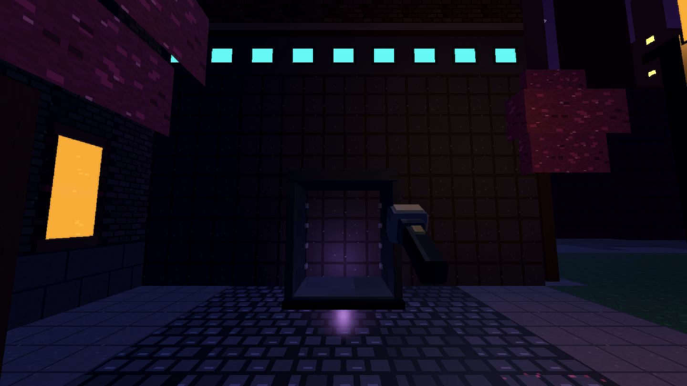
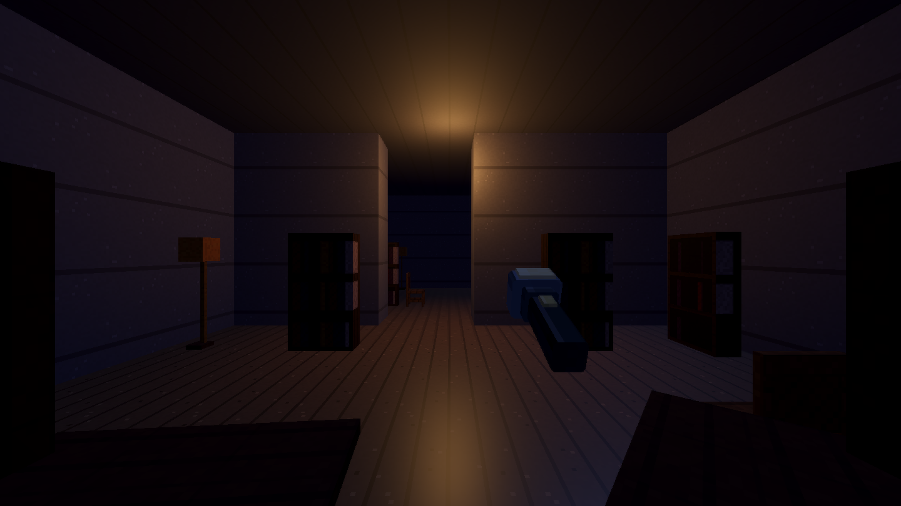
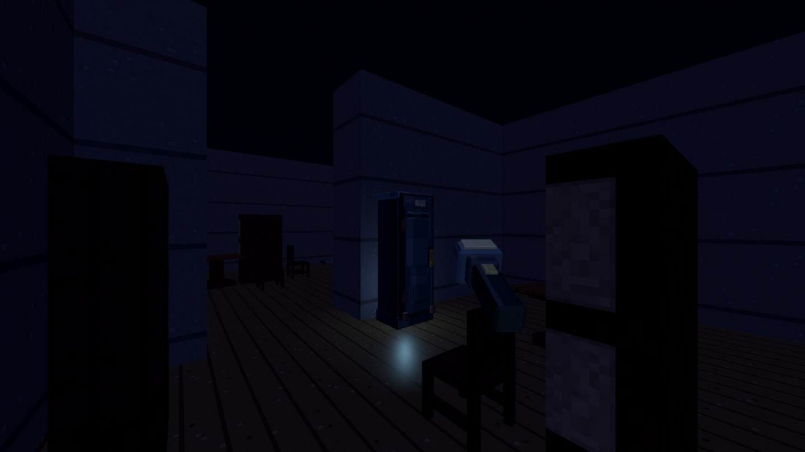
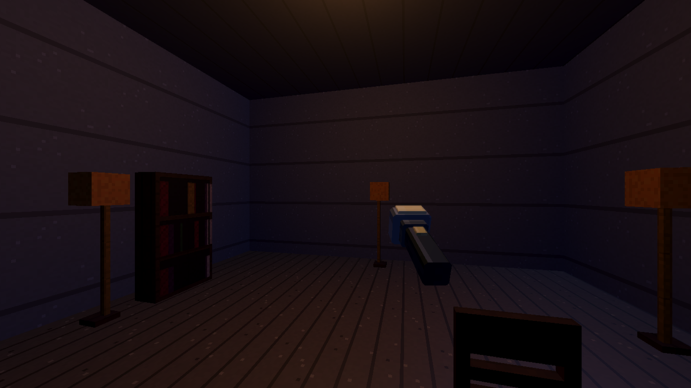

# KYTTU: The City

The City is its own project in the game hub (id `city`), next to The Last Route and the locked Night Watch. It is one
bounded, hand-planned, domed oval city, not a district of the endless maze. The maze rules (3/5-wide halls, 9x9+ rooms,
compact banks, no humps) are maze-only and are not applied here.

References (all in `LastRoute-3D-refs/`): `city-ref-street.webp`, `city-ref-street-2.webp`, `city-ref-boulevard.webp`
(wet cobbled night streets, tall dark Victorian-industrial fronts with lit windows, iron fire escapes, pipes, ivy,
lanterns on lamp posts, cyan wall panels, blossom trees in planters, bollards, awnings, crosswalks, manhole covers),
`city-ref-plaza.webp`, `city-ref-grand-plaza.webp` (fountain plaza, bus shelter, benches, statue on a plinth, long
reflecting pool, cypress and blossom trees) and `city-ref-topdown-map.webp` (the layout).

## 1. What the City is

A walled city under an open night sky (the dome shell was removed: no ribs, rings or pylons; only the rim wall bounds it). A dark truss ring runs around the rim with cyan beacons; overhead is an artificial
night sky (navy to purple gradient, pixel stars, cloud blobs, a moon) with lit dome struts; beyond the dome the skyline
of spires and arched viaducts is visible. Orange gas lanterns, cyan accent panels, pink-purple blossom trees, wet
cobbles with fallen petals. It is dark: the flashlight still matters.

Top-down (from the reference), mapped onto the grid in section 3:

* a long straight **N-S central avenue** splitting the city in two (traffic lights, crosswalks, lamp rows, blossom trees)
* a **fountain roundabout** where the avenue crosses the main **E-W street**: compass-rose paving, ornate fountain
* **two formal gardens** (cross-shaped paths, flower beds, hedges, fountain) beside the centre
* an **inner ring street** (rounded corners) and an **outer oval ring road** inside the dome rim
* a **grand plaza** with a statue and a reflecting pool at the north end, a **gate/arch** at the south end of the avenue
* dense **city blocks** of dark Victorian/industrial buildings (pipes, chimneys, domes, courtyards, orange windows);
  civic domed halls in the north and south, large industrial/tech buildings with cyan service ports east and west
* huge **dome-support pylons** with cyan lights on the rim

## 2. How it plugs into the game (no maze code is touched)

The running game is `scenes/infinite_route_test.tscn` (`src/infinite_route_test.gd`): it reads chunk dictionaries from a
`StreamedRouteGenerator` through a `StreamedFacilityView3D`, and hunters, brains, pathfinding, pickups, safe rooms,
emotes, admin, spectators, death scenes and multiplayer all work from that chunk contract. The City re-uses all of it:

| Piece | File | Notes |
| --- | --- | --- |
| Master layout (pure data) | `src/game/city_layout.gd` | one deterministic 225 x 135 cell grid, zones, lots, buildings, props |
| Chunk provider | `src/game/city_route_generator.gd` | `extends StreamedRouteGenerator`; slices the layout into 45 x 45 chunks, same dictionary shape |
| Renderer | `src/game_3d/city_facility_view_3d.gd` | `extends StreamedFacilityView3D`; open streets, tall facades, interiors, props, lights |
| Surface mesh | `src/game_3d/city_surface.gd` | own quad batcher and pixel atlas (does not touch RefTextures / RefSurfaceMesh) |
| Sky and dome | `src/game_3d/city_sky.gd` | dome shader, stars, clouds, truss ring, skyline |
| Run scene | `scenes/city_route.tscn` | copy of the route scene with the City view node |
| Menus | `scenes/city_menu.tscn`, `src/ui/city_menu.gd` | NEW RUN, CONTINUE, co-op / room, BACK TO GAMES |
| Hub entry | `src/config/game_registry.gd`, `src/ui/theme_city.tres` | id `city`, title `KYTTU: The City` |

Shared files only change additively: a `Mode.CITY` value and a scene lookup in `RoomState`, a `game` field in the room
register/resolve calls (backend and client), a registry entry, and the suite list in `scripts/validate_runner.gd`.

## 3. World spec (cells are 1 m)

Chunks stay 45 x 45. The City is **5 x 3 chunks**, `x` in -2..2 and `z` in -1..1, level 0. Absolute cell
`X = chunk.x * 45 + local.x` (so X runs -90..134, Z runs -45..89). Chunk (0,0) is the spawn chunk; the roundabout sits on
its centre cell (22,22), which is also the origin checkpoint, so the spawn rules of the route code keep working.

Everything outside the dome ellipse (centre 22.5, 22.5; semi-axes 112 x 66) is solid rim. Chunks that are entirely rim
are "sealed" (`is_chunk_allowed` is true only for the 15 city chunks).

Street cross-sections: avenue and main street **9 wide** (2 pavement, 5 road, 2 pavement), roundabout radius 13,
secondary streets **5 wide** (1 pavement, 3 road, 1 pavement), outer ring road 7 wide, alleys 3 wide, plazas open.

| Zone | Placement (absolute cells) |
| --- | --- |
| Central avenue | X 18..26, full height of the oval |
| Main E-W street | Z 18..26, full width of the oval |
| Fountain roundabout | centre (22,22), radius 13; island radius 6 with fountain basin; head house 9x9 at the centre (spawn shelter) |
| Secondary N-S streets | X -47..-43, -2..2, 43..47, 88..92 (5 wide, on chunk borders) |
| Secondary E-W streets | Z -2..2 and 43..47 |
| Outer ring road | inside the rim, 7 wide, follows the ellipse |
| Gardens | quadrant blocks beside the roundabout (NE and SW): cross paths, beds, hedges, fountain |
| Grand plaza | north end of the avenue: statue plinth, reflecting pool 14 x 4, benches, cypresses |
| Gate | south end of the avenue: arch across the road in the rim |
| Blocks | everything else, cut into lots 10..20 wide |

Block centres coincide with chunk centres on rows -1 and 1 (and columns -2, -1, 1, 2), so **shelters** (safe rooms,
the route code expects them on the chunk centre) go there: 11x11 metro / bus-shelter kiosks with a door, a checkpoint
light and a cyan sign. Each block chunk rolls one (seeded, about half of them); chunk (0,0) always has one.

Buildings: a one-cell facade ring, one enterable room inside, a door onto the street (2 wide) and sometimes a back door.
Interior kinds (shop, cafe, lobby, apartment, office, hall, workshop) pick the prop sets, floor and light colour. Facades
are visual only above 3.5 m: collision walls stay 4 m, the view stacks tall textured facade blocks (12..30 m) with lit
window cells, fire escapes, chimneys and pipes on top of them. Courtyard blocks leave a walled inner garden.

## 4. Props (all new, our own blocky style, in new files only)

`tools/props/city_props.py` builds the City-only pieces into `art/props-3d/props/city/`; nothing in the shared prop
families is edited (the props lane owns those). First pass list: lamp post (emissive lantern), cyan wall lamp, blossom
tree (trunk plus cube canopy), cypress, planter (box with flowers), bollard, bench, bus shelter (glass panels),
fountain (basin plus tiers), statue on plinth, reflecting pool rim, fire escape (landing plus ladder run), awning
(striped), traffic light, crosswalk and manhole as floor decals, petal decals, hedge rows, notice board, newspaper
box, vent/pipe runs. Where a piece is simple it is drawn straight into the surface mesh (no node).

## 5. Sky, light budget, performance

* **Sky**: a large inverted dome (radius 150, shader, no post effects): vertical gradient (navy to purple at the
  horizon), hash-pixel stars (quantised, twinkle), cloud blobs from low-frequency noise on 8 colour steps, a moon disc.
  A truss lattice (5 meridians x 3 parallels, thin emissive-free boxes) with 14 cyan/red beacon dots, a rim of dark
  pylons, and a skyline ring (60 dark towers with window specks, 3 arched viaducts) outside the dome.
* **Lights**: lanterns and cyan panels are emissive meshes; only a pool of 8 `OmniLight3D` follows the player (nearest
  lanterns, no shadows). The flashlight is the only shadow caster. Ambient stays low, so streets are dark between
  lamps. Shelters keep their checkpoint light (budgeted by the existing lamp field).
* **Performance**: one `ArrayMesh` per chunk for all floors and walls (one material, nearest-filtered atlas), props as
  `MultiMeshInstance3D` per kind per chunk, colliders only for walls and solid props as boxes. Stream radius 1 keeps 9
  chunks resident. Target: 60 fps on the M4 Mac mini.

## 6. Multiplayer, saves and namespacing

* `RoomState.Mode.CITY` (added at the end of the enum, so existing values do not change) selects the City scene; the
  mode travels with the room like every other mode.
* Rooms carry `game` (`last_route` default, `city`): the host sends it when it registers and the directory returns it.
  A client that resolves a code for another game refuses the join with a clear message. Old clients and old servers
  simply omit the field and are treated as `last_route`.
* City run saves live under `user://city_runs/`, never in `user://route_saves/`; settings, account and per-server
  sessions are shared with the other games. Public route: see "Dome gate" and "Public City" below.
* Everything is deterministic from the seed (the master layout is a pure function of the seed), so host and guests
  build identical chunks.

## 7. Validators and tools

`scripts/validate_city.gd` (suite `city`): the layout is connected (every open cell reachable from the spawn), seams
between chunks match, streets are at least 5 wide except alleys, every building has a reachable door, shelters sit on
chunk centres and have a door, spawn / relay / battery / hunter-spawn coverage on every chunk, no prop on a door, the
registry entry and theme load, the `game` namespacing works, and a **hunter nav stuck test**: hunters walk long routes
through streets, plazas and doors (the `hunter_real` machinery) and must never stay still for more than 1 s.
`tools/look/city_map.gd` renders the top-down map; `tools/look/city_capture.gd` takes the street, plaza, sky and
interior captures into `docs/`.

## 8. Status of the first pass (what exists)

Built and passing (suites `city` and `city_nav`, `COOP_MODE=city scripts/coop_test.sh`):

* **Layout** (`city_layout.gd`): 225 x 135 oval, avenue, main street, five N-S and three E-W streets, fountain roundabout
  with the spawn kiosk on its island, four shelter plazas on chunk centres, two formal gardens, the grand plaza with
  statue and reflecting pool, about 25 enterable buildings (each a facade ring, a room, 2 to 4 doorway cells), alleys,
  verge parkland, about 300 pieces of street furniture. `docs/city_map.png` is the top-down map
  (`tools/look/city_map.gd`).
* **Chunk provider** (`city_route_generator.gd`): all 15 chunks hold city (the four corner chunks only a sliver of ring road), 5 shelters are the safe rooms (chunk
  (0,0) is the spawn), relays, batteries, tools, hiding spots, vents and hunter spawns follow the route code's own rules.
* **Renderer** (`city_facility_view_3d.gd`, `city_surface.gd`, `city_atlas.gd`, `tools/city/make_city_atlas.py`): the
  pixel atlas (56 tiles + emission), tall facades with lit amber / cyan windows, shop fronts, civic arches, industrial
  ports, 4 m interiors with ceilings, kiosks with a cyan sign, hedges, flower beds, water with a stone lip, wet cobbles,
  crosswalks, fallen petals.
* **Sky and dome** (`city_sky.gd`, `city_dome_frame.gd`): the pixel sky shader (gradient, stars, clouds, moon), dome
  ribs and rings with cyan beacons, 16 rim pylons, a 96-tower skyline with lit windows and three viaduct spans.
* **Lights**: lanterns and window panes are emissive; the 8-light `LampField` pool follows the player (lanterns, one
  lamp per building, the shelter checkpoint light). No post effects; the flashlight is the only shadow caster.
* **Menus and rooms**: hub card, `city_menu` (solo, host, join), room game id, "back" returns to the City menu.
* **Performance** (M4 Mac mini, windowed, frame limiter off): 270 to 480 fps, 270 to 560 draw calls (street canyons
  are the worst case); nine chunks resident.
* **Captures**: `tools/look/city_capture.tscn -- OUTDIR TAG` saves the spawn kiosk, the avenue both ways, the main
  street, the grand plaza, a garden, a shelter plaza, an alley, the sky, the rim gate, an interior and a facade;
  `docs/city_street.png`, `city_garden.png`, `city_plaza.png`, `city_sky.png` are samples.

## 9. Not in the first pass

* Run saves (the pause menu refuses saving and loading in the City; Last Route archives are never touched).
* Interior variety beyond one room per building, door leaves, traffic, rain, the city soundscape, irregular building
  footprints and courtyards, the south gate arch prop.
* Prop rework: the interiors use the shared prop types as they exist today; the props lane's rewrites apply
  automatically, a City-only prop set (`tools/props/city_props.py`) was not needed for this pass (street furniture is
  drawn straight into the surface mesh).

## Dome gate (escape objective)

The avenue ends in a closed 7 m gate (`CityLayout.GATE`, row 120, columns 108..116). Its interaction cell (112,119) holds one
`gate` pickup entity (chunk 0,0,1, id `...:PICKUP:GATE:0`), built as a `RouteInteractable3D` LIFT. The host refuses it
until the party has `CityLayout.gate_relays_required(difficulty)` relays (6 relaxed, 10 standard, 14 hard, 16 nightmare). The
claim goes through the normal `stream_pickup` event, so every peer runs `_city_escape()`: a short gate sequence, then the
ESCAPED run card. Restart on that card starts a new City run (solo) or leaves the room (online). Covered by `city` suite.

## Public City

The backend keeps one public route per game id (`PUBLIC_CODES`: `last_route` = `PUBLC`, `city` = `CTYPR`; room codes cannot
contain I, O, 0, 1). Each has its own seed, relay claims and store file (`godot_publicroom_city.json`). `/api/public/*` take a
`game` field (`?game=` on status). The client's `PublicRoute.join(mode)` remembers the game, so rejoins and takeovers stay in
the City. The City menu has a PUBLIC CITY button. `GAME=city scripts/public_test.sh` runs the host / guest / resume / restart
scenario on the City route.

## Run saves and the City menu

The City writes a small JSON checkpoint (`CityRunSave`, schema 1) to the shared account under `games.city`
(`Backend.account_save_game_progress`), so it shows up in the account panel's SAVES section (the panel reads
`games.city.summary`) with its own CLEAR. It stores the seed, difficulty, score, claimed pickup ids (relays and coins are
re-derived from those) and where the runner stood; hunters, doors and weather start fresh. Solo runs and a host with no
guests write it (on every pickup, every 45 s, and when leaving); signed-in only. The City menu shows CONTINUE RUN / CLEAR
SAVE when the account holds one (`RoomState.prepare_city_run` queues it, the run scene consumes it once). A new solo run
stays online when signed in so it can save. The dome gate clears the save.

The City menu also has ACCOUNT (the shared `AccountPanel`) and SETTINGS (the shared `scenes/settings_overlay.tscn`, now split
out of `main_menu.tscn`). Controls tabs come from `ControlsRegistry`; the City is an alias of Last Route's (MOVEMENT / ACTIONS /
SYSTEM). The pause menu's local save slots stay off in the City.

## World depth (pass 2)

Blocks are now split into lots down to 9x9, giving about 51 buildings (3 end up sealed shut where an alley was removed and are
solid masses with no rooms). Two new interior kinds, **library** (bookcase rows, tables) and **chapel** (benches, lamps; civic
style, taller). Interiors 11+ wide get a **partition wall with a two-wide doorway**, so about a tenth of the buildings have
two rooms (props keep the doorway clear, the validator floods both rooms). Relays, pickups and hunter spawns already pick any
open cell, so they now also land inside buildings. Not done: two-floor buildings and subway interiors (the four shelter plazas
stay the underground-style refuge).

   

## Look pass (pass 2)

Atlas now 64 tiles (brick_dark, stucco, ashlar, ivy, two awnings, fire_escape, neon_sign). `CityFacadeDetails` gives every brick
building one of six wall materials (brick mix, dark brick, stucco, ashlar, ivy on the lower floors) plus, by building kind:
striped awnings and neon signs on shops and cafes, balconies on apartments, fire escapes, drainpipes and rooftop chimneys,
and a stone threshold in every doorway. All of it hangs above head height or is a thin pipe, so collision and nav are
unchanged. `CityProps` (new file) holds City-only street furniture: plaza lights, banners, market stalls, newsstands, phone
booths and hydrants; the grand plaza now has 13 cyan lights, banners and a stall row. Shots: `city_look_street.png`,
`city_look_plaza.png`.

## Open sky

The dome shell is gone: `CityDomeFrame` now only builds the ring of far towers (a natural skyline behind the rim wall); the
sky shader, fog and colours are unchanged. The rim wall is the only boundary. Shots: `city_dome_before_street.png` (ribs
overhead), `city_open_sky_street.png`, `city_open_sky_up.png`. The "DOME SEALED" kicker and the DOME GATE name are left as copy.

## Daytime

`RoomState.daytime` (City only, `RoomState.is_day()`): a TIME button on the City menu and a TIME OF DAY choice in the lobby (host
only online); synced to guests by `_receive_daytime`, listed in the directory (`daytime` on register/heartbeat/listing), saved in
the City run save. The public City stays night-only. Look: blue sky with a sun and white clouds (`CitySky.set_day`), a warm
shadow-casting sun and sky ambient (roofed interiors stay dim), street/plaza lamps off, window glow dimmed. Vision
(`HunterBrain.sight_limit_for`): outdoors by day a hunter sees `sight x GameConfig.DAYLIGHT_SIGHT_SCALE (2.4) x difficulty x her day
multiplier` whatever light the runner carries; indoors the night rules apply (x her night multiplier). Per-hunter data lives in
`src/config/hunter_vision.gd` (`night`, `day`, `notice` seconds of clear sight before a chase starts). Hunter population is
x`GameConfig.DAY_POPULATION_SCALE` (0.8) by day. Not done: a narrower view cone (perception is distance-based) and
`LightField.exposure_at` (the world lane's light rules are not on this branch yet). Shots: `city_day_street.png`,
`city_night_street.png`, `city_day_interior.png`, `city_day_sky.png`.

| hunter | night | day | notice |
|---|---|---|---|
| nyxie | 1.2 | 0.45 | 1.6 s |
| kathy | 0.95 | 1.25 | 0 |
| solyth | 0.9 | 1.3 | 0 |
| xivvy | 0.95 | 1.15 | 0 |
| ilyra, thessine, ravelle | 1.0 | 1.1 | 0 |
| ceryth | 1.05 | 0.9 | 0.5 s |
| umbriel | 1.1 | 0.85 | 0.6 s |
| mavrine | 1.0 | 0.95 | 0.3 s |
| void_black/blue/brown/cyan | 1.15 | 0.7 | 0.8 s |
| everyone else | 1.0 | 1.0 | 0 |

## Entrances (doors)

Every enterable building has a `CityDoor` (`src/game_3d/city_door.gd`): a 2 m x 3 m doorway with two sliding leaves (glass for
shops/cafes/offices/lobbies, steel for workshops, wood for apartments/libraries, civic for halls/chapels). The leaves are never
locked and slide into the wall whenever the runner or a hunter is within 3.6 m; only the leaves carry colliders, so the opening is
clear when open. The street side has jamb posts, a lit cyan lintel strip and a sign plate; the doorway cell has a stone
threshold. No Last Route door type is used anywhere in the City (the route's `fixtures` are only vents and hiding spots; City
chunks carry no `doors`): the earlier entrances were bare unlit openings, which read as blocked slits. `validate_city` checks each
building's doorway width, that every enterable building has a CityDoor, that a player-sized capsule can walk from the street
through the opened doorway (+-2 m, the keep-clear lane) and that the closed leaf blocks only the doorway. Shots:
`city_door_before_*.png`, `city_door_after_*.png`. Shops and towers must build their entrances with the same `CityDoor`.

## Life and sound

* **Doors**: see "Entrances": every doorway has sliding `CityDoor` leaves.
* **Trams** (`city_tram.gd`): two elevated tram lines (avenue and main street, rail at 6 m, cars 6.3-8.5 m) with two cars
  each gliding end to end; visual only, deterministic from the run clock, above every lamp, canopy and sign.
* **Rain** (`city_rain.gd`): `Settings.city_rain` (RAIN button on the City menu; a device setting, not a room choice):
  one camera-following GPUParticles3D of unlit streaks, paused while the runner is indoors.
* **Sound bed** (`city_ambience.gd`): three rendered seamless noise loops on the SFX bus (city hum, distant traffic rumble,
  rain); levels drop indoors, brighten by day, and obey `Sound.muted` and the SFX volume. No audio files.
* Validated in `city`: nodes present, levels follow indoors/mute/rain, rain toggles, trams move and stay over streets.
  Shots: `city_life_avenue.png`, `city_life_street.png`.

## Expansion, stage A: the outskirts and modern roads

The grid grew from 5 x 3 to 7 x 5 chunks (315 x 225 cells; `CityLayout.DOWNTOWN_SHIFT` = +45,+45 moved every downtown
constant, chunk (0,0) is still the roundabout). Downtown keeps its plan inside the old ellipse; around it:

* **suburbs** (downtown-ellipse r 1.0 to `SUBURB_TO` 1.28): grass, the avenue and the main street continuing as 9-wide
  asphalt arterials, a 7-wide **suburb ring road** loop at the suburb/farm boundary;
* **farmland** (beyond the ring road to the outer rim, `OUTER_AXES` 155 x 110): striped crop fields (`FIELD`, walkable),
  eight 3-wide **dirt farm tracks** radiating to the rim;
* the **perimeter wall** (RIM band from `outer_r` 0.965) and the **gate**, now on the outer rim at the south end of the
  avenue (`GATE_ROW` 219), so the escape is a run from downtown through the suburbs and the fields.

Modern carriageways: asphalt with a dashed yellow centre line, dashed white lane lines on 9-wide roads, a solid edge line
by the kerb, kerb tiles where pavement meets road (`CityFacilityView3D._road_tile`, rotated `_x` tiles for east-west
roads; curved ring roads are plain asphalt). The atlas is 8 x 16 tiles now (83 used). Streaming radius is 3 (all 35
chunks resident from the spawn; the mini reads 150 fps on the avenue, 300 at the spawn). Houses, farms, shops and the
rest of the modern furniture come in the next stages. Shots: `city_expansion_map.png`, `city_expansion_avenue.png`, `city_expansion_suburb_ring.png`, `city_expansion_gate.png`.

## Expansion, stage B: houses and farms

Outskirt bands are measured by `CityLayout.band_t` (0 at the downtown edge, 1 at the outer rim, along the ray from the
centre), so suburbs (t < 0.37), the ring road (0.40-0.52) and farmland (t >= 0.55) keep their width all the way round.
Lots are walked round each band: 19 suburb **houses** (9 x 9, clapboard walls, shingle roof, hedge yard with a path gap and a
mailbox) and 4 **barns** (red planks) with a silo, a water pump, hay bales and a tractor; two irrigation channels (WATER) cross
the fields. Every lot keeps 2 clear cells from roads, tracks and other masses. Validated: counts, bands, no lot touching a
road; geometry_overlap stays at zero.

## Water bodies and OSM hooks

Generic WATER cells (solid on the nav grid, drawn with a bank lip, never a spawn/pickup/furniture cell): a 3-wide canal
along the inner edge of the west farmland with footbridges, a lake in the east farmland, two farm ponds, irrigation
channels, plus the existing roundabout ring, garden ponds and plaza pool. Arterials run straight over the canal. Validated:
water never walkable, nothing built or placed on it, every enterable building and the gate reachable from the spawn.
Barns: 9 x 9 lots walked round band_t 0.73 with a 1-cell clearance (~17 per seed).

Hooks for the OSM maps lane (src/osm_city/, docs/CITY_OSM_MAPS.md): `CityRouteGenerator.new(seed, prebuilt_layout)`,
`CityFacilityView3D.begin()` asks `res://src/osm_city/osm_city_run.gd`.layout_for(seed) when that file exists,
`CityLayout.in_chunk_range/chunk_min/chunk_max/is_outside/interior_kind_for` (instance, overridable), and a REAL PLACES
button on the City menu shown only when `res://src/osm_city/osm_city_menu.gd` exists.

## Modern street furniture

`CityLayout._lay_modern_furniture` (drawn in `CityProps`, checked by the decor clipping rules): traffic lights on every corner
of the downtown crossings (16), street-name signs (11), parked cars in the outer lanes of the avenue and main street (two
cells each, front/back halves, 38), bus stops on the suburb arterials, utility poles on the ring road's outer pavement (65),
billboards in the suburbs. Not done: manholes/storm drains (floor decals need atlas room), overhead wires, road barriers.

## Per-layout size and gate

`CityLayout` instances carry `width`, `height`, `origin_offset`, `chunk_lo`, `chunk_hi`, `gate_row`, `gate_cell`, `gate_x`
(defaults = the generated City's constants) with `idx()`, `inside_grid()`, `chunk_origin_of()`, `in_chunk_range()`; the
generator, view, trams and the layout's own planning read those, so an OSM layout can be any multiple of 45 cells and put
its exit anywhere. `is_outside()` stays overridable. The static constants remain only as the generated City's defaults
(validators and look tools of the generated City still use them).
