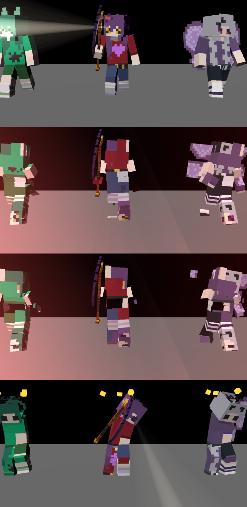

# Hunter expression check

KT reported that the hunters' expression textures look broken in the City (a hunter with no proper face and a black slit near the
feet). This is what was checked, on the real game scene (HunterView3D), on the mini and the Windows PCs.

Rows: idle, chase, scream (chase with the runner close), stun. Verrine/Eirys, Kathy, Aki and Xivvy.

## Result: no texture or expression bug found in the models or in the face swap

- **Data** (`scripts/validate_expressions.gd`, suite `expressions`): for all 38 hunters (A-Z and Void) the `Face` quad is a child of the `Head`,
  inside the head, looks along the model's forward axis, its UVs are exactly one 8x8 cell, every expression cell (`BlockyFace.CELLS` and
  `ANIMS`) lies inside the 64x128 atlas, no other mesh samples the expression grid (checked face by face), and two instances of one hunter
  never share a face material or an expression offset.
- **Pixels** (`tools/look/hunter_check.tscn`, `FORCE_FACING=1 DARK=1 HUNTER_STATE=idle|chase|scream|stun`): neutral, stun (closed eyes + stars)
  and idle faces render correctly for every hunter I rendered; in the dark the face quad is lit like the rest of the model.
- **Facing** (`tools/look/facing_check.tscn`): in wander and chase the face looks along the heading the brain reports (dot 0.93..1.00 for
  six hunters, both states).
- **Props lane merge** (`ModelSlot.share_blocky_materials`) is not the cause: it only keys materials of `art/props-3d/props/blocky/*_BlockyAtlas.png`
  (128x64 atlases); hunter atlases are 64x128 and live in `assets/hunters_blocky/`, and the props lane changed no hunter asset.

## What probably looks like a broken face

1. In the chase clips the body leans forward and the head dips, so from a camera behind or above you see the hair, not the face; hunters
   seen from behind (patrolling away from the player) show the back of the head, which is plain hair colour at night.
2. The boots: with the lean the toe points at the camera and the toe + sole (a dark strap/buckle on a dark sole, gold on Kathy) read as a small
   face with a black slit at the feet (see the middle rows).

If a face is still wrong in a specific state, send the hunter name, state, distance and the window/lighting; `HUNTERS=<id> HUNTER_STATE=<state> FORCE_FACING=1 POSE_DEBUG=1`
in `tools/look/hunter_check.tscn` prints the part orientations (`PARTS`/`FACE` lines).
