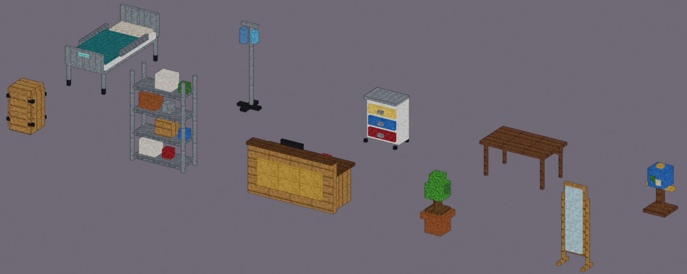
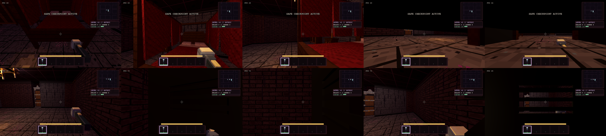

# Room props by purpose, and furniture you can hide in

## More prop types per room

Ten new blocky props, designed in metres on the 6.25 cm grid (`tools/props/blocky_props_rework4.py`). They are matte and
use the shared atlas, and their fitted colliders are in `src/config/prop_collider_sizes.gd`. The thuing models were only
used as a reference for proportions; nothing was copied.

| Prop | Room recipe |
|---|---|
| `hospitalBed`, `ivStand`, `medicalCart` | `infirmary`: a new prison-wing room (every fifth room, index 4), 9×9 to 13×13 cells |
| `storageShelving`, `storageBarrel` | `maze_storage`: steel shelving alternates with the bookcases, with barrels in the corners |
| `receptionDesk`, `pottedPlant` | `office_reception`: the desk sits to one side of the door aisle |
| `pottedPlant`, `libraryGlobe` | `lounge` (drawing rooms) |
| `libraryGlobe`, `readingTable` | `gothic_archive` |
| `standingMirror`, `bedroomVanity` + `vanityStool`, `normalBookcase` | `bedroom` (the vanity and bookcase appear only in wide rooms) |

Most of what KT listed already existed, including dressers, vanities, rugs, nightstands, filing cabinets, the copier, the
water cooler, stoves, fridges, sinks, crates, couches and curtains. The new types fill the gaps.

All placements go through the normal recipe rules:
- the claim order;
- collider clearance;
- `PlacementClearance`, which keeps the walk from the door open and removes any prop blocking it;
- the `RoomCapacity` fill limits.

A prop that does not fit is skipped, never squeezed in. Kitchen pots, as surface props on the stove, are not done yet.

## How many fit (capacity)

KT: "only one player or bot should occupy a hiding spot, unless its a larger one like a wardrobe, then allow 2". Each
hiding prop holds `hide_capacity` runners (lr.prop/1 field, so mods can set it; 1 when absent, at most 2). Lockers, beds,
vents and tables hold 1. `bedroomWardrobe` and `gothicWardrobe` hold 2. `HideOccupancy` holds the rules:
- A full spot shows **SPOT TAKEN** and refuses E, for runners and bots alike. Bots pass a full spot for the next one.
- Each occupant takes a slot, replicated as `hide_slot`. Slot 0 is to one side and nearer the door; slot 1 is to the
  other side and deeper. Their bodies and cameras never overlap.
- The host settles two runners who got in on the same frame. Past capacity, or when two hold one slot, the higher peer
  gets a `hide_full` event and is put back out.
- A hunter's check pulls the front occupant out first (`grab_order`). Locker inspection with two inside finds neither.

## Hiding in beds and wardrobes

Every bed and wardrobe that a room recipe places becomes an ordinary `hiding_spot` fixture. This applies to `singleBed`,
`doubleBed`, `gothicDoubleBed`, `bedroomWardrobe` and `gothicWardrobe` (see
`StreamedRouteGenerator.HIDING_PROP_STYLES`).

Because they are ordinary fixtures, everything the lockers already have applies without new code:
- the E toggle;
- the hunter navigation snapshot;
- Loxelle's break, Javelle's reach and Void Brown;
- replication of the `hidden` and `hiding_spot` state to guests.

The fixture carries a `style` and the prop's size. The prop itself is the visual, so the interactable has no model,
barrier or glow of its own.

| | Bed | Wardrobe |
|---|---|---|
| Prompt | HIDE UNDER BED (aim low at the foot) | HIDE IN WARDROBE |
| Where you are | Under the mattress, eye height 0.16 m | Inside, standing eye height |
| What you see | A slit 4–20 cm off the floor at the foot | Door slats at 1.42–1.68 m |
| Leaving | E, back to where you entered | Same |

Entering and leaving are **camera moves, not cuts**: 0.6 s with easing, input locked, `PlayerController3D.HIDE_MOVE_SECONDS`.
- **Bed:** you step to the foot, crouch to the floor, then slide under at 0.16 m, turning to look out.
- **Wardrobe or locker:** you walk to the doors, step in and turn around behind the slats.
- **Leaving** backs out the same way and stands you up where you went in.

The move is presentation only: the body, collision and `hidden` change at once, so hunters and existing tests see the
same state as before. Only the first-person pivot and the view yaw ease along the path, which goes to the opening at the
current height first, so it passes over furniture rather than through it.

A forced pull is immediate and cancels the move: a catch, a hunter's check, Loxelle or Javelle.

Guests see the runner's body slide into the spot (remote bodies already ease between replicated positions). It stays
visible for the length of the move, crouched for a bed, and then disappears. The replicated state carries `hiding_style`.

The wardrobe doors are solid in the model and do not open, so for a moment during the step-in the camera passes the door
plane. The dark shell is already up at that point.

**Fit.** The beds now stand on legs with the frame and footboard raised, which leaves at least 0.36 m (about 0.40 m)
clear underneath and an open foot end. This covers every `singleBed`/`doubleBed` variant and the gothic canopy bed, whose
frame moved from 0.30 to 0.42 m. A lying runner fits under any of them. The wardrobes, 0.62–0.69 m deep and 2.1–2.5 m
tall, already hold a standing runner, whose player radius is 0.2 m. Footprints and colliders are unchanged.

The limited view comes from a dark two-sided shell just inside the prop, shown only to the local hider. The solid blocky
props would otherwise let the camera see out through their own back faces.

`silent_presses` still holds: entering and leaving are real actions with their usual cues, and nothing new plays on an
empty press.

## Hunters checking hiding spots

This is host-only, like all hunter logic. Constants are in `GameConfig.HIDE_CHECK_*`, and the rule itself is
`HunterBrain.hide_check_triggers`.

A hunter checks a spot only when all of these hold:
- it is hunting (chase, search or investigate), not wandering;
- its last sighting of the runner is within 3 cells of the spot, meaning it tracked you there;
- it has reached the spot (within 1.8 cells).

Hiding unseen is therefore safe.

When the check starts:
1. The hunter stops for **1.6 s**, and the furniture rattles and creaks (`Sound.hide_search`) for every peer through the
   `stream_hide_check` event. That is the tell, your chance to bolt.
2. If you are still inside when it ends, the hunter pulls you out (the `hide_found` player event, which arrives on the
   guest's own machine), with "FOUND // RUN".
3. The hunter goes straight to chase.

A checked spot is left alone for 20 s. Hunter gimmicks that break hiding (Loxelle, Javelle) keep their own rules.

## Checks

- `hiding_props` suite (`scripts/validate_hiding_props.gd`):
  - every new type has a model, a blocky model and a fitted collider;
  - every bed variant has at least 0.36 m clear underneath and an open foot end, measured from its mesh faces;
  - every wardrobe variant is big enough to stand in;
  - enter and exit are animated moves of 0.4–0.8 s with input locked;
  - under a bed the camera never rises into the frame while inside the footprint;
  - a hunter's pull is immediate;
  - each recipe places its new types across four seeds;
  - every recipe bed and wardrobe is a hiding spot with the right style;
  - no hiding position is inside a wall;
  - the search rule's cases hold;
  - in the streamed route, E hides and unhides you under a bed and in a wardrobe, with the low or standing view and the
    shell;
  - the replicated state shows the runner hidden in that spot;
  - the stream event plays the tell with sound;
  - `hide_found` pulls you out and restores the view.
- `tools/look/hiding_props.tscn` (windowed, on the mini) captures the approach, the inside view and the tell for the
  nearest bed and wardrobe.

The collider emitter now runs as a scene (`godot --headless --path . res://tools/props/emit_collider_sizes.tscn`). The
generator it reads needs the autoloads, which `-s` scripts do not get.

While you are in a wardrobe, its model is hidden for your own camera only, because the model's doors are solid. The
shell then forms the wardrobe, with slats to peek through. Everyone else still sees the real wardrobe.

## Aiming at a hiding spot (KT: "locker instruction hitbox too big")

This is now the rule for every interactable. See "Prompt hitboxes" in [SEATING.md](SEATING.md).
