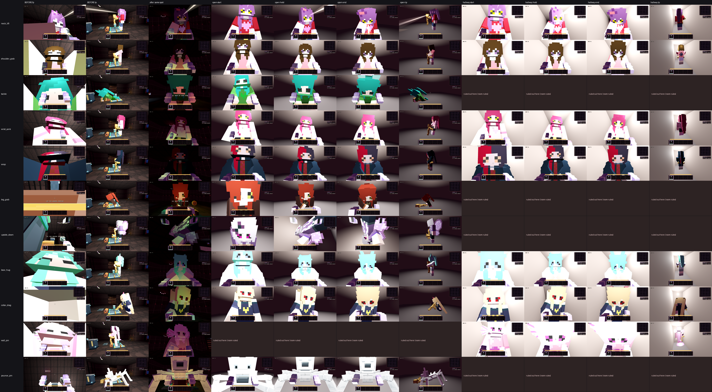

# Hunter grabs

KT: every hunter grabs a caught runner in a way that fits its personality and body, and a catch varies between a few styles.
One grab plays (about 1.9 s), then the death line and game over as before.

## Styles (`GrabStyles.STYLES`, poses in `GrabStyles.pose`)

| Style | What happens | Needs |
| --- | --- | --- |
| `neck_lift` (NL) | one hand at the throat, the runner raised until the feet leave the floor | ceiling 2.5 m |
| `shoulder_grab` (SG) | both hands on the shoulders, shaken | always fits (the fallback) |
| `tackle` (TK) | knocked flat on the back, the hunter on top | 1.7 m clear behind |
| `wrist_yank` (WY) | one wrist taken, the runner yanked in off balance | - |
| `wrap` (WR) | both arms close round the runner | - |
| `leg_grab` (LG) | an ankle taken from behind, the runner falls on their face and is dragged back | 1.8 m clear ahead |
| `upside_down` (UD) | a leg hoisted, the runner swung out to her side and hung head down; first person turns over slowly | ceiling 2.4 m, 1.4 m clear to each side |
| `bear_hug` (BH) | crushed in both arms and lifted | ceiling 2.3 m |
| `collar_drag` (CD) | pulled face down by the collar and dragged as the hunter backs off | 1.6 m clear behind the hunter |
| `wall_pin` (WP) | shoved back against a wall and held there | a wall within 1.3 m behind |
| `pounce_pin` (PP) | creature rigs only: pounced on and pinned on the back | 1.7 m clear behind |

## Pools (`res://data/grabs/<hunter_id>.json`, schema `lr.grab/1`)

- **Pool size and weights:** each hunter has a weighted pool of 2-4 styles. The main style always has the most weight.
- **Picking a style:**
  - On a catch, the host rolls `GrabStyles.roll_for(seed, peer, catch number)` and sends it as `grab_roll` with the capture event.
  - The caught runner probes the room (`HunterGrab.probe_room`): ceiling, floor behind them at chest and knee height, and floor behind the hunter.
  - It drops the styles that don't fit, then picks with the roll (`GrabStyles.pick`).
  - If nothing fits, it falls back to the shoulder grab (creature rigs fall back to the pounce).
- **File format:** strict, like `ContentRegistry`. Unknown keys, unknown styles and non-positive weights are errors.
- **Content packs:** packs can replace a pool with `GrabStyles.apply_defs` once the pack loader lists `grabs/<id>` overrides, following the `lr.pack/1` manifest pattern.

## First-person camera rules (KT, after the first sheet)

`HunterGrab._solve_camera` places the camera every frame:
- **Start:** the grabbed body's head.
- **Framing:** pulled straight back from the hunter, by at most 0.9 m, until her face and upper body sit 1.45 m away. If a wall is behind, it stops short of the wall and steps to the roomier side instead.
- **Walls:** it is never inside a wall. A ray runs from where the runner stood, then a sphere test.
- **Hunter:** it is never inside the hunter. Her collider and every box of her posed model count, 0.2 m spare for the aim and 0.08 m hard, which is the near plane plus a little. Nearest-clear points are found by bisection, so the camera doesn't jitter.
- **Motion:** it eases at 4/s, capped at 2.8 m/s and 2.4 rad/s, starting from the view the runner had when caught.
- **Look:** it always looks at her face.
- **Roll:** at most 15 degrees. The upside-down hold turns over slowly, eased over 1.5 s, then sways within 10 degrees.
- **Other limits:** the FOV is never touched. The held tool is hidden. The skinned hands stay on screen and at most half the screen tall.

Her arms use two-bone IK (`HunterGrab.solve_arm`):
- **Joints:** shoulder, then elbow (forearm), then the grip locator, which is the hand prop. The Void rigs have no hand prop, so their grip is just past the wrist.
- **Elbow:** a natural pole (down, out and back; wide for arms that go round the runner). The upper arm is twisted so the elbow bends about its own hinge.
- **Reach:** she steps in or crouches until every contact is within reach (`reach_correction`), and the grabs suite holds every grip within 3 cm.
- **Head:** her head turns to the camera within neck limits (66 degrees to the side, 30 down, 35 up), eased (`head_look`). Aki (`GrabStyles.SHY`) looks away while she yanks, then meets your eyes for the last beat.
- **Wrist yank:** her right hand closes on the runner's raised left wrist. Other players see the runner's arm go out to it, and in first person it is your own left skinned hand in her grip.

## Playing it (`HunterGrab`)

- **Local runner:** the body is moved where the grab puts it. The first-person eye follows the grabbed body's head: lifted, flat on the floor or upside down. A face-to-face hold looks up at the hunter's face.
- **Skinned hands:** set by `PlayerController3D.set_grab_view` (`GRAB_HAND_POSES`), from the same source as the ladder hands. Poses: gripping the arm, pushing, a held wrist, pinned, clawing at the floor, pushing up, or dangling.
- **Hunter body:** the hunter's model is leaned, lowered or moved (for example crouched for a leg grab, or on top for a tackle). Its arm bones go to the named body point (`GrabStyles.BODY_POINTS`). This happens after its clips have run, and is put back on release. The simulated hunter is untouched.
- **Co-op:** the runner's state carries `grab = [style, t, lift, body pitch, hunter forward, drop, lean]`.
  - `RemotePlayers` raises and tips the body from it.
  - It also bends the nearest hunter with `HunterGrab.pose_nearest_hunter`.
  - The host relays it like any other state, and the guard clamps every field.
- **VR:** a headset runner keeps their own tracked view. Others still see the grab.
- **Hooks:** `main_3d.gd` and `infinite_route_test.gd` call `_resolve_capture_outcome` before the (disabled) jumpscare and the death moment. `release()` runs on restart and respawn.

## Check and capture

- `grabs` suite: every A-Z, Void and creature id has a valid 2-4 style pool, with the main style weighted highest.
  - The six approved neck-lifters have NL as their main style. Void hunters never neck-lift. Creature-only styles stay on creature rigs.
  - The pick is repeatable, every pool style shows up, and the main style is the most common.
  - Low ceilings, walls and tight spots rule styles out, with the fallback when nothing fits.
- Then every style plays on the real route scene, in an open room and in a 2 m hallway with a wall behind (`scripts/grab_arena.gd`). Styles the room rules out are skipped there. On every frame it checks:
  - the camera is clear of every hunter collider, every box of her model and every wall;
  - roll limits, no snapping (turn and move rates), and a steady FOV;
  - every grip within 3 cm during the hold.
- At the hold it checks:
  - her face framed and at least 0.9 m away (0.45 m for the wall pin);
  - her head turned to the camera, and Aki looking away first;
  - lift or floor height, the inverted view, facing away for the leg grab, and the clip;
  - skinned, mirrored hands;
  - the hunter's hands on the right body point;
  - the state packet, and a guest's copy of the body taken the same way;
  - a clean release that puts the hunter's model back.
- Capture rig: `tools/look/grabs.tscn`.
  - Every style at the route's spawn spot (the earlier sheet's spot, for before/after), in the open room and in the hallway.
  - Start, hold and end in first person, then from the side as another player sees it.
  - The sheet's first columns are the earlier views KT reviewed (before).

