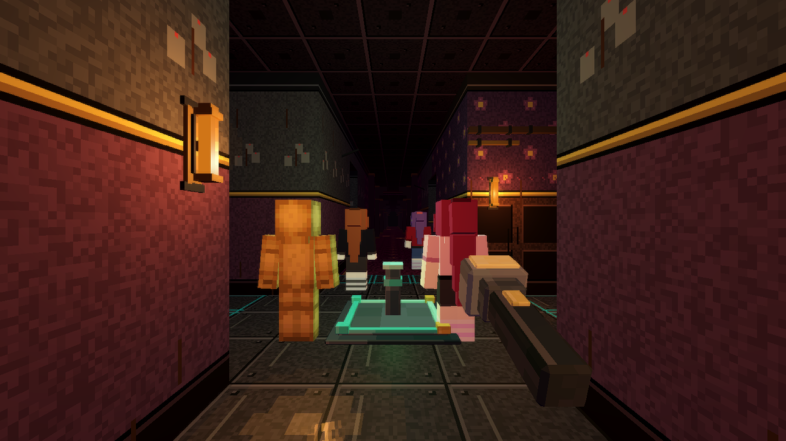
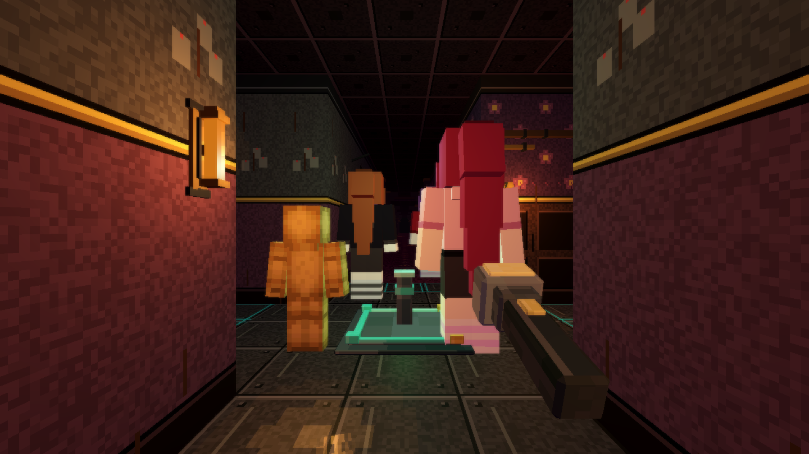

# Hunter scale

KT: remove the tall hunter figures, keep the normal-sized ones and make them 1.5x larger.

## What was removed

The ten `_tall` model variants (`aki`, `eirys`, `glyra`, `ilyra`, `jyvra`, `kathy`, `loxelle`, `opalie`, `umbriel`, `xivvy`)
in `assets/hunters_blocky/`, their entries in `stride_table.json` and `emotes.json`, and the generator option that made them
(`build.py --tall`). None of them was referenced by the game at runtime (`HunterRoster._model_path` only looks at the
hunter's own folder), so no hunter changes body: they were unused assets and tests.

## The one size knob

`HunterRoster.MODEL_SCALE = 1.5` (`HunterRoster.scale_for(id)`: humanoid hunters 1.5, secret creature rigs 1.0).
Everything that depends on size follows it:

| Thing | How it follows |
| --- | --- |
| model | `HunterView3D._apply_model` scales the model node (feet stay on the view origin, so it grows upward) |
| hit radius / footprint | `GameConfig.HUNTER_RADIUS` 0.22 -> 0.33 (still inside one cell, so which cells are walkable is unchanged; catch reach grows by 0.11 m) |
| view collider | capsule radius = hit radius + 0.05, height 1.72 x 1.5 |
| head, eyes, expressions, emote and label positions | derived from the model nodes' global transforms, so they scale with it |
| stride / foot slip | `HunterStride.ref_speed` is multiplied by the scale (the table is measured at authored size) |
| doors and halls | a 1 m door still passes the 0.66 m footprint; checked on real doors by `hunter_scale` |
| ceiling | tallest hunter (Void blue with crown) 3.84 m under the 4 m ceiling |
| player | unchanged |

Not scaled on purpose: the Night Watch offices place their hunters in fixed camera compositions (`ModelSlot.instantiate_hunter`
is used directly there), and the secret creature rigs keep their authored size. The Void hunters already stood 2.0 m tall;
they take the same 1.5 so every humanoid shares one scale (they now reach 3.0 m and above).

## Validator

`hunter_scale`: no `_tall` model left, every one of the 38 hunters is drawn at 1.5 x its authored height, collider and brain
radius follow, the stride reference is scaled, creatures are untouched, the tallest hunter fits the ceiling and every door of
nine real chunks still admits the scaled footprint. `blocky`, `foot_slip`, `hunter_nav`, `hunter_real`, `collision` cover the
rest.

## Before / after

Same spot, hunters Aki, Ferryn and Kathy with the player model (orange, left) for scale:

| before | after |
| --- | --- |
|  |  |
