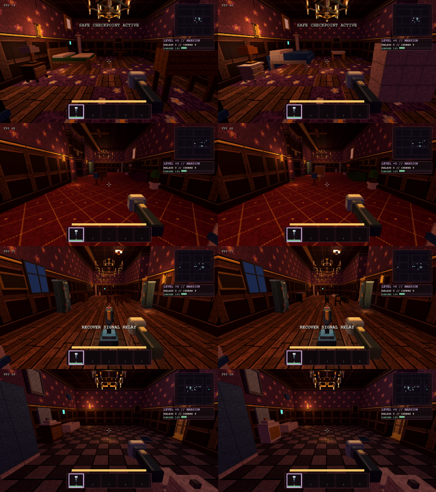
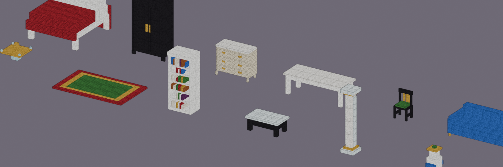
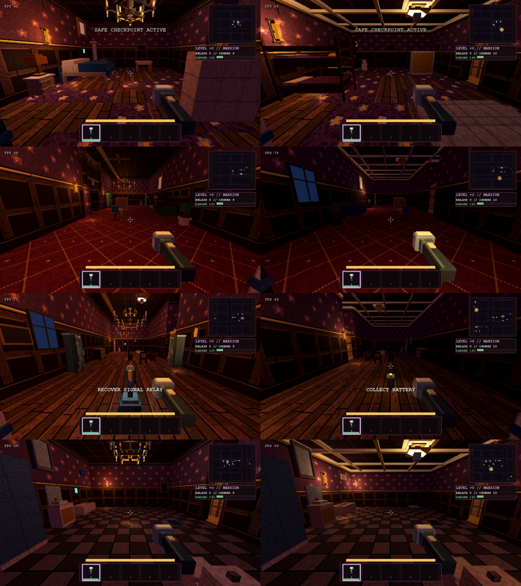

# Mansion luxury props

The mansion region gets its own look of the ordinary furniture. The pieces are lacquered or painted (white, black, cream)
instead of brown wood, with marble tops, velvet upholstery (deep red, emerald, navy), gilt legs, pulls and trims, crystal
chandeliers, ornate rugs and gold-framed paintings. The region also gets two new pieces: marble columns and porcelain
vases. Everything stays blocky and matte, with no new atlas tiles and no sheen.

## How it works

`tools/props/blocky_props_mansion.py` builds a `<type>Mansion` model set for 33 furniture types, three finishes each. Every
finish keeps the base type's exact shape and footprint. The rules:
- the topmost full-footprint slab of tables and cabinets turns to marble, and their narrow legs turn gilt;
- every fabric turns to velvet;
- the head and foot boards of beds are upholstered;
- wood turns to lacquer;
- steel turns to brass.

The game keeps a single type name per piece. `PropModelCatalog.model_path(..., finish)` picks the `Mansion` models when
the chunk's region is in `REGION_FINISHES`. Sizes, colliders, surface props (lamps on nightstands), hiding spots (beds,
wardrobes), room-size signatures and capacity rules therefore all apply unchanged, and nothing outside the mansion
changes.

The generator side:
- gold frames (`luxury*FrameEmpty`) and `mansionAreaRug` in mansion rooms;
- in mansion bedrooms, lounges (drawing rooms) and dining rooms: `mansionMarbleColumn` in the back corners and
  `mansionPorcelainVase` beside them.

These go through the normal placement rules, so a room with no space simply skips them.

Not covered:
- **Floors:** marble or parquet floors belong to the world lane's floor table.
- **Rooms:** the ballroom, library, grand stair hall and kitchen are 2D-facility room types. The streamed mansion
  generates the bedroom, drawing room, dining room and luxury bathroom.

## Scale fit (docs/SCALE_FIT.md)

The props lane owned five outliers, all now fixed:
- `singleBed` and `doubleBed` are 2.29 m long including boards (were 2.67 m);
- `gothicDoubleBed` is 2.35 m (was 2.79 m);
- the `bathroomVanity` and `prisonServingCounter` colliders stop below the mirror and the sneeze hood (0.95 m and 1.1 m,
  `HEIGHT_CAP` in the collider emitter).

`validate_scale_fit.gd` KNOWN is now empty.

## Captures

`tools/look/mansion_rooms.tscn` (windowed, on the mini) takes the first mansion bedroom, drawing room, dining room and
luxury bathroom of the `MANSION-LOOK` seed, from a back corner, with the finishes off and on.

## Ceilings and lighting

**One fixture family per room.** KT found rooms with chandeliers and ceiling fans together. Two placers caused it: the
room recipes (ceiling fan, ceiling light and chandelier props) and the ref-look decor (`src/look/ref_decor.gd`, which
hangs a chandelier in each room centre plus pendants and strip lamps on a lattice). The fix has two parts:
- `StreamedRouteGenerator.one_ceiling_family` keeps one family per room: a chandelier wins over a fan, and a fan, which
  has its own light kit, wins over a plain ceiling light.
- The decor adds nothing to a room whose recipe placed its own ceiling fixture.

**Mansion ceilings:**
- Fans and ceiling lights in mansion recipes become chandeliers, which use the crystal-and-brass mansion finish.
- The decor chandelier is the grand three-tier one in rooms of 150 m² or more.
- Every mansion chandelier, from the decor or the recipe, gets a plaster-and-brass ceiling medallion.
- Rooms get crown moulding along every wall and a coffered ceiling, with a beam grid every two cells and brass edges.
- Every room is lit, by wall sconces and warm candle-gold light (tint `ffc27a`). Pipes and floor cables are gone from
  the mansion.

The `ceiling_fixtures` suite checks across three seeds that no room mixes families, that no decor fixture sits in a
recipe-lit room, that the mansion has no fans or strip lights, and that each mansion chandelier has a medallion,
moulding and coffers.

