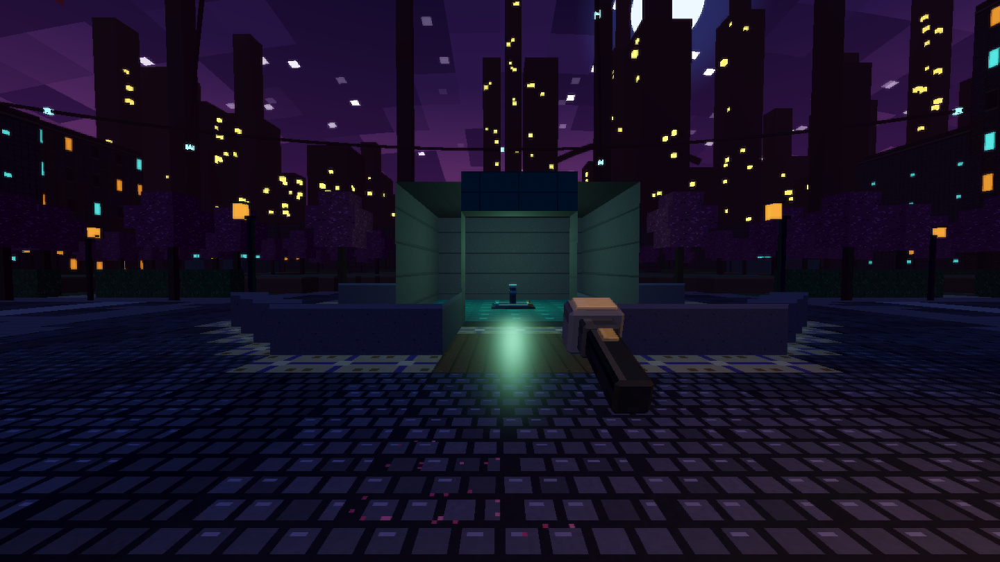
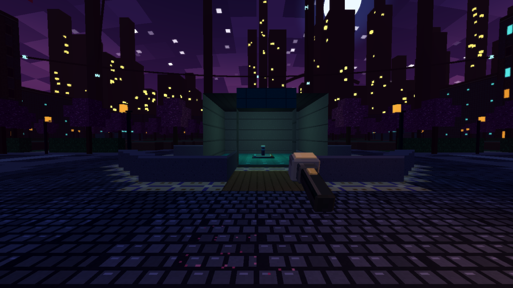
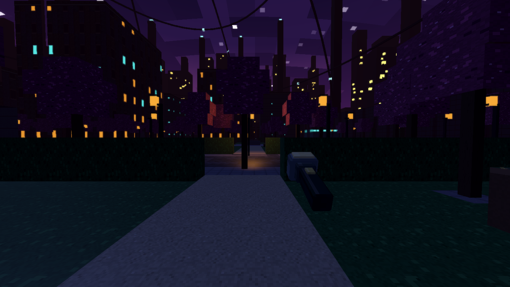
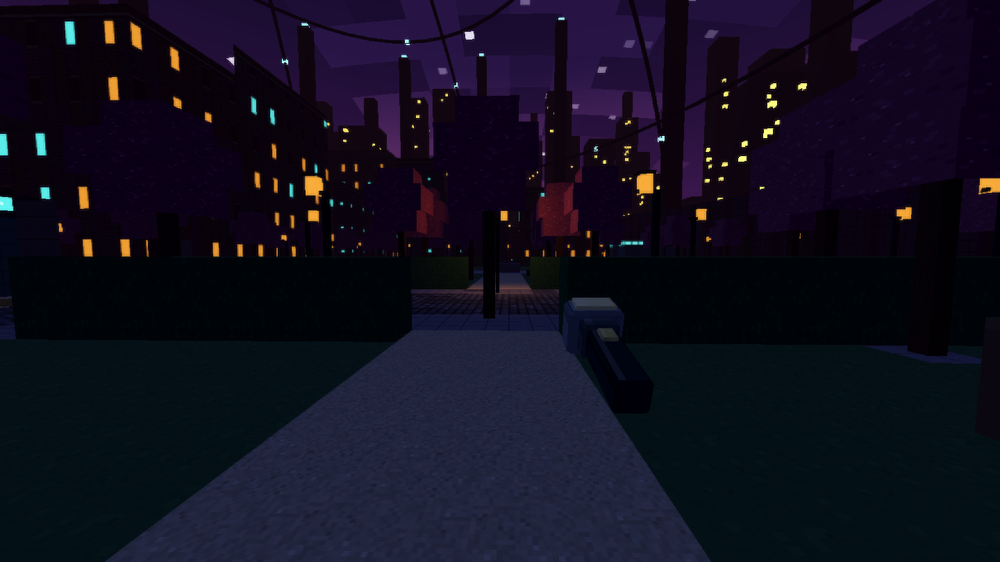
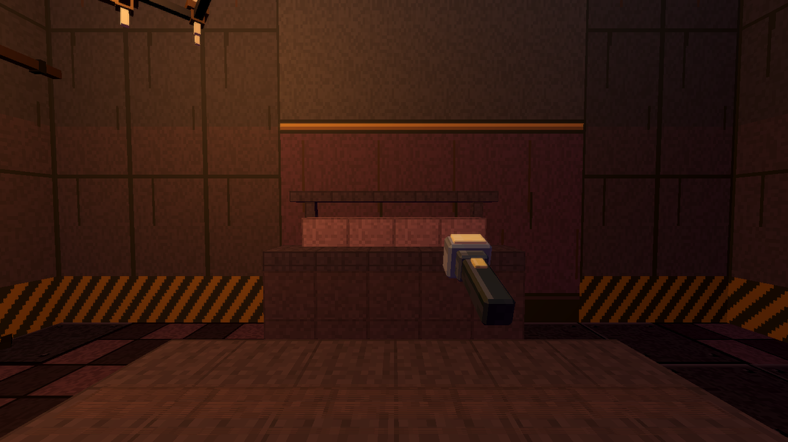
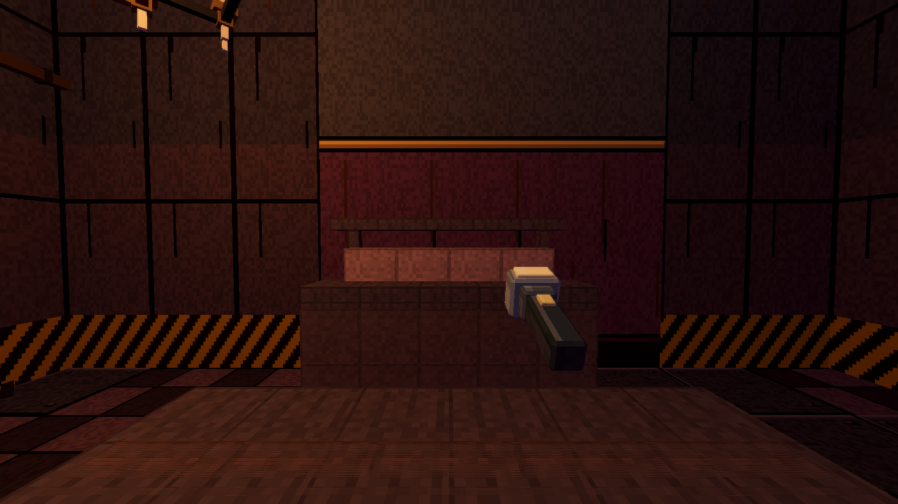

# Material look: matte by default

KT's report: the maps rendered far too shiny (City paving and tiles with bright glints and light-blue speckle, glossy
flashlight hot spots). Causes found in the audit:

| Cause | Where | Fix |
| --- | --- | --- |
| City ground tiles at roughness 0.42 and a tile shader that left `SPECULAR` at Godot's default 0.5 | `city_surface.gd` | roughness 0.86 / 0.95, `SPECULAR = 0.18` |
| polished-floor kinds at roughness 0.22 to 0.38 with specular 0.6 to 0.9, metal floors metallic 0.35 | `ref_textures.gd` (`material()`, `params()`), `ref_surface.gdshader` (`SPECULAR = 0.5 + 0.4 * metal`) | one response table, `MaterialLook.floor_response()`; shader specular is a uniform |
| lamp pool lights with `light_specular = 1.2`; every other light at Godot's default 0.5 | `lamp_field.gd`, flashlight spots in the scenes, room/fixture/peer lights | `MaterialLook.LIGHT_SPECULAR = 0.22`, applied to every light that enters the tree |
| the environment reflected the flat background colour over dark surfaces | `ref_look.gd`, City and Night Watch environments | `reflected_light_source = DISABLED` |
| decor metals at metallic 0.5 to 0.7, shared prop materials only lifted to roughness 0.72, default specular 0.5 | `ref_decor.gd`, `model_slot.gd` | `MaterialLook.tame()` |

## Garden speckle (second report)

Grass, flower beds, hedges, petals, blossom and cypress tiles carry random bright pixels (leaf glints, saturated petals).
Sampled per pixel at a distance they sparkle in purple, green, yellow and cyan. Fix in the City tile shader (no atlas art
change): those layers (`CityAtlas` names in `CitySurface.CALM_TILES`) are pulled 60% toward their own average colour (the
1x1 mip) and 20% desaturated, and the tile array samples with anisotropic mip filtering. Checked for the other suspects:
no TAA, SSR, SSIL or SDFGI is enabled in any environment, the emission atlas is only used for windows and lamps, and every
lamp now has `light_specular` 0.22.

## One shared place

`src/look/material_look.gd` (`MaterialLook`) holds every value: `ROUGHNESS_MATTE` 0.92, `ROUGHNESS_SOFT_FLOOR` 0.82,
`ROUGHNESS_METAL` 0.62, City ground / solid 0.86 / 0.95, `SPECULAR_DEFAULT` 0.18, `SPECULAR_METAL` 0.32, `METALLIC_METAL` 0.18,
`LIGHT_SPECULAR` 0.22, plus the limits the validator enforces (`MIN_ROUGHNESS` 0.55, `MAX_METALLIC` 0.4, `MAX_SPECULAR` 0.35,
`MAX_LIGHT_SPECULAR` 0.3). `MaterialLook.tame(material, metal, floor_soft)` pulls a StandardMaterial3D into the look;
`MaterialLook.install(tree)` (called by `RefLook.install` and the Night Watch world) tames every Light3D as it enters the
tree. New surfaces, any game: take values from `MaterialLook`, never literals. Intentional gloss (glass, water, wet, mirror,
emissive bulbs and windows) is allowed by `ALLOWED_GLOSS` and by emission/transparency.

## Validator

`material_look` scans the shared surface tables (floor / wall / ceiling kinds, the texture-array shaders), the City tile
shader and rim, decor, and every mesh material and light in a booted Last Route scene and City scene: roughness below 0.55,
metallic above 0.4, shader specular above 0.35 or any light specular above 0.3 fails (unless emissive, transparent glass or
allow-listed). Checked to fail on the old values (City ground 0.42, lamp specular 1.2).

## Before / after

Same spot, same seed, same flashlight (captured on the Mac mini):

| | before | after |
| --- | --- | --- |
| City, fountain roundabout |  |  |
| City, garden district |  |  |
| Last Route, prison cafeteria |  |  |

The flashlight hot spot on the paving and the glints on the tiles are gone; surfaces take the beam softly. Lit areas are a
little darker overall (the old glossy response added brightness): the next step, if KT wants, is a small albedo or
ambient lift, set in `MaterialLook` and `RefLook.AMBIENT_ENERGY`.
