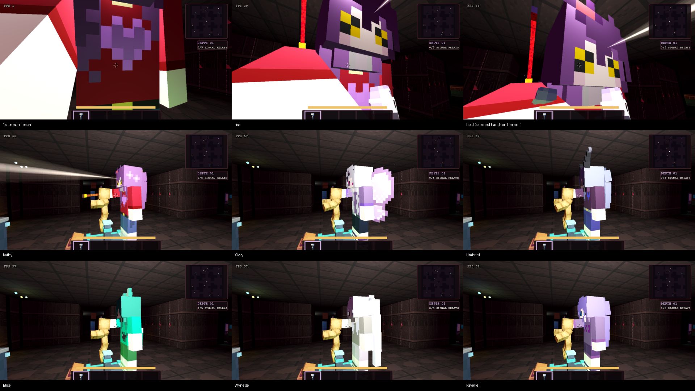

# Neck-lift catch

KT: some hunters lift a caught runner by the neck instead of the normal catch. The approved lifters are Kathy, Xivvy, Umbriel,
Elise, Wynelle and Ravelle (`GrabStyles.STYLES`). Every other hunter, Void included, keeps the classic catch until its own grab is
approved.

## Sequence (`NeckLift`, about 1.9 s, then the death line and game over as before)

| Phase | What happens |
| --- | --- |
| reach (0.35 s) | The hunter's right arm swings out to the runner's throat. The runner is drawn a few centimetres to the hand and turned to face the hunter's head. |
| rise (0.6 s) | The hand carries the runner up until their feet are off the floor (about 0.5 m at the 1.5x hunter scale, capped at 1.2 m). The eye rises, tips back and sways. |
| hold (0.9 s) | The runner hangs there. The first-person skinned hands grip the hunter's forearm and tremble. |

- The local runner's state is set by `PlayerController3D.set_lift_view`: eye height, pitch, roll, and the `LiftHands` built from `_build_skinned_hand`, the same skinned source as the viewmodel and ladder hands.
- `release()` puts the runner back down when they restart or respawn.
- VR runners skip the lift (no forced head movement in a headset).

## Co-op

- The runner's own state packet carries `lift` (metres), and `current_clip()` sends `fall` while lifted.
- `RemotePlayers` draws that body raised by `lift`, and `NeckLift.pose_nearest_hunter` bends the nearest lifting hunter's arm to the body's neck.
- Every peer sees the same grab, synced through the host's normal state relay. There is no extra packet.

## Hooks

- `main_3d.gd`: `_resolve_capture_outcome`.
- `infinite_route_test.gd`: `_resolve_capture_outcome(hunter_id, entity_id)`, which finds the catcher with `_capture_view`.
- Both run before the (disabled) jumpscare and the death moment.

## Check and capture

- `neck_lift` suite (`scripts/validate_neck_lift.gd`) checks that:
  - every A-Z and Void hunter has a grab style, and only the six approved hunters lift;
  - each lifter raises the runner 0.3-1.2 m, raises the eye and tips the view back;
  - the lifted runner plays the fall clip;
  - the hunter's hand ends up at the runner's neck, with the shoulder above the runner at hunter scale;
  - the lift hands are skinned (no boxes, textured, left mirrored) and on screen;
  - the state packet carries the lift;
  - a guest's copy of the body is taken by the neck;
  - release resets everything.
- Capture rig: `tools/look/neck_lift.tscn` gives first person through Kathy's lift and a side view of each lifter as a guest sees it.

