# Night Watch 3D (plan, audit and first playable slice)

Night Watch is the 2D browser game in `LastRoute/games/night-watch` (about 8,500 lines of plain ES modules, nine games sharing one roster, one save and one progression). KT decided to build it as a 3D game inside the Kyttu's Lab app, as the second card on the game hub. This page is the audit of the 2D game, the 2D to 3D mapping, the milestone plan, the slice that exists now and the open questions. Nothing here changes version information.

Related: [GAME_HUB.md](GAME_HUB.md) (registry, themes, the old port plan), [DEATH_SCENES.md](DEATH_SCENES.md), [HUNTER_PARITY.md](HUNTER_PARITY.md), [BLOCKY_HUNTERS.md](BLOCKY_HUNTERS.md).

## 1. What the 2D game is

A Five Nights at Freddy's style shift: you sit in a fixed office from 12 AM to 6 AM, hunters walk a building toward your doors, and you hold them off with a few tools and a limited resource. The 2D game is an "anthology" in the spirit of Help Wanted: each game is a miniature of one FNaF era, all sharing the same roster (24 Last Route hunters plus Kathy and Zellia).

| # | Mode (id) | Core loop | Tools | Resource / limit |
|---|---|---|---|---|
| 1 | Classic (`classic`) | 4 hunters walk a graph of 8 camera rooms toward two doors | doors A/D, door lights Q/E (held), 8 cameras (Space, 1-8, arrows) | power meter (percent) |
| 2 | Masked Hours (`mask`) | no doors; hall hunters, vent hunters, a music box | mask, flashlight, vent lights, wind the music box | flashlight battery, music box |
| 3 | Dead Air (`lure`) | one vent crawler plus phantoms that break systems; temperature swings | lure, vent seal, reboots, climate | systems down, temperature |
| 4 | Bedtime (`bedroom`) | no cameras, listen: closet, hall, bed | closet door, hall light, bed light (one hand at a time) | one battery, never recharges |
| 5 | The Facility (`story`) | six rooms, each with a station, ordered task list | station tasks | noise you make draws the others |
| 6 | The Descent (`descent`) | elevator shaft, repair wires/signal/pipes before she reaches the window | repair puzzles | time |
| 7 | Salvage Run (`dayshift`) | day budget shop, then salvage pieces at night for a quota | upgrades, doors, window | budget, quota |
| 8 | Open Air (`extra`) | three outdoor watches (rooftop, bus stop, campfire) | per watch | per watch |
| 9 | Mixed Shift (`mixed`) | 3-7 threats drawn each night, a pacing director; QUIET/STEADY/RESTLESS/CHAOS/ENDLESS | Classic's tools plus three vents | power, director pressure |

Progress is per level key `mode:index` (night, `beatFive`, `cleared`, stars, best hour); a mode's Custom Night (AI slider 0-20 per hunter, four presets, a score and rating) unlocks after night 5. Device settings: volume, Calm mode (no flicker), Scare (full / short / off). The 2D game keeps the account on the shared Last Route session (`/api/v1/saves/save`, game id `night-watch`), supports pause and resume of every game (`resume.js`), Zellia's headset call box (`callbox.js`), an admin/debug layer, and per-hunter death lines and scenes (`deathlines.js`, `scene.js`).

### 1.1 Classic in detail (the spine, and the first target)

- **Clock:** a night is 270 s (45 s per hour), 12 AM to 6 AM (`core/time.js`). AI steps up +1 at 3 AM and +2 from 4 AM. The same shift also scales the old eight-minute tuning by `TIME_SCALE`.
- **Building graph** (`classic-data.js`): stage, dining, backstage, west hall, supply closet, kitchen, east hall, east corner; doors L and R hang off the two halls; the office is one step from either door. Eight numbered cameras; each room has a stereo pan (-1 west to +1 east) so footsteps are positional.
- **Hunters and what is special about each:** Dovelle walks to the left door (from night 1). Ravelle takes the right door and, when a shut door turns her away, tries the other (from night 2). Aki only moves while the cameras are DOWN (from night 3). Ilyra freezes while you watch her room (from night 4). Nyxie never walks: when the power dies she reaches the office after a blackout whose length depends on her level (11 s at level 1 down to 4 s). Kathy hunts alone on night 7 (door light dips, flickers on hall cameras, a hum at the door; the K key "meets her eyes" to send her back).
- **Movement:** no fixed tick; after each move a hunter waits a random time from a 3 s window that slides with her AI level (level 1: 12.5-15.5 s; level 10: 8-11 s; level 20: 3-6 s; level 0 never moves). Per-night stretch `NIGHT_PACE` and wait spreads (+/-15%), phases (`pressure.js`) and a "focus" for how straight she walks. All from a seeded RNG, so the same seed replays the same night.
- **At the door:** an open unlit door gives a grace time before the attack (9.0 s on night 1 down to 5.8 s on night 6, never under 5.2 s). Two defences: shut the door for 0.45 s (she retreats two rooms) or hold the light on her (2.0-4.5 s by night) and she is pushed back to her start. Halfway through the stare-down she flinches. Two hunters can share a door (second one waits behind).
- **Power:** 100%, base drain 0.10%/s and 0.07%/s per device in use (door, light or camera), scaled by `TIME_SCALE`. At 0 the doors open and lights die and Nyxie comes.
- **Zellia's calls:** one scripted headset call per night (nights 1-7), subtitle box with a Mute button, typed out word by word.
- **Death:** a scare (full / short / off) then the CAUGHT card with the hunter's line, Retry and Menu. The Godot 2 game already has the same idea as `DeathMoment` and `death_lines.json` (see [DEATH_SCENES.md](DEATH_SCENES.md)).

## 2. Mapping 2D to 3D

| 2D concept | 3D plan | Source in Godot 2 |
|---|---|---|
| Fixed office picture with parallax | A real WALKABLE first-person security room (KT's decision): desk and monitor, chair, lamp, breaker box and vent hatch, two doorways with sliding slabs, control panels on the walls; you walk, look and use things, or sit at the desk | new scene `scenes/night_watch.tscn`, new files under `src/night_watch/`; the shared `PlayerController3D` |
| Door slab and light buttons (A/D/Q/E) | A control panel on the wall beside each door (DOOR button: press use; LIGHT button: hold use) plus non-movement quick keys 1 / 2 (doors) and hold 3 / 4 (lights); doors are cube slabs on a tween with a collider (a shut door blocks the way); door lights are SpotLight3D shining down the hall (counted in the light budget) | `LampField` budget rules from [REF_LOOK.md](REF_LOOK.md) |
| Camera view (8 cameras, map) | A desk monitor showing a `SubViewport` per camera (one rendered at a time, so one camera cost); the camera map is a UI panel | new `NightWatchMonitor` |
| Camera rooms | Small blocky rooms (stage, dining, backstage, halls, closet, kitchen, corner), cube props in the Godot 2 style, each with a `Camera3D` and a stand position per hunter | new `NightWatchBuilding` (own files, NEW props only) |
| Hunters (sprites with poses) | Blocky hunter models and clips (idle, walk, stun, emotes, scythe for Kathy) placed in the rooms from the graph; the door pose is the looming pose | `assets/hunters_blocky/<id>`, `HunterRoster`, `BlockyEmotes` |
| Hunter AI (`classic-logic.js`) | Ported 1:1 as pure GDScript (`night_watch_classic.gd`), deterministic from a seed, no scene dependency, so a headless validator can replay a night | new `NightWatchClassic` (RefCounted) |
| Power meter | HUD bar and a desk gauge; same drain numbers | `ui_hud_bar.gd` pattern |
| Shift clock | Wall clock model and HUD (12 AM to 6 AM, 270 s) | new |
| Zellia calls | Subtitle box (same typed-out style as `DeathMoment`), Mute key N | `death_moment.gd` pattern |
| Death scare and CAUGHT | No jumpscare (KT removed them): the existing `DeathMoment` line then the run-over card | `DeathMoment`, `DeathLines`, `run_report.gd` |
| Progress (`night`, `cleared`, Custom Night) | Account save namespaced `night_watch` (separate keys, backward compatible `game` field exactly as the City lane did) | `RunSaves`, `Backend`, `RoomState.game_id()` |
| Settings (volume, Calm, Scare) | Shared settings panel (Calm = no light flicker); the Scare setting becomes the existing `short_death_scenes` / reduced motion | `settings_panel.gd` |
| Pause and resume | Pause menu now; saved-night resume is a later milestone | `pause_menu.gd` |
| Admin overlay | Admin menu rows for Night Watch (set night, hunter levels, power, skip hour) | `admin_menu.gd` |
| Hub card | Unlock the card, launch the menu scene | `GameRegistry` |

## 3. What is new work in 3D

1. The office as a room (collision-free seat, head-turn limits, door frames that line up with the hall cameras).
2. The monitor with live feeds from small rooms, camera noise/glitch states, and positional audio (pan from the graph becomes real 3D audio from the hall).
3. Door and vent interaction that feels physical (button prompts, slab animation, light cone) and still obeys the 2D timings (0.45 s shut-door rule, light push times, door grace).
4. Hunters approaching through rooms you can only see on a feed, then standing in a real doorway; hunters at the door need a pose that reads in the light cone.
5. Light budget: only two door spot lights and the desk lamp are real lights; room feeds use emissive materials.
6. Camera-feed rendering cost: render only the active feed at a reduced resolution (SubViewport 480x270 matches the 2D picture, nearest filtering, no post effects).
7. Modes beyond Classic: mask/vents, bedroom (no cameras), facility tasks, descent puzzles, salvage shop, open air and Mixed Shift each need their own interaction set (see the milestone plan).

## 4. Milestones

| # | Milestone | Contents | Status |
|---|---|---|---|
| M0 | Plan | this page, hub entry, registry flip, menu | in this slice |
| M1 | Classic office and monitor | walkable security room, desk, all 8 camera rooms, monitor and map | done in the slice |
| M2 | Classic rules | `NightWatchClassic` port: graph, pacer, door grace, shut door, light push, Dovelle/Ravelle/Aki/Ilyra, Nyxie blackout, power, clock | done (variety levers later) |
| M3 | Win, death, saves | 6 AM win, DeathMoment, end card, night progress save, night select | done (night select 1-6) |
| M4 | Classic complete | Custom Night sliders, Kathy night 7, variety levers, audio, resume, account sync | planned |
| M5 | Masked Hours + Bedtime | mask, flashlight, vents, music box; listen-only bedroom | planned |
| M6 | Dead Air, Facility, Descent | reboots/climate, six stations, repair puzzles | planned |
| M7 | Salvage Run + Open Air + Mixed Shift | shop, outdoor watches, director | planned |
| M8 | Polish | audio pass, accessibility (Calm, short scenes), multiplayer spectating of a friend's office (optional), web build | planned |

## 5. The first playable slice (this lane)

Entry: the hub card NIGHT WATCH is unlocked (`GameRegistry`, status in progress) and opens `scenes/night_watch_menu.tscn` (night select 1-6, a cleared night opens the next, BACK TO GAMES). The shift is `scenes/night_watch.tscn` (`src/night_watch/night_watch_game.gd`):

- **Security room** (`night_watch_office.gd`): a walkable blocky 6 x 5 m room (KT chose a walkable room over a seated office). A desk with the monitor, keyboard, cup and desk lamp against the back wall, a chair, a breaker box and a vent hatch (physical props for the later modes: they show a prompt), a clock and a poster, a doorway with a sliding slab on each side wall and a control panel beside each doorway (DOOR above LIGHT), and a short dark hall behind each doorway. Everything solid has a collision body (the slabs carry theirs, so a shut door blocks the way) and an invisible guard at each hall mouth keeps you out of the hunters' corridor. Lights: the desk lamp, two door spot lights (on only while held) and a very dim glow per hall.
- **Walking:** the SHARED player controller (`PlayerController3D`, instantiated from `scenes/night_watch_player.tscn`, a line-for-line copy of the route scene's player node tree): the same speeds, acceleration, head bob, step and slide handling, mouse look and sensitivity, FOV, camera height and eye locator, stamina, flashlight, inventory keys, crouch and sprint, input actions, pause key, gamepad mapping and cursor rules (`MouseLock`). Night Watch adds nothing to it. (The earlier slice had its own lean walker; KT asked for the same feel as Last Route and the City, so it is gone.)
- **Stations (aim + use, E):** `NightWatchStation` is a `RouteInteractable3D` (the class the shared controller already aims at: same range, aim cone, line-of-sight rule and prompt) with no model and no rules of its own. The monitor (opens the camera view; use, the monitor key or the shared pause key leave it), DOOR (press) and LIGHT (hold) on each wall panel, the desk lamp, the chair (the shared sit pose: `use_furniture(..., "sit")`, interact again to stand), the breaker box and the vent hatch (a note: not used tonight). The prompt is drawn like the route HUD's `InteractionLabel` (same size, colour, shadow and place) and the reticle is the shared `Crosshair`.
- **Hunters at the door:** a hunter at a door starts well down the hall, steps up to the doorway as her wait runs out and leans in at the threshold; with the door shut she is held outside. Nyxie, in the dark, walks in from the left hall toward you over the blackout.
- **Building** (`night_watch_building.gd`): the eight Classic rooms (stage, dining, backstage, west hall, supply closet, kitchen, east hall, east corner) as small cube rooms on a grid north of the office, each with a camera mount and two hunter spots.
- **Monitor** (`night_watch_hud.gd`): Space opens a full-screen feed from ONE `SubViewport` (480 x 270, nearest filtering, only rendering while open) whose camera moves to the chosen room, with the room name, REC, a static flash on a switch and the clickable camera map. Keys 1-8 or the arrow keys pick a camera.
- **Rules** (`night_watch_classic.gd`, `night_watch_stalker.gd`, `night_watch_data.gd`): the pure port of the 2D Classic: building graph, the sliding pacer, night levels with the 3 AM and 4 AM step-ups, door grace per night, shut door (0.45 s), light push and flinch, door sharing, Dovelle, Ravelle (alternates doors), Aki (only moves with the monitor down), Ilyra (freezes while her room is on the monitor), the combo patience, the power meter and Nyxie's blackout. Not ported yet: the variety levers (random wait spreads, pressure phases) and Kathy's night 7.
- **Hunters in the world:** the blocky models and `idle`/`stun` clips from Godot 2; at a door they stand in the doorway facing the desk, a flinch plays the stun clip.
- **Controls:** exactly the shared ones (WASD, mouse, Shift, Ctrl/C, Space, E to use, the pause key, the shared gamepad mapping). Optional quick keys are Night Watch's own `nw_*` actions on keys no shared action uses: Z / X the left / right door, hold G / H the left / right door light, Y the lamp, U the monitor; R (`office_radio`) mutes Zellia; inside the monitor 1-8 (`office_camera_1..8`) or the arrows pick a camera. The old `office_*` defaults (A / D / L / C ...) clash with walking and are not read. A validator checks that no `nw_*` key is bound to any shared action. `NightWatchControls.controls_tab()` returns the OFFICE tab data for the per-game controls registry.
- **Zellia:** her night 1-6 calls from the 2D game as subtitles (5.5 s each).
- **End:** 6 AM shows a card (NEXT NIGHT, RETRY, BACK TO GAMES) and saves the clear; a catch plays the existing `DeathMoment` line (hunter name and a seeded line from `death_lines.json`, no jumpscare) then the CAUGHT card with RETRY (same seed) and BACK TO GAMES. Nyxie ends the night in the dark with her "darkness" lines.
- **Saves:** `user://night_watch.cfg`, section `night_watch` (highest night unlocked, nights cleared), separate from Last Route's files. Account sync is later.
- **Tests:** suite `night_watch` (`scripts/validate_night_watch.gd`): the 2D numbers, deterministic replay, doors, lights, cameras, sharing, power, blackout, and the live scene (office, eight rooms, hunter models, door slabs, lights, the monitor feed, a hunter in the doorway, the shut door, the loss with the death moment and the CAUGHT card, a won night saved under `night_watch`, the menu following the save).
- **Captures:** `tools/look/night_watch_capture.tscn` writes the screenshots in this folder: 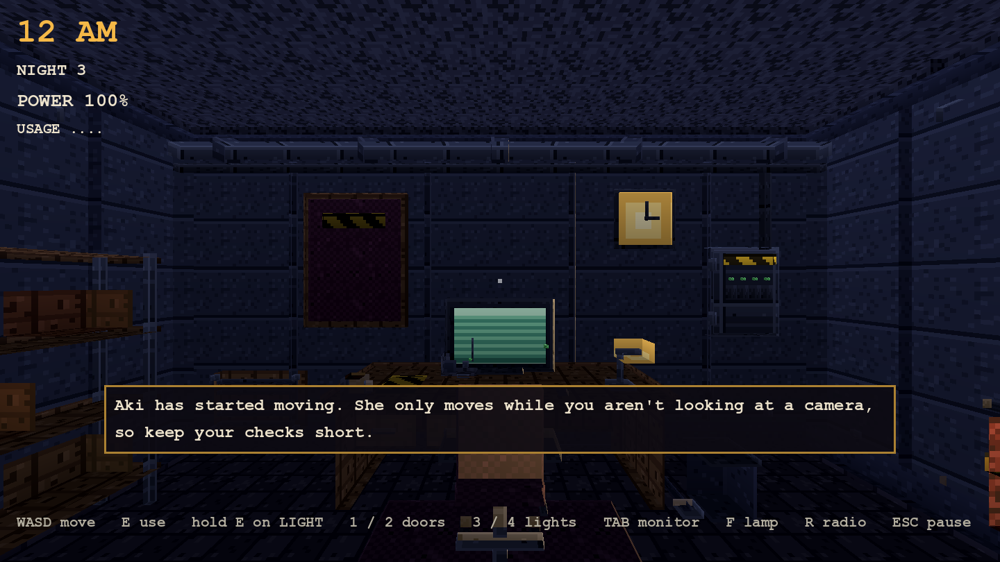 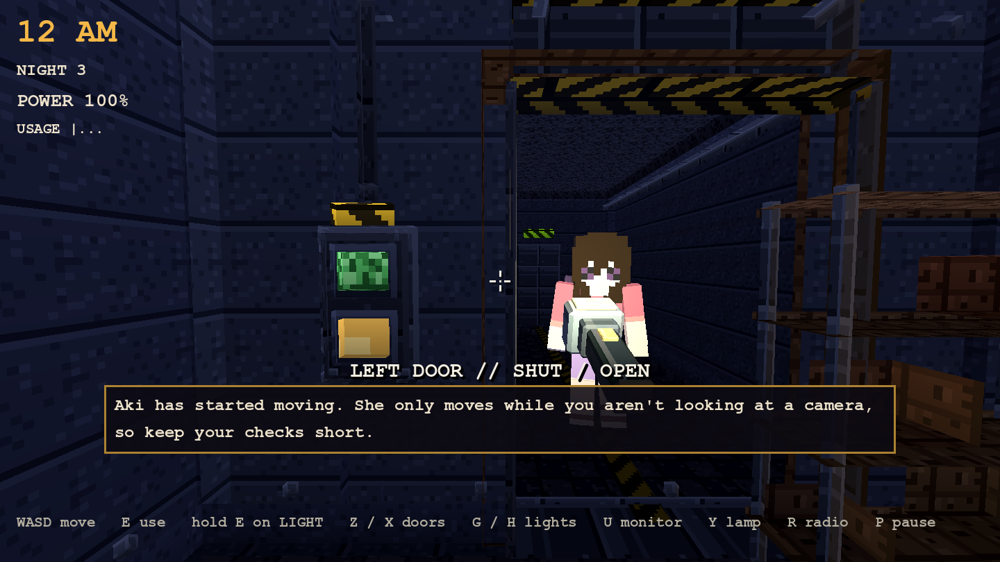 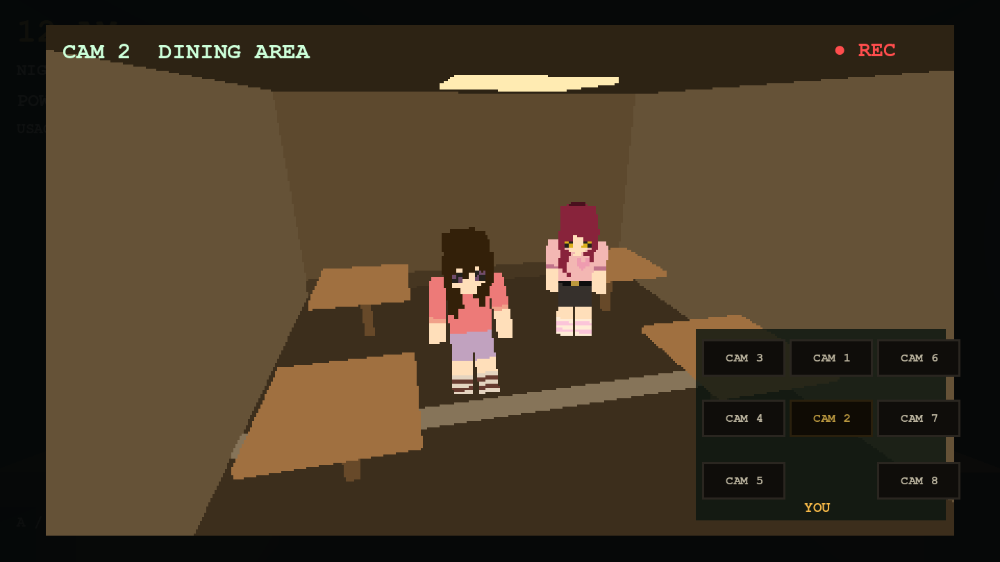 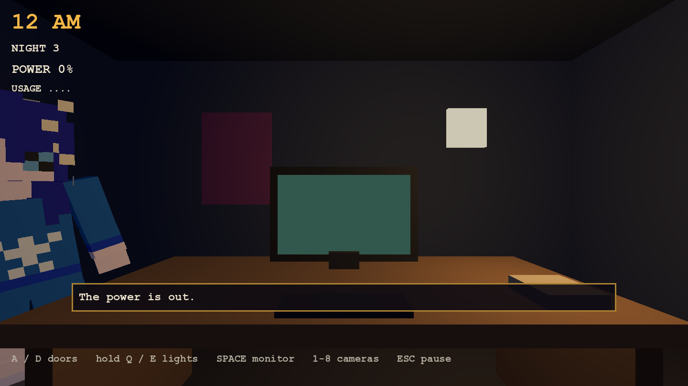

Everything is deterministic from a seed, uses no post effects and adds no version information. Audio is not in the slice (footsteps by room pan, door thumps, the blackout hum are the first thing to add).

## 5b. The art pass (detail and baked shading)

Everything Night Watch ships is built by `src/night_watch/night_watch_art.gd` from shaded cubes in named prop groups, in our blocky pixel style, with no post effects and in NEW files only (the shared prop families are untouched):

- **Painted textures:** one 16 x 16 pixel tile per material kind (wood, metal, plastic, fabric, concrete, glass, wall, floor, screen, label, light, red, green), each a hand-picked 3-4 tone ramp with its own pattern (wood grain and plank gaps, brushed metal with rivets and edge highlights, woven fabric, speckled concrete, glass with a diagonal highlight, wall panel lines with bolts, tiled floor with grout and dirt, screen scanlines, hazard stripes), nearest filtering. A texture may be at most 32 x 32 with at most 8 colours (checked).
- **Baked shading:** every cube is built face by face with vertex colours: the top face lighter, the bottom darker, the sides in between from one fixed light direction, and a darker band at the foot of the side faces as contact occlusion, so cubes read as volume under flat lighting.
- **Detail:** panel lines, baseboards and crown trim, bolts and screws, conduit and pipe runs, vent grilles and louvers, handles, name plates, door seals and thresholds, hazard-striped headers, button guards, a keyboard with key rows, papers, a clipboard, a cup, Zellia's radio (dial, grille, antenna, LED), a lamp with arm and shade, a chair with arms, base and wheels, a breaker box with hinges, switches and LEDs, a shelf unit with boxes, a fire extinguisher, a notice board and a ceiling grille in the office; each of the eight camera rooms has its own set (curtains, stage lights and a microphone; tables with cloths, chairs and vases; crates, a costume rack and a mirror; lockers, a runner, signs and an emergency light; shelves, a mop bucket and paint; counters, a hood with hanging pans, a fridge and a stove; a pillar, a bench, a vending machine and a plant) plus shared trim, a pipe, a vent and clutter.
- **Emissive** only where a name allows it (screens, lamp shade, LEDs, labels, buttons, signs, the clock face, ceiling panels): everything else is lit by the few real lights (desk lamp, two door lights while held, a dim light per hall) and the feed camera's brighter ambient.
- **Checks** (suite `night_watch`): texture size and colour limits; the office has every named prop; no prop with untextured cubes, with emissive cubes that are not allowed to glow, a single material look, or fewer than three cubes (a plain slab); the office has at least 260 cubes (it has 272 in 30 props) and the eight camera rooms at least 420 (445) with at least three prop groups each; cubes carry baked vertex-colour shading.
- **Captures:**    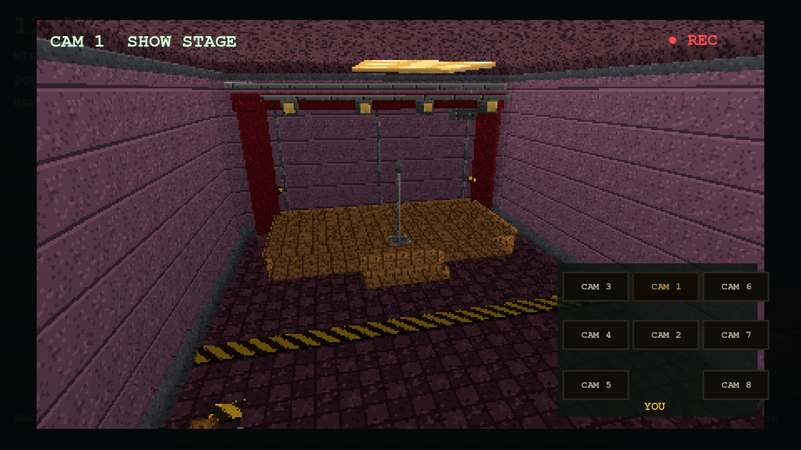

## 5c. Controls and sounds parity with Last Route

KT's rule: Night Watch must feel and sound like Last Route and the City, not like a new set.

| | Before (stage 3 slice) | Now |
|---|---|---|
| Player | `NightWatchWalker`: own capsule controller, own camera rig, own speeds (2.4 / 4.0 / 1.2 m/s), own look code | the shared `PlayerController3D` from a copy of the route scene's player subtree (checked line for line against `main_3d.tscn` by the validator) |
| Look | own mouse look, arrows, right stick | the shared mouse look (`Settings.mouse_sensitivity`, pitch limits, controller look, FOV, camera height and eye locator) |
| Interaction | own layer-2 ray, 2.3 m reach, own prompt | `NightWatchStation` is a `RouteInteractable3D`: the shared range (4.5 m), aim cone, line-of-sight rule and `get_interaction_prompt()`; same prompt label style and shared `Crosshair` |
| Sit | own sit transform | the shared furniture sit pose |
| Quick keys | 1-4, F, Tab (clashed with the shared inventory 1-5, flashlight and inventory keys) | Z, X, G, H, Y, U (free keys); digits stay inventory, F stays the flashlight |
| Gamepad | own button remap | none added: the shared mapping stands |
| Cursor | own `Input.mouse_mode` calls | `MouseLock` claims (monitor, pause, end card) |
| Footsteps | none | the shared controller's `Sound.footstep` (surface-aware walk, sprint and crouch variants) |
| Other sounds | none | `NightWatchSounds` maps the 2D game's sounds to the shared `Sound` cues (below), so the master / SFX volume and mute apply |
| UI sounds | none | the shared `Sound` hooks every Button (menu blip) automatically |

Sound mapping (all through `Sound`, nothing of its own, no `AudioStreamPlayer` in Night Watch): a door slab moving = `Sound.door`; a panel button = the `control` office cue; opening or leaving the monitor and switching camera = `camera` (+ `static` on a switch); a hunter in a hall = `footsteps` panned by the room; arriving at a door = the `crimson_door` knock; a flinch = `presence`; sent away = `scrape`; power out = `drain`; each hour = `shift`; Zellia's line = a quiet `control`; a win = `collect`; a catch = `capture` (then the existing death moment). 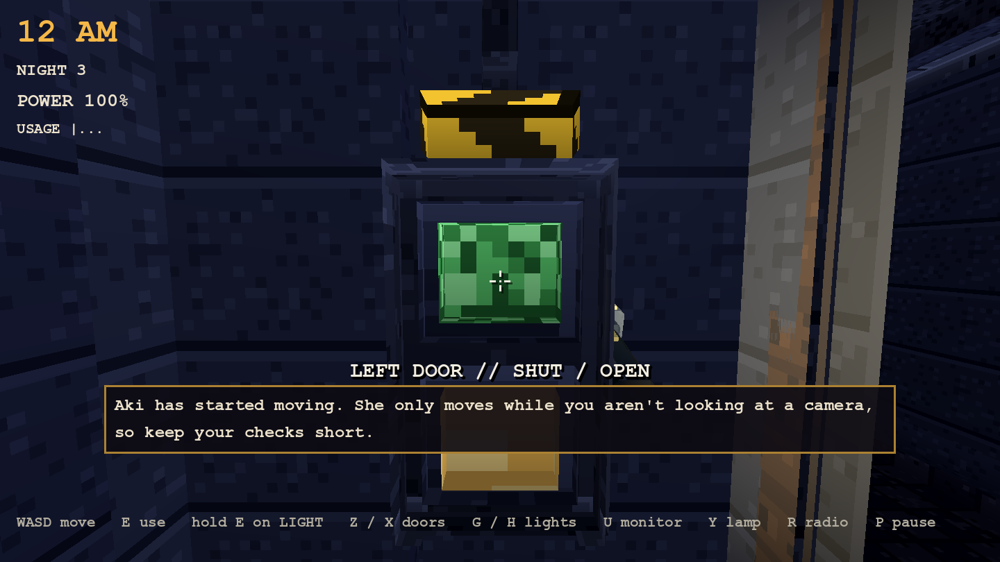 The held flashlight, the reticle and the prompt are the route's own.

Validators: the player scene equals the route's, the prompt style equals the route HUD's, the sound events land in `Sound.play_counts`, Night Watch has no audio player of its own, and no quick key shares a key with a shared action.

## 6. Risks

- **Scope.** Nine 2D games cannot be ported at once; the plan is Classic first (the spine and Mixed Shift's base), then one mode per milestone.
- **Readability.** A hunter at a doorway must read clearly in a door light cone and on a 480x270 feed at nearest filtering; blocky models were built for first-person chases at 3-10 m, so camera poses and door poses need a pass.
- **Feed cost.** Multiple `SubViewport` cameras can double the cost; only the active feed renders.
- **Duplicated rules.** Two implementations (2D JS and 3D GDScript) can drift. The pure port keeps the numbers in one table (`NightWatchClassic.NIGHT_LEVELS` etc.), and the validator checks them against values copied from the 2D docs.
- **Hub and save files** are shared with other lanes (hub, registry, room state); edits are additive.

## 7. Questions for KT

1. ~~Seated office or walkable room?~~ Decided by KT: a walkable security room (with an optional SIT AT DESK).
2. Should Night Watch be single-player only at first, or should a friend be able to spectate or share the office?
3. Which mode after Classic: Mixed Shift (a director and many threats), Bedtime (the audio-first one) or Masked Hours?
4. Keep the 45 s per hour night length, or longer in 3D?
5. Hunter art at doors: keep the blocky models or give Night Watch its own looming pose set?

## 5d. Hunters walk (pathfinding instead of teleporting)

The rules still move a hunter from room to room as a step, but she is no longer placed in the new room: `NightWatchPaths`
(`src/night_watch/night_watch_paths.gd`) holds a waypoint graph over the building (each room's centre, its open south mouth and the lane
outside it, plus doorway links) searched with AStar3D, and `NightWatchWalker` walks her along the route at a walking pace (a run when the
sim gives her a short window, within about two seconds), playing the rig's walk/sprint clip and facing where she goes. The building's
rooms have real doorways in the shared walls (`NightWatchBuilding.DOORWAYS`). The two office doors hang off the halls: the leg from
the hall to the point down the office hall is the only jump (out of sight, in the dark); she walks the rest. Validators check that every
pair of rooms is connected, no walked segment crosses a wall, the only jumps are hall to office, a walker never exceeds the run
speed in a step, and a hunter the sim moves is not placed in the new room.

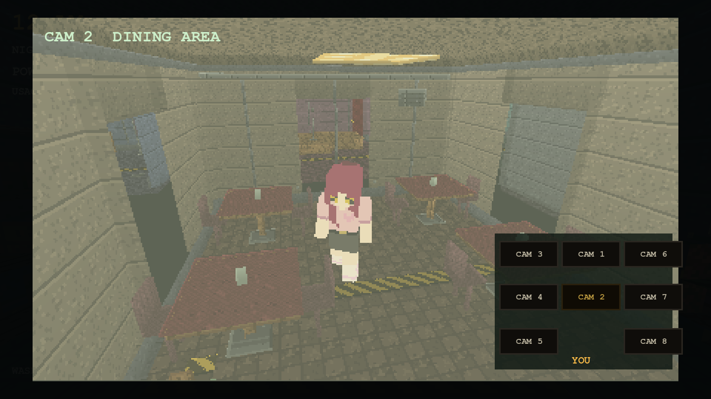

### Speed rule and exceptions (NW WORLD)

* A hop's visible walk takes a quarter of the 2D move window's lower bound (`NightWatchWalker.budget_for(level)`, 1.5 to 4 s); the pace is
  route length / budget clamped to 1.2..6.0 m/s (`speed_for`). The validator walks every graph edge for every hunter and night and
  prints how many hops the clamp bites on (28 of 360 today).
* The rules still decide the hop at its start (the sim room changes at once, so sightings, door blocking, light and combos work on the
  sim room, as in 2D); the walk is the visible time to get there.
* Exceptions, by design: the hall-to-office leg (out of sight, in the dark) is a jump; Nyxie's blackout approach is a timed walk from
  the left door to the desk over the blackout. Not yet done: vent shafts and vent crawlers (Dead Air / Mixed Shift lanes), doors that
  animate for a passing hunter, a top-down facility capture, a `hunter_nav`-style stuck test.

Top-down map of the facility with the walking routes (green) and the camera mounts (red): 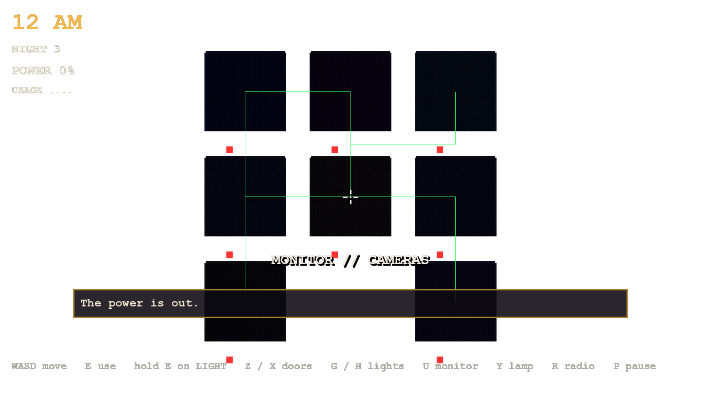
(Taken with the HUD and the blackout up; the rooms are the nine cells, the lane runs along each row's south side.) The validator now also has a
stuck test: four hunters walk every ordered room pair, never stall for a second, never stand inside a wall and arrive within their budget.
Vent shafts, vent crawlers and doors that open for a passing hunter belong to the modes that have vents (Dead Air, Mixed Shift) and are
built there on the same `NightWatchPaths` graph.

## 5e. Door stripes and prop mapping (texture-stripe bug)

**Cause.** `NightWatchArt.box_mesh` wound every triangle counter-clockwise seen from outside, but Godot's front faces are clockwise: every cube was
drawn **inside out**. The near faces were culled and the far faces' insides showed through, mirrored, so the hazard stripes on the door frame, the header
and the leaf bands looked skewed and broken (the stripe sense flipped between faces, thin bands showed a sliver of a tile). On top of that the UV scale was
clamped to at least a quarter tile (`maxf(0.25, ...)`), which squashed the texture on anything thinner than 12 cm, hazard tape started mid-stripe at
its ends, and the same diagonal-stripe texture was used for *every* "label" (paper sheets, notes, name plates, signs, the poster title).

**Fix (at the source, `src/night_watch/night_watch_art.gd`).**
* Triangles are wound `0,2,1 / 0,3,2` (clockwise), so each face is drawn from the outside with its UVs the right way round. A validator checks every cube.
* Every face maps at the same texel density: 32 px per metre (`TILE` = 0.5 m per 16 px tile); no clamping.
* Hazard tape is its own kind (`hazard`, option `"hazard": "x"` naming the tape faces): 64 px per metre (`HAZ_TILE` = 0.25 m), 45 degree stripes 4 px wide with a
  lit and a dark edge pixel, and each tape face counts a **whole number of stripe periods along its length**, so it starts and ends on the same phase; the
  ends and thickness faces of a tape piece map to one dark texel of the same texture (a dedicated tile, never a stretched copy of the stripes).
* "label" is now a plain plate with text rows (no stripes) and "paper" an off-white sheet; only real tape is striped.
* The door leaf's four bands are two hazard tapes (top, bottom) and two stepped metal ribs (geometry, 3 cm proud), not thin texture lines; the leaf is a rigid
  mesh, the animation only moves it.
* Tape users: door frame header, leaf top/bottom, floor stripe in front of the desk, the hall floor stripe, the extinguisher band, the room floor stripes and
  runner trims in the camera rooms.

**Checks.** `night_watch` now asserts, for every cube in the office and the camera rooms: clockwise winding; texel density within 10% on every face (32 px/m,
tape 64 px/m); tape faces hold a whole number of periods; every UV finite, non-negative and with area; at least 20 dedicated edge faces of tape.

**Captures.** `tools/look/night_watch_door_capture.tscn` (both doors closed / half / open from the office, and from the hall at 1.5 m and 4 m) and
`tools/look/night_watch_prop_sheet.tscn` (every office prop and every camera-room prop group alone, 8 views: four sides, two three-quarter views, top and
underneath, joined into one sheet). Before (left) and after (right):

| | |
|---|---|
| left door closed, from the office | 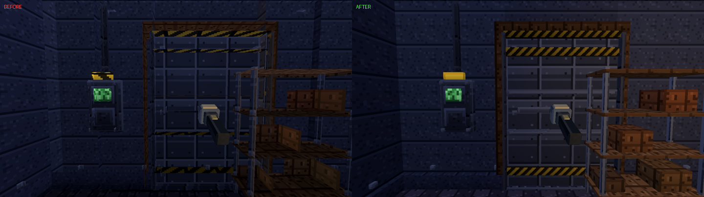 |
| left door half open | 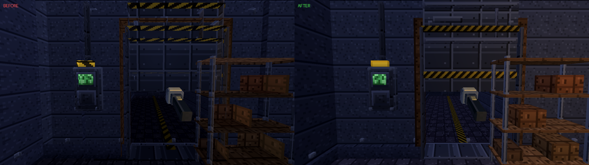 |
| right door closed | 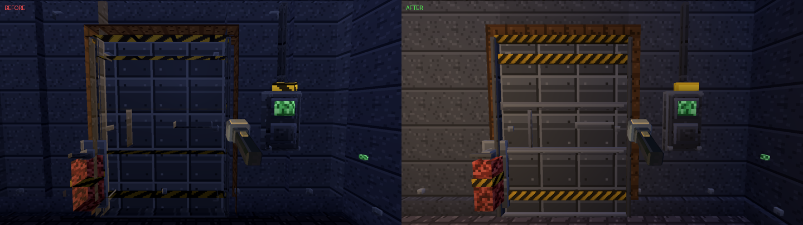 |
| left door from the hall, 1.5 m | 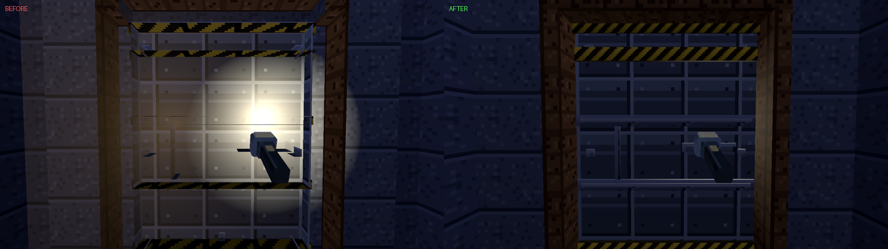 |
| left door from the hall, 4 m | 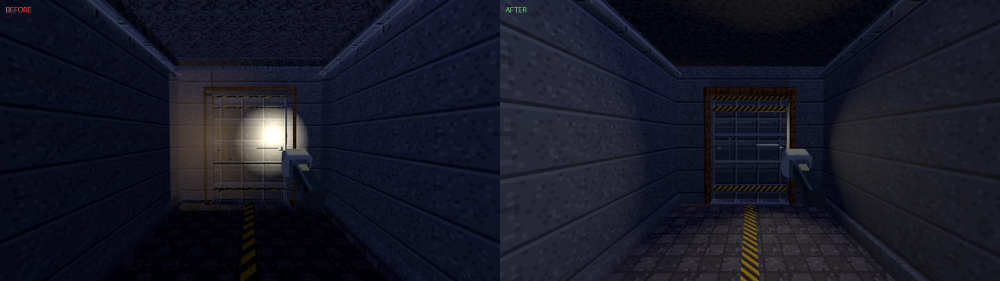 |
| right door from the hall, 1.5 m | 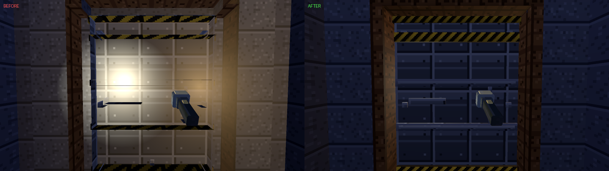 |
| desk, floor stripe, panels | 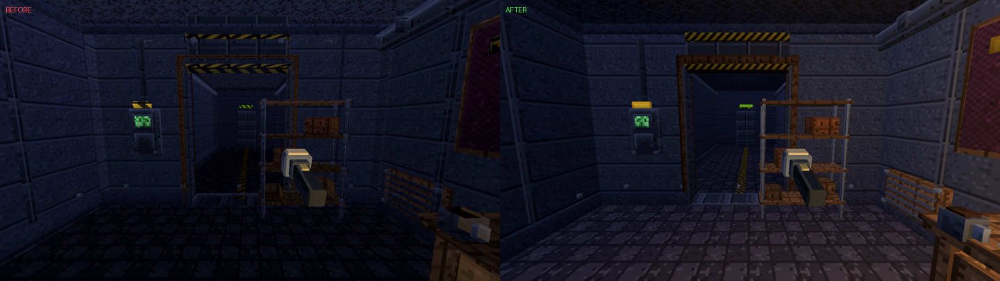 |

Prop sheets from all sides (the full set renders on demand; these are samples): 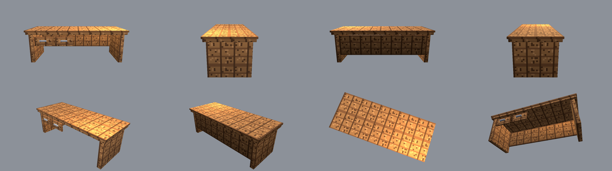 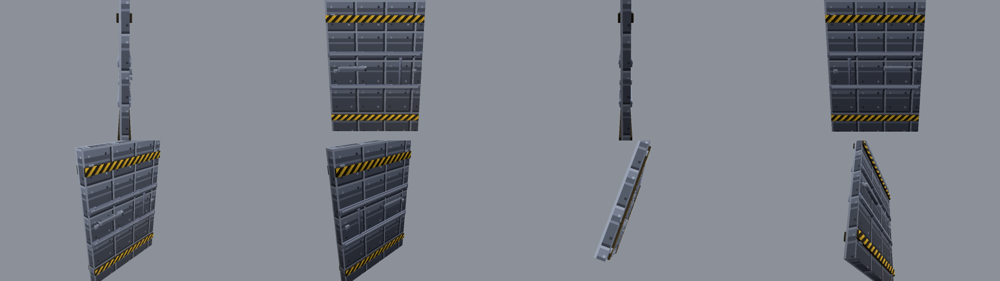
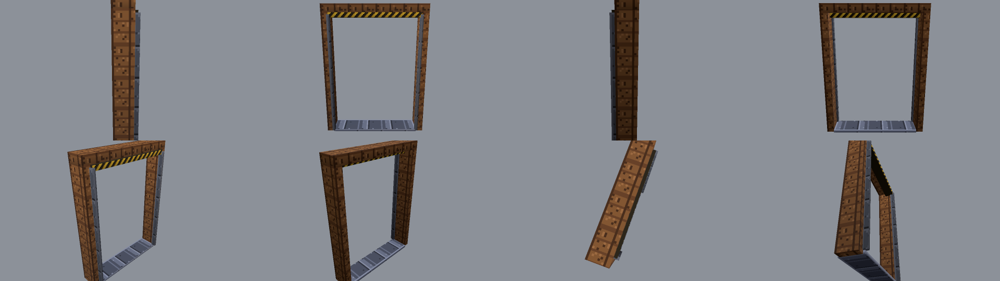 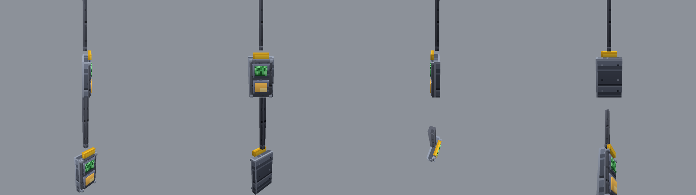 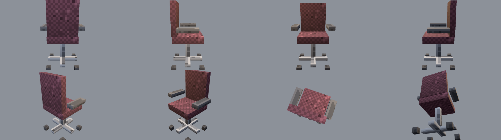
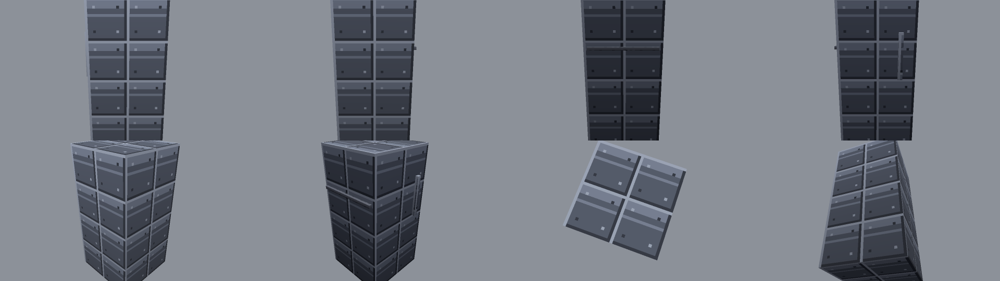
