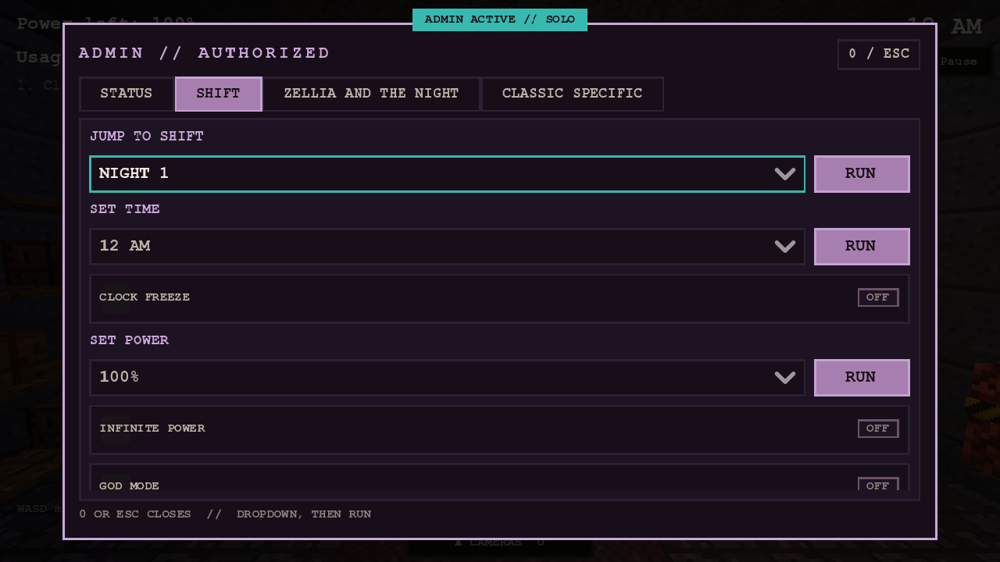
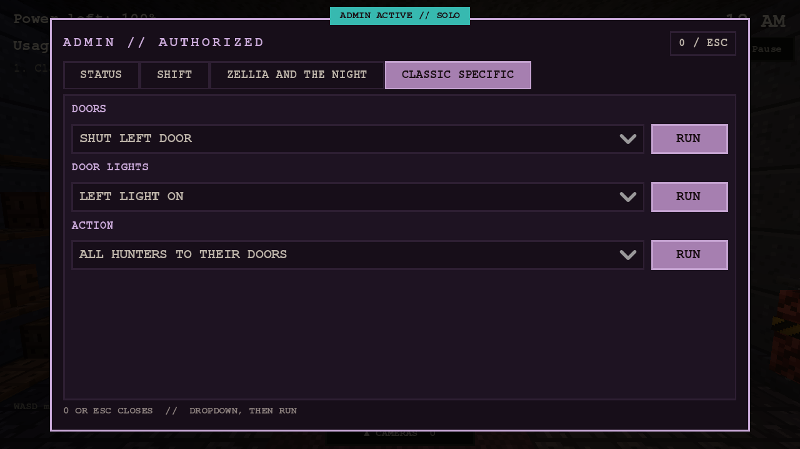

# Night Watch: the admin menu

The Night Watch admin menu is the shared `AdminMenu` (`src/ui/admin_menu.gd`, the **0** key) filled from a per-mode data table by `NightWatchAdmin` (`src/night_watch/admin/night_watch_admin.gd`). Same gate as Last Route and the City:
`Build.tools_enabled()` (a signed-in admin; `NightWatchAdmin.attach` returns null for everyone else, so the menu does not exist and the key does nothing), each entry carries a `permission` scope (`world`, `player`,
`hunters`, `visual`) checked per account, and using a control marks the run as a DEBUG run (`ADMIN ACTIVE // ...`, not recorded). The hint line lists `0 admin` only for an admin.

## How it is built

* **Common controls** are generated from HOOKS the game offers (`admin_*` methods): an entry exists only when the game has the hook, so every control changes game state through a public method, never a test-only path.
  `admin_jump_to(level)`, `admin_set_hour(h)`, `admin_set_frozen(on)`, `admin_set_power(%)`, `admin_set_infinite_power(on)`, `admin_set_god(on)`, `admin_set_no_scare(on)`, `admin_set_hunter_speed(x)`,
  `admin_hunter_ids()` + `admin_set_hunter_level(id, n)`, `admin_places()` + `admin_place_hunter(id, place)`, `admin_play_call()` / `admin_skip_call()`, `admin_set_reveal(on)`, `admin_win()` / `admin_lose()`,
  `admin_set_noclip(on)`, plus `admin_status()` for the status tab.
* **A mode section** comes from `NightWatchAdmin.PROVIDERS[mode_id]` (one line each): a script with `static func entries(game) -> Array` (AdminMenu entry format: `heading` / `items` + `labels` + `action(id)` /
  `label` + `state` + `action` / `hunter_tool`, each with a `permission`) and optional `static func status(game) -> String`. Attach with `admin_menu = NightWatchAdmin.attach(self)` **after** the mode's sim exists.
* Suite `night_watch_admin`: the gate (null for a non-admin), the sections, the layout at 480x270 / 1280x720 / 1920x1080, and that every Classic control changes state (see its list).

## Classic (done)

SHIFT: jump to Night 1-7, set the hour, freeze the clock, set power (100/50/10/0 = power out), infinite power, god mode (a caught hunter is sent back to wait), no jumpscare, noclip, reveal hunters on the camera map (red dots),
hunter speed (0.5x to 4x), per hunter AI level 0-20 and SEND TO any camera room or door. ZELLIA AND THE NIGHT: play / skip the call, win / lose the shift. CLASSIC SPECIFIC: shut / open either door, door lights, all hunters to
their doors, and on Night 7 force Kathy's meet-her-eyes.

## Per-mode sections still to add (one provider script each, in the mode's own folder, + one PROVIDERS line, + the game's admin_* hooks)

Dead Air (radio / lure controls, vent crawlers), Bedtime (closet / bed state, sleep meter), Masked Hours (mask timer, music box %, vent lights), The Facility (power / hazards), Salvage Run (hull / oxygen / scrap),
The Descent (level / stairs), Open Air (watch / waypoints), Mixed Shift / Endless (rotation: pick the next dressing / shift, set the endless wave). Each adds the common hooks it can (a mode with no clock, e.g. Bedtime's sleep meter,
simply lacks `admin_set_hour`) and checks its section in `night_watch_admin` or its own suite.
