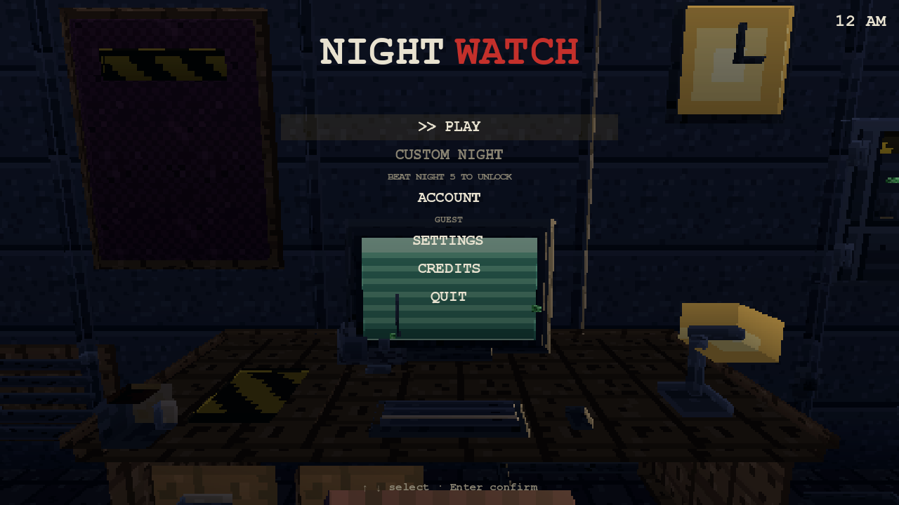
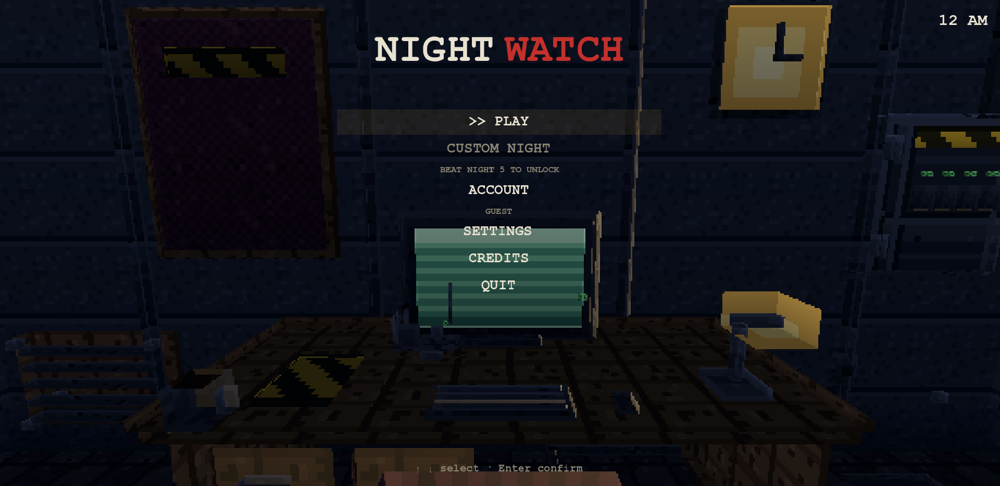
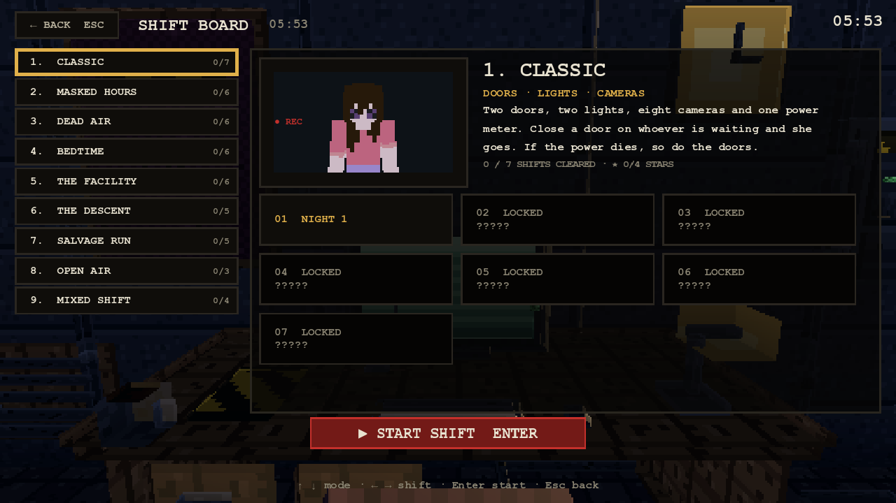
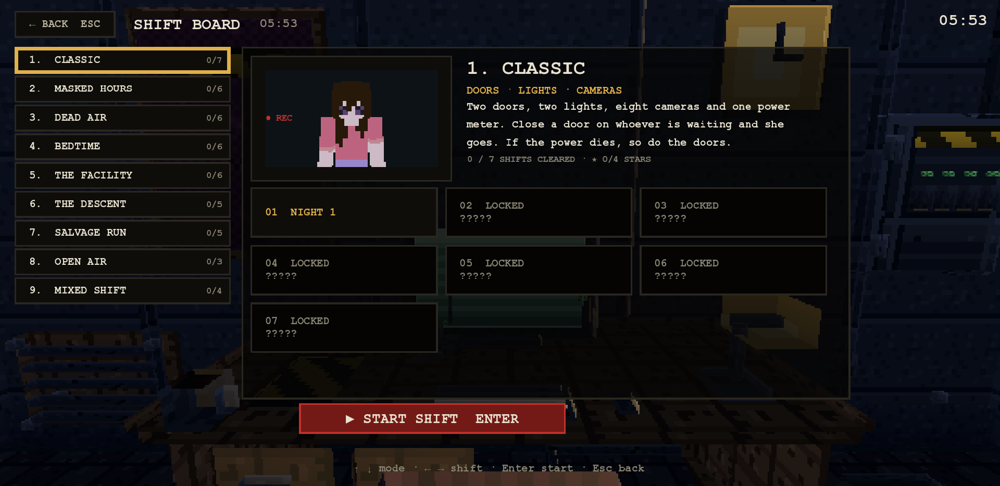
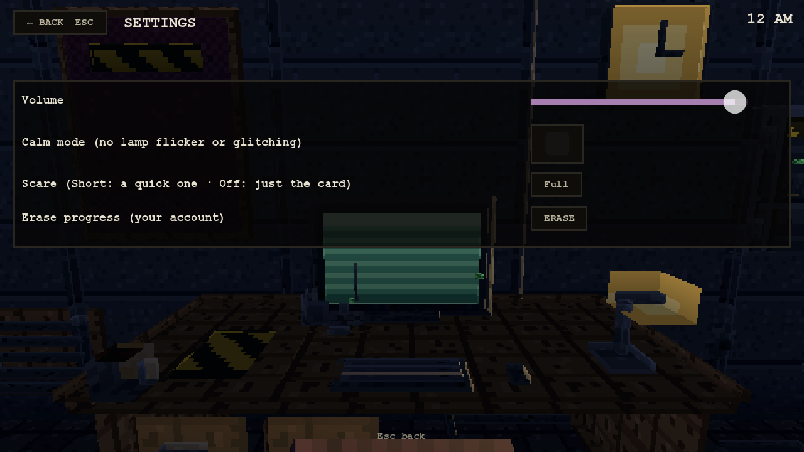
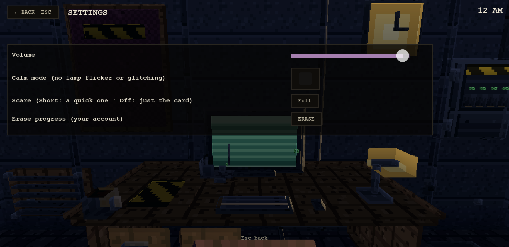
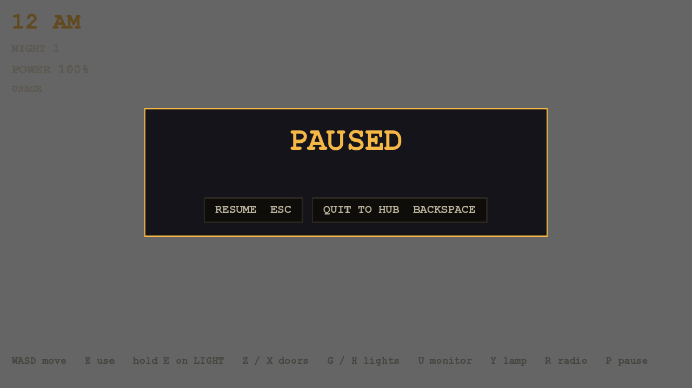
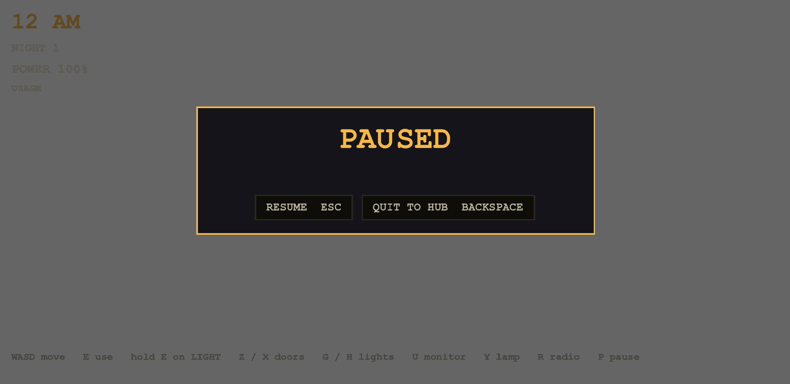

# Night Watch 3D menus vs the 2D menus

The 3D menus are the 2D game's menus rebuilt in Godot, not new ones. Source of truth: `games/night-watch/src/ui/menu.js`, `hub.js`,
`custom.js`, `core/scene.js` (pause and end cards) and `modes/registry.js`. Each 2D screen was opened in the built-in browser (local
preview server) and its visible text and structure read back, then the Godot screen was made to show the same things in the same order.
`scripts/validate_night_watch_menus.gd` (suite `night_watch_menus`) compares the two lists screen by screen.

Code: `src/ui/night_watch_menu.gd` (title, board, custom, account, settings, credits), `src/night_watch/night_watch_modes_data.gd`
(the 2D mode table, generated from `registry.js`), the pause and end cards in `src/night_watch/night_watch_hud.gd`.
Colours are the 2D game's: ink `#e8e2d0`, dim `#8a8472`, red `#c4302b`, amber `#e0b04a`, panels `rgba(6,5,4,.72)`.

## Screen by screen

| Screen | 2D (what the page shows, in order) | 3D (Godot) |
|---|---|---|
| Title | `NIGHT WATCH` (WATCH in red) · PLAY · CUSTOM NIGHT (`beat Night 5 to unlock`) · ACCOUNT (`guest`) · SETTINGS · CREDITS · QUIT · `↑ ↓ select · Enter confirm`; clock drifts 12 AM to 6 AM | same; `>>` marks the selected row; QUIT returns to the games hub (2D: to the lab) |
| Shift Board | `← BACK ESC` · SHIFT BOARD · time · nine mode rows `n. TITLE  cleared/total` · portrait with `● REC` · title, tagline (amber), blurb, `x / y SHIFTS CLEARED · ★ a/b STARS` · shift tiles `01 NIGHT 1`, locked `02 LOCKED ?????` · `▶ START SHIFT ENTER` · `↑ ↓ mode · ← → shift · Enter start · Esc back` | same order and texts; the portrait is the mode's first hunter in 3D; a mode not yet ported says `NOT BUILT YET` |
| Custom Night | `← BACK ESC` · CUSTOM NIGHT · stars · mode tabs (locked with 🔒) · one 0-20 slider per hunter · presets (☆/★) and All 0 / All 10 / All 20 / Random · `Score x of y · rating · Best n` · `▶ START NIGHT`; locked until Night 5 of a mode is cleared | same |
| Account | `← BACK ESC` · ACCOUNT · guest sentence · Username (`3-24 CHARS: A-Z 0-9 _`) · Password (`6+ characters`) · `Usernames are CAPS only and shared with Last Route and KT: Systems.` · SIGN IN · CREATE ACCOUNT | same, wired to the Godot `Backend` account calls |
| Settings | `← BACK ESC` · SETTINGS · Volume (slider) · Calm mode (no lamp flicker or glitching) (checkbox) · Scare (Short: a quick one · Off: just the card) (Full / Short / Off) · Erase progress (your account) (ERASE) | same; Volume is the shared master volume, Calm is the shared reduced-motion setting, Scare is Night Watch's own (`night_watch.cfg`), ERASE asks twice and clears Night Watch's progress |
| Credits | `← BACK ESC` · CREDITS · fan-project line · INSPIRED BY · MADE BY · SOUND | same text |
| Pause | PAUSED · `RESUME ESC` · `QUIT TO HUB BACKSPACE` | same; QUIT TO HUB goes to the Shift Board |
| Win card | `6:00 AM` · `NIGHT n COMPLETE` · detail · `Next night ENTER` · `Menu ESC` | same labels and keys |
| Death card | title · line · what happened · `Retry ENTER` · `Menu ESC` | same labels and keys |

## Deliberate differences

* Credits SOUND line says the sound is synthesized "in the game" (the 2D game's says "in the browser").
* The 2D pause has no subtitles switch, so the 3D pause lost the one it had; Zellia's calls always show.
* The Shift Board portrait is a 3D model of the hunter instead of a sprite; tiles do not show the cast figures yet.
* The office behind the menus is the real 3D office (the 2D game shows its office picture).
* Modes not yet ported are listed with their real title, tagline, blurb and shifts but start with "not built yet" (see `docs/NIGHT_WATCH_MODES.md`).

## Captures (1280x720 and 1920x1080)

Made on KT-Mini4-2 with `tools/look/night_watch_menu_capture.tscn`.

| | 1280x720 | 1920x1080 |
|---|---|---|
| Title |  |  |
| Shift Board |  |  |
| Settings |  |  |
| Pause |  |  |

Also: [board, Dead Air](night_watch_menus/1280x720_board_dead_air.png), [account](night_watch_menus/1280x720_account.png),
[credits](night_watch_menus/1280x720_credits.png), [custom night](night_watch_menus/1280x720_custom.png).

## Hover versus selection

As in the 2D game, hovering only highlights: the mode list, the shift tiles and the title entries change their selection on CLICK or the
arrow keys, never on mouse-over. A selected entry has amber text and an amber frame; a hovered one gets a lighter background and a lighter
border only; keyboard focus keeps the theme's focus ring. `validate_night_watch_menus.gd` emits `mouse_entered` on every entry and asserts
the selected mode, tile and the detail panel do not change, then checks that a click and the down arrow do.
