# Night Watch: one office per mode (the OFFICE CONTRACT)

Every mode of the 2D game has its own office picture (`games/night-watch/assets/offices/<office>.png`, the `office:` field of each mode in
`src/modes/registry.js`). In 3D every mode gets its own **office scene** too, all different, built to one contract so the framework, the menus
and the validators treat them alike. Classic's security room is the reference implementation.

## The contract

Code: `src/night_watch/office/` (`night_watch_office_spec.gd`, `night_watch_office_base.gd`, `night_watch_office_registry.gd`); validator suite
`night_watch_offices` (`scripts/validate_night_watch_offices.gd`).

An office is a script `extends NightWatchOfficeBase` in the mode's own folder (`src/night_watch/<mode>/<mode>_office.gd`) with
`static func make_spec() -> NightWatchOfficeSpec` and `_make_spec()` returning it, plus `build()`. Registered with one line in
`NightWatchOfficeRegistry.OFFICES` (`script`). The spec carries:

| Field | Meaning |
|---|---|
| `id`, `title`, `mode_ids` (`rotation` for Mixed Shift) | unique office id; the mode(s) using it; one office per mode |
| `footprint` (Rect2, XZ, local), `spawn` | the walkable floor and where the player starts; the spawn must lie inside |
| `entrances` | `[{id, kind, position, outward, sim_room, blockable}]`: where hunters/vents/hatches reach the office. `kind` in `door_slab, door_wood, curtain, hatch, vent, window, stairs, lift, gate, opening`; `sim_room` is the node of the mode's graph that arrives here; `blockable` says the player can shut it. The mode's connected map (NightWatchPaths-style waypoints) ends at these positions |
| `required_stations` | station ids the office must expose in `stations` (NightWatchStation nodes: monitor, chair, lamp, door buttons, breaker, radio, hatch ...) |
| `has_monitor` | false for offices with no camera monitor (Bedtime: listen only); then `monitor` is not required |
| `mood` | `{kind: warm_lamp / cold_monitor / emergency_red / daylight / night_outdoor / dusk / fluorescent, ambient, lamp, accent}` |
| `tone_cue` | room tone: one of the shared `NightWatchSounds.CUES` |
| `controls` | the quick-key actions that apply here (others are hidden from the hint line and the controls tab) |
| `references` | 2D screenshot and concept image paths for this doc |

Runtime interface (`NightWatchOfficeBase`): `spec`, `stations`, `props`, `build()`, `spawn_position()`, `entrance_position(id)`, `entrance_outward(id)`,
`light_count()`. The mode's game scene makes its office with `NightWatchOfficeRegistry.make(mode_id)` and wires `stations[...].on_activate`.

Rules for an office:
* New files only; never edit another office or another lane's folder. Cubes only through `NightWatchArt.box` (baked shading, one texel density, hazard tape only
  where a hazard sign belongs); interactables are `NightWatchStation`; solid things have a layer-1 `StaticBody3D`.
* Real lights: at most `NightWatchOfficeSpec.MAX_REAL_LIGHTS` (3) on at once, no shadow casters (docs/REF_LOOK.md budget).
* Shared player (`scenes/night_watch_player.tscn`), shared prompt, crosshair and sounds. Hunters reach the entrances by path (`NightWatchPaths` pattern); no teleports.
* Walkable: the suite does a capsule flood fill from the spawn: it must reach every station (within 3 m) and every entrance (within 2.5 m); no blocked spawn,
  no split room.
* Capture: one image from the entrance and one from the desk (or the mode's main station) in `docs/night_watch_offices/<id>_door.png` / `_desk.png`.
* The registry validator requires distinct office ids for all nine modes; set `REQUIRE_ALL_BUILT = true` there when the last office lands.

## Who builds what, and from which 2D identity

| Mode (2D `office`) | Office id | Concept (from the 2D mode) | Entrances | Monitor | Lane |
|---|---|---|---|---|---|
| Classic (`classic`) | `classic_security` | the existing security room: two steel doors with panels and lights | doorL, doorR (slab) | yes | built (this lane); polish here |
| Masked Hours (`mask`) | `front_office` | the day-shift front office / reception with a mask rack: no doors, hall hunters walk in | hall opening, vents | yes | B: **built** (`mask/mask_office.gd`) |
| Dead Air (`lure`) | `broadcast_booth` | **built** (`src/night_watch/lure/lure_office.gd`): a radio / broadcast booth, foam-lined, a glass window onto a dark studio, a mixing console with the systems monitor, a boom mic, a patch rack, an ON AIR lamp; the two ventilation hatches have slatted covers (the DOOR buttons seal them) and service ducts behind. 2D: 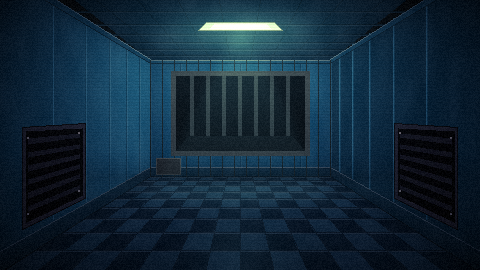 3D: 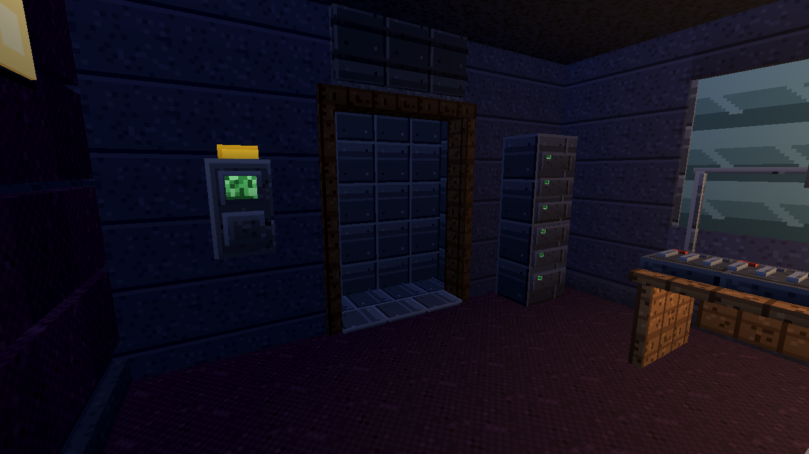 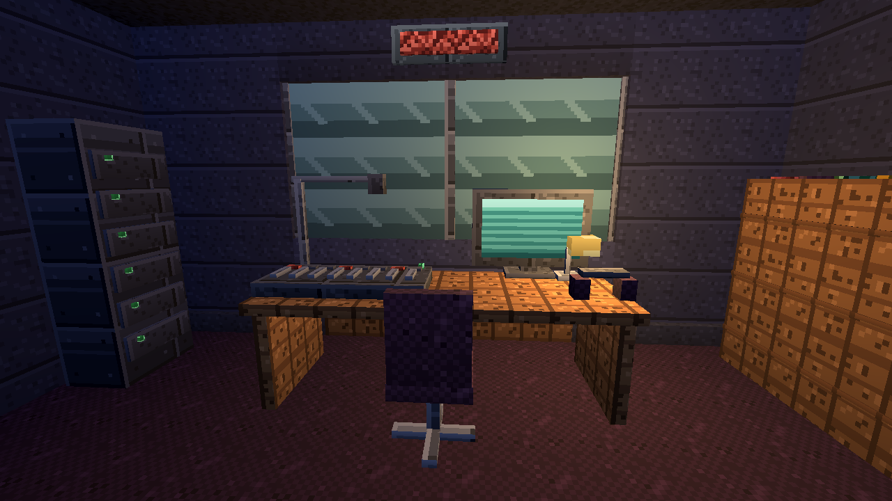 | vent L, vent R, studio window | yes (systems panel) | A (nw-modes-a) |
| Bedtime (`bedroom`) | `child_bedroom` | **built** (`src/night_watch/bedroom/bedroom_office.gd`): a child's bedroom seen from the pillow, a closet in the west wall, a hall doorway with a long hall in the east wall, the foot of the bed; two flashlight spots, no monitor. 2D: 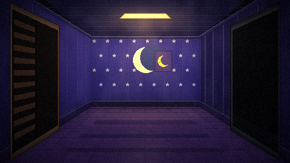 3D: 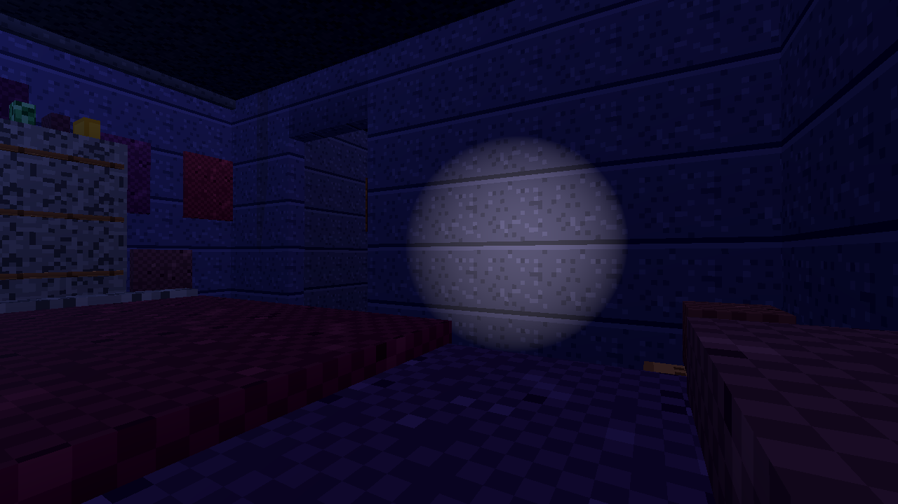 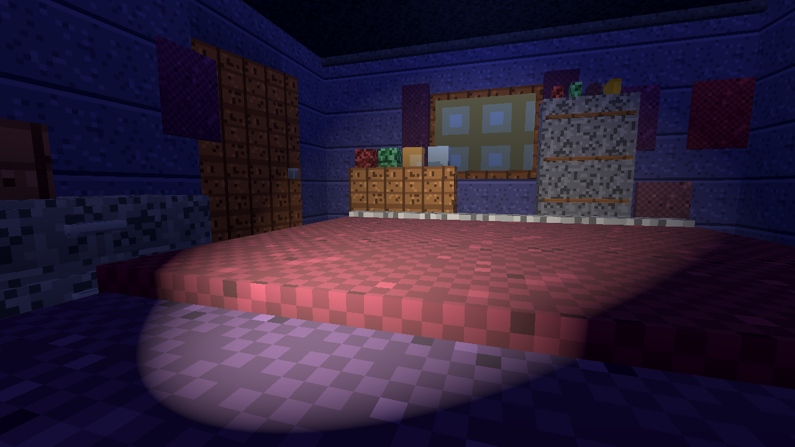 | closet, hall, bed | no | A |
| The Facility (`story`) | `control_room` | **built** (`src/night_watch/story/story_office.gd`): the control room: a wall of monitors either side of the lift door, a task board, the log-in terminal with its number note, the desk you hide under; doorways to the gallery and the workshop. 2D: 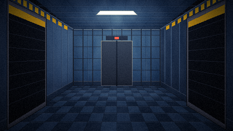 3D: 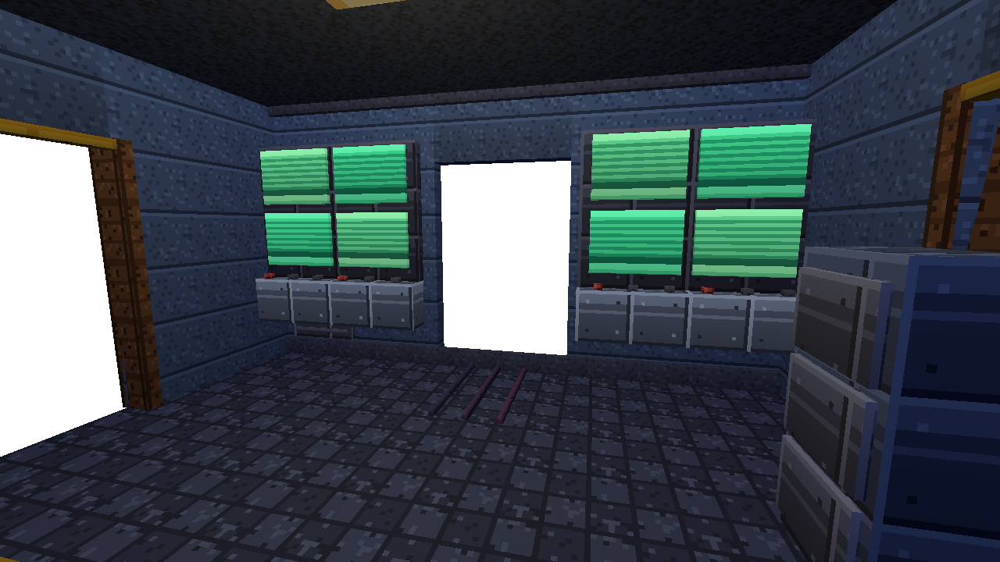 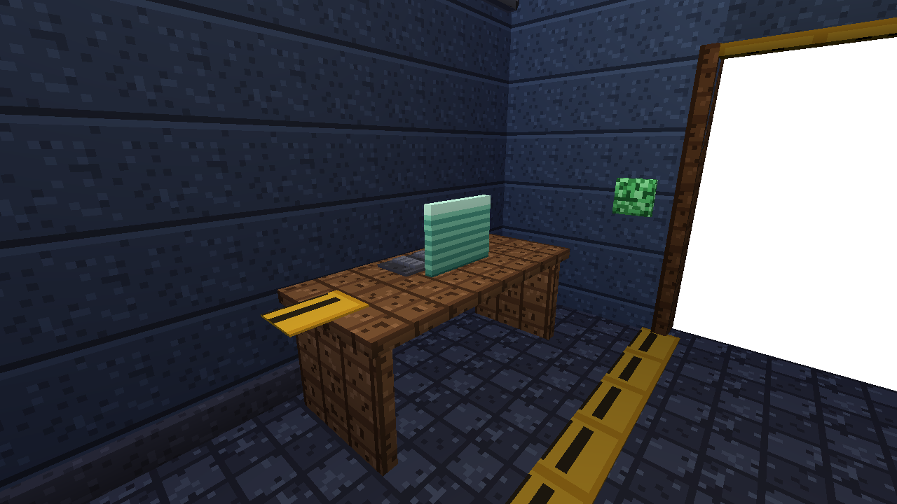 | door L, door R, lift | yes (monitor wall) | A |
| The Descent (`descent`) | `lift_landing` | an elevator cabin / shaft landing: wires, signal panel, pipes, a window | window, hatch | no | C (nw-modes-c): **built** |
| Salvage Run (`dayshift`) | `cargo_bay` | a cargo bay / workshop: a rack to salvage from, a budget desk, doors and a window | two doors, window | no monitor (ledger instead) | B: **built** (`dayshift/cargo_bay.gd`) |
| Open Air (`extra`) | `watch_post` | an outdoor guard booth / roof / bus stop / campfire (three watches): daylight and night outdoor | opening, edge, path | no | C (nw-modes-c): **built** |
| Mixed Shift (`mixed`) | `hub_office` | rotates through the set (one office per hour, drawn by the pacing director) or the Classic building hub | per office | yes | this lane / B: **built** as the hub (`mixed/mixed_office.gd`) |

Each lane chooses and documents its own offices in this file (a row of its own, with the 2D screenshot next to the 3D concept) and implements them in its
own folder. Mixed Shift's `rotation` lists the office ids it cycles.

## Lane B offices (Masked Hours, Salvage Run)

Both are subclasses of the Classic room (`NightWatchOffice`, so the desk, chair, lamp and door panels are the same reference mechanics) that override
`_build_shell()` and `_build_wall_props()` and add their own stations; the games build them with `NightWatchOfficeRegistry.make(mode)`.
| Office | 2D (`games/night-watch/assets/offices/`) | 3D, from the entrance | 3D, at the desk / main station |
|---|---|---|---|
| `front_office` (Masked Hours) | 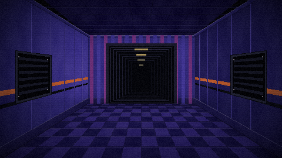 | 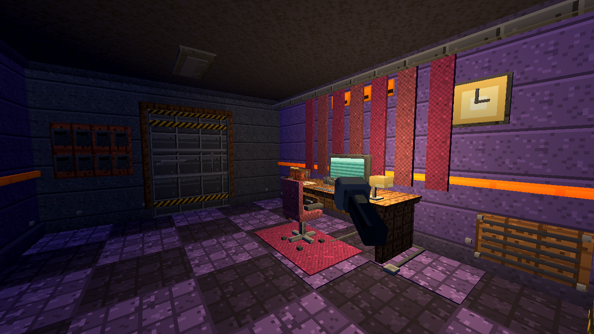 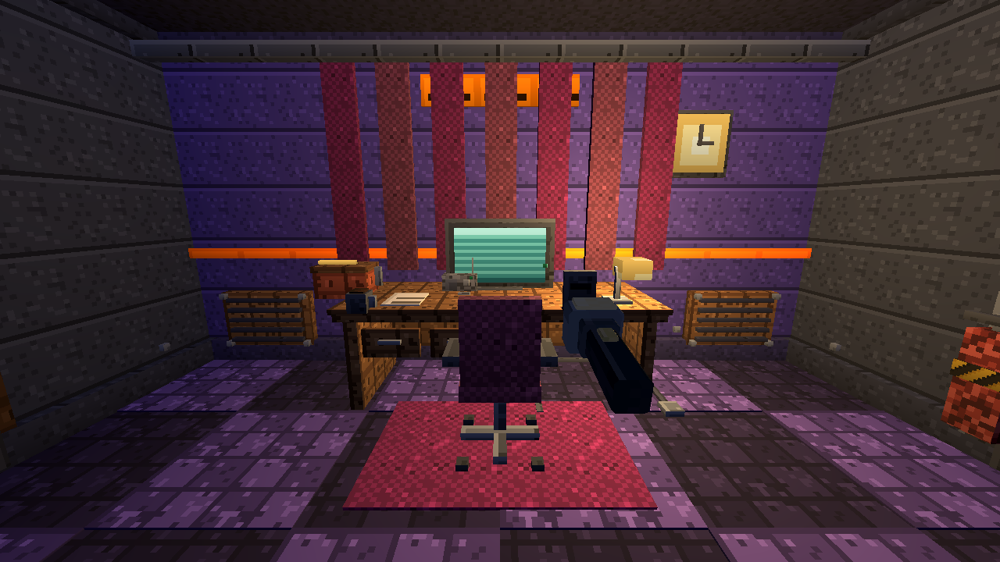 | purple walls, orange stripe, checkerboard floor, striped curtain; no doors (the right doorway is the hall, the left is sealed), two dark vent grates on the back wall, a rack of masks, a reception counter; on the desk the monitor, the mask and the music box; stations `mask`, `musicbox`, `vent`, `ventR`, `doorR_light` (the hall light) |
| `cargo_bay` (Salvage Run) | 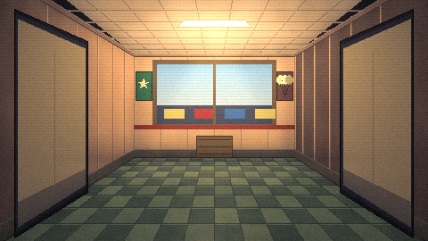 | 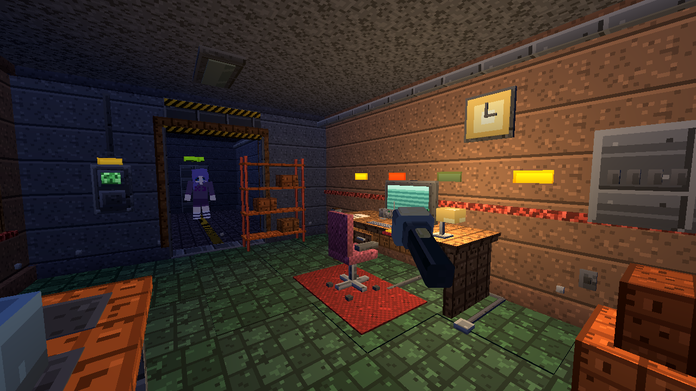 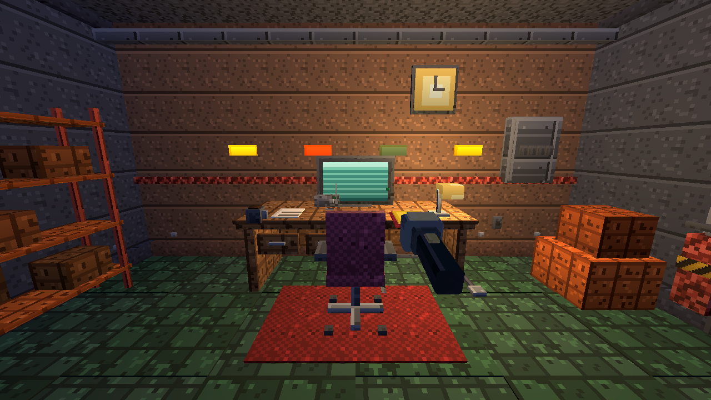 | warm wood panels, green checkerboard, a window in the front wall with a yard outside, pallet racking, crates, a workbench with the four-slot rack (`rack0`..`rack3`), a budget ledger on the desk (`ledger`), the two steel doors and panels; the monitor is off (the 2D mode has no cameras), so `has_monitor` is false |
Lights: Masked Hours has the desk lamp only (vent beams and the hall light are off until held); Salvage Run has the desk lamp (the yard lamp is an emissive cube).
### Mixed Shift: `hub_office`
The Classic building's hub: the Classic security room (doors, panels, desk, monitor, chair, lamp) with the three permanent vents of the 2D Mixed office
(`mixed/mixed_office.gd`, a subclass of `NightWatchOffice`): left and right low on the back wall and one in the ceiling above the desk, each with a shutter (shown while
sealed) and a glowing opening for the vent light (an emissive cube, not a real light). The DOOR buttons stay; the LIGHT buttons are off (the doors' light pulses are the
tell). Entrances: `doorL`, `doorR` (slab), `ventL`, `ventR`, `ventT`. Mixed Shift does not rotate through other offices yet (`rotation` is empty). Lights: the desk lamp.
| `hub_office` (Mixed Shift) | 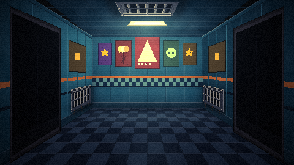 | 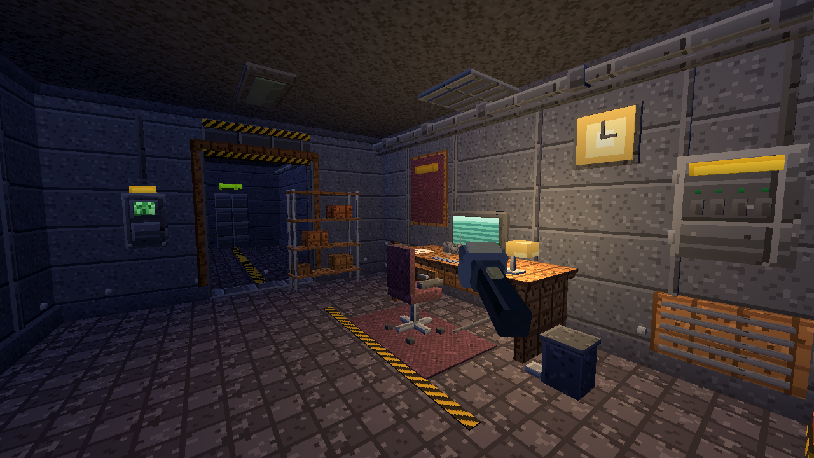 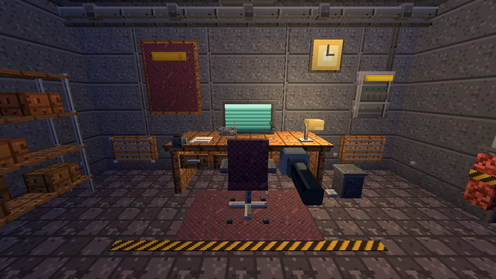 |
## Lane C: `lift_landing` (The Descent) and `watch_post` (Open Air)
Both are built from their mode's own world class (`NightWatchDescentWorld`, `NightWatchOpenAirWorld`) wrapped by a `NightWatchOfficeBase` script in the mode's folder
(`src/night_watch/descent/descent_office.gd`, `src/night_watch/openair/openair_office.gd`); the game scenes make them with `NightWatchOfficeRegistry.make(mode)`. Neither has a
monitor. Entrance positions are the last waypoints of the hunters' graphs (Elise at the glass, Verrine at the stair door and hatch, Wynelle at the shelter, the campfire's three).
`NwOfficeWalk` (`scripts/nw_office_walk.gd`) is the capsule flood fill as a helper: the mode suites run it on every variant (`watch_post` is built three ways, by `watch`).
| `lift_landing` (descent): car, panel, two caged windows, shaft | 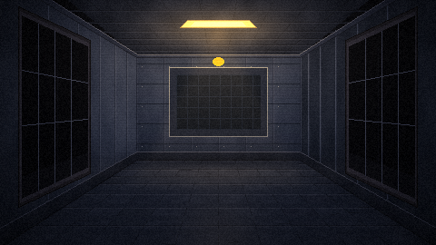 | 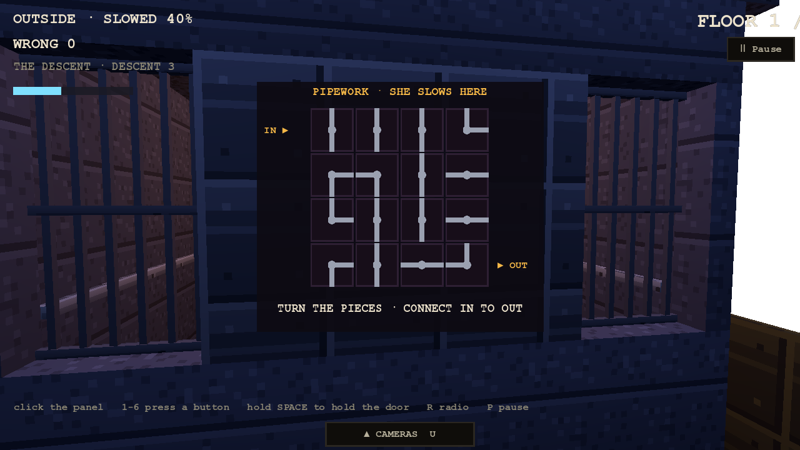 | 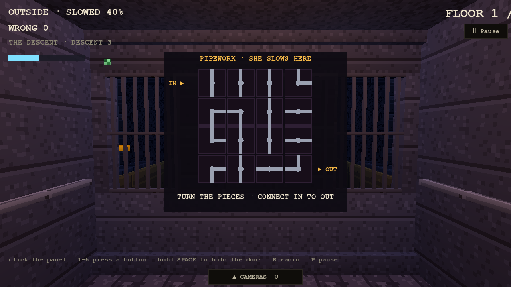 |
| `watch_post`, ROOFTOP (`extra`): stair door left, hatch right, lantern post | 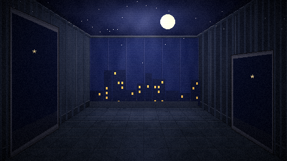 | 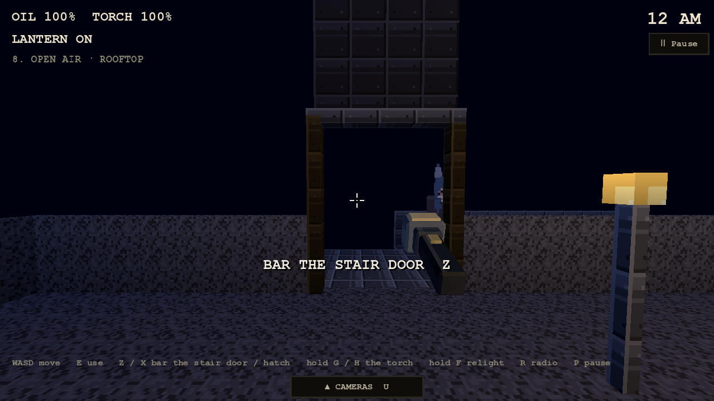 | 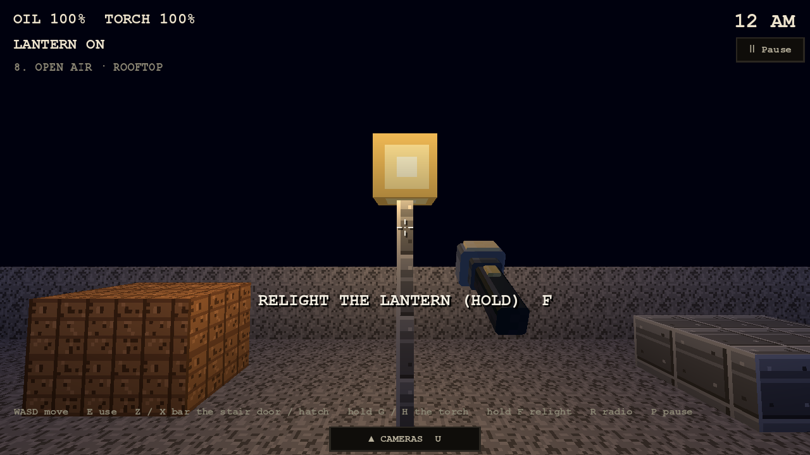 |
| `watch_post`, BUS STOP: shelter, heat lamp, canisters, the road | 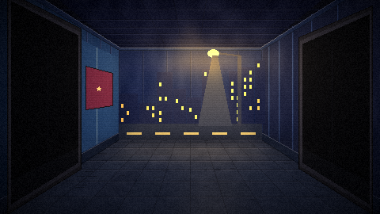 | 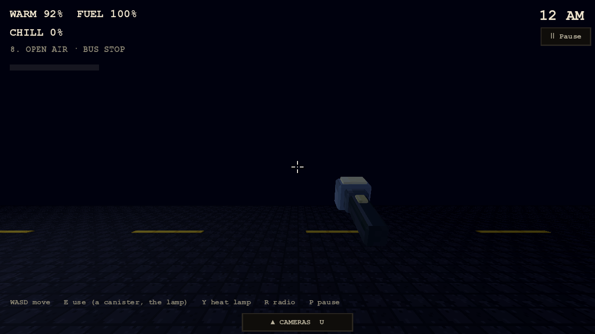 | 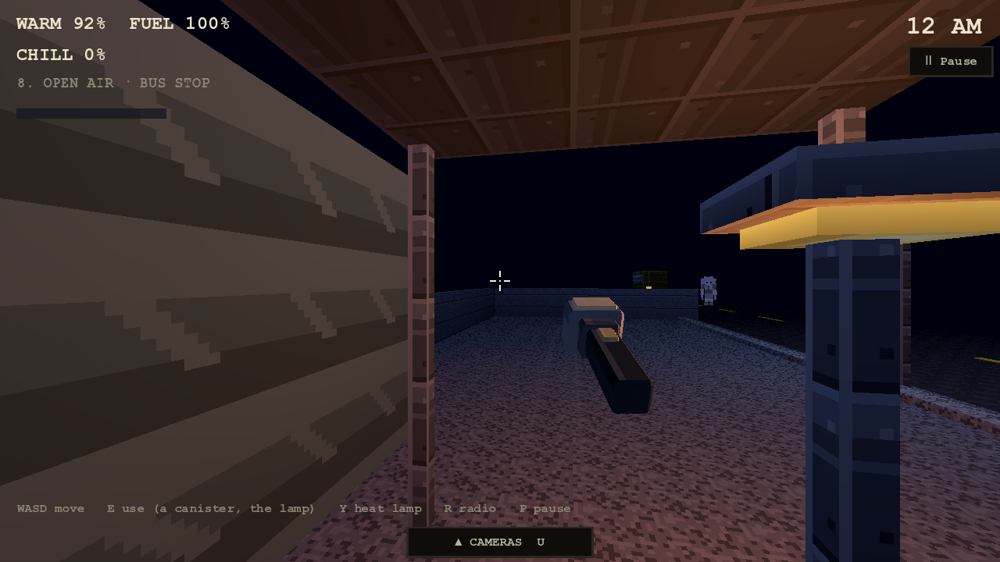 |
| `watch_post`, CAMPFIRE: fire, log pile, firewood, tent, torch posts | 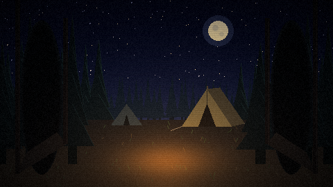 | 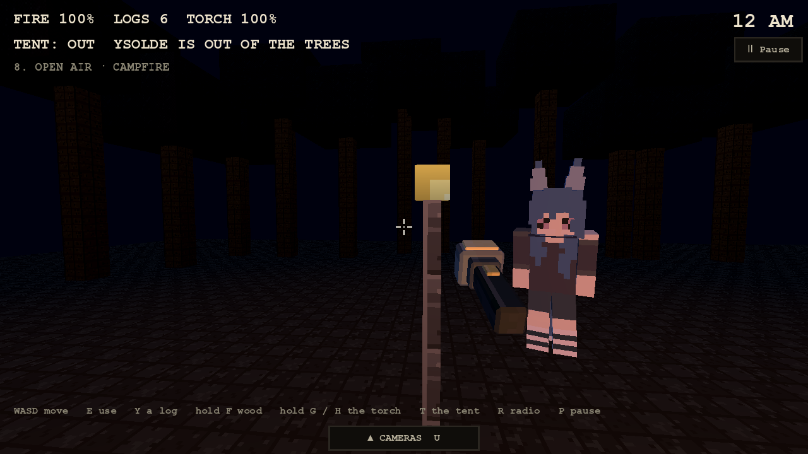 | 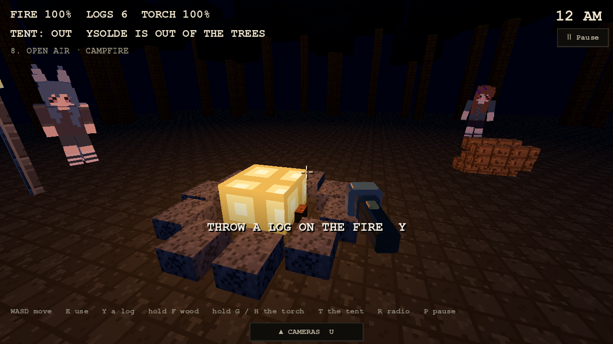 |
Captures: `tools/look/night_watch_offices_c_capture.tscn` (run with `--scene ... -- OUT_DIR` on the mini).

## Maps: every mode its own layout

The office is not the only thing that must differ: every mode's MAP (the rooms the hunters walk and the cameras look into) is its own themed layout, never a reskin of Classic's building.
`NightWatchMapRegistry` (`src/night_watch/office/night_watch_map_registry.gd`) has one entry per mode: a script with `static func map_layout() -> Dictionary`
(`{rooms: {id: centre}, edges: [[a, b]], entrances: [room ids the office is reached from], theme: text}`), or `single_space: true` for a mode with no multi-room map (Bedtime, Salvage Run).
Validator `night_watch_maps`: no two modes share a layout signature (sorted room centres and edges), no mode shares more than 3 room ids with Classic, every layout is connected from its entrances,
and no mode's map script extends `NightWatchBuilding`. The layout must stay in step with the walking-hunter paths and the office spec entrances. Themes: Masked Hours = a FNAF 2 style
building (not derived from Classic), Dead Air = a radio station / studio floor, The Facility = an industrial complex, The Descent = stairwell / shaft levels, Open Air = open grounds,
Mixed Shift = rotates between the other modes' maps, Classic stays as is.

| Mode | Map script | Layout | Top-down |
|---|---|---|---|
| Dead Air (`lure`) | `src/night_watch/lure/lure_map.gd` (`LureMap`, built by `LureWorld`, walked by `LurePaths`) | a radio station: reception on top of a plus-shaped floor, studio A and B either side of the big live room, the transmitter room below it with the tape library beside it, two crawlspaces out to the booth; rooms of different sizes, doorways in shared walls. The rules graph is unchanged (lobby = reception, arcade = studio A, party = studio B, ballpit = live room, prize = tape library, storage = transmitter, ventl / ventr = the crawlspaces) | 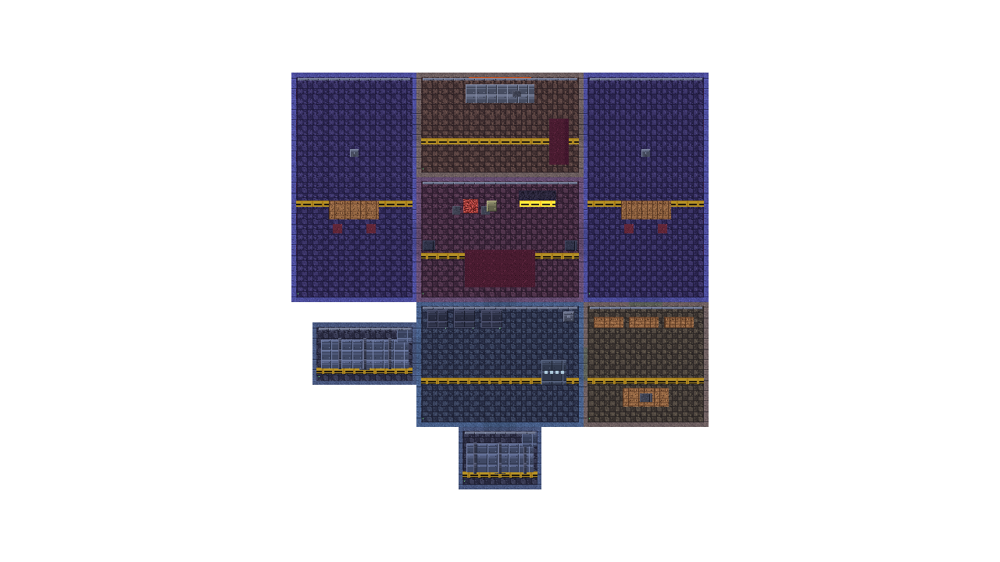 |
| Bedtime (`bedroom`) | single space (`bedroom_office.gd`) | one bedroom plus the hall Javelle walks | |
| The Facility (`story`) | `src/night_watch/story/story_map.gd` (`StoryMap`, built by `StoryWorld`) | an industrial complex: the production line of five rooms (breaker room, gallery, control, workshop, auditorium) with the lift north of control. It is the rules' own graph, so the plan is a line with one branch; none of Classic's room ids | 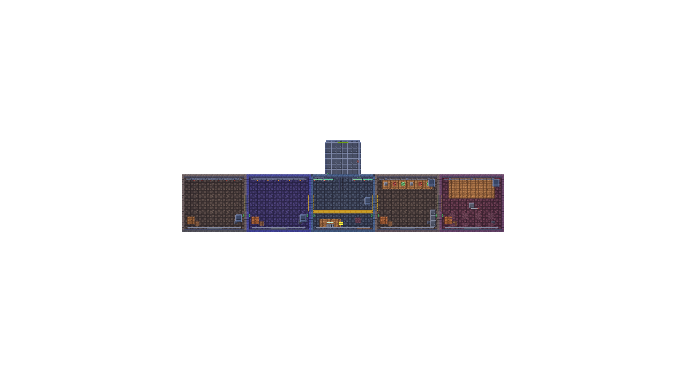 |
