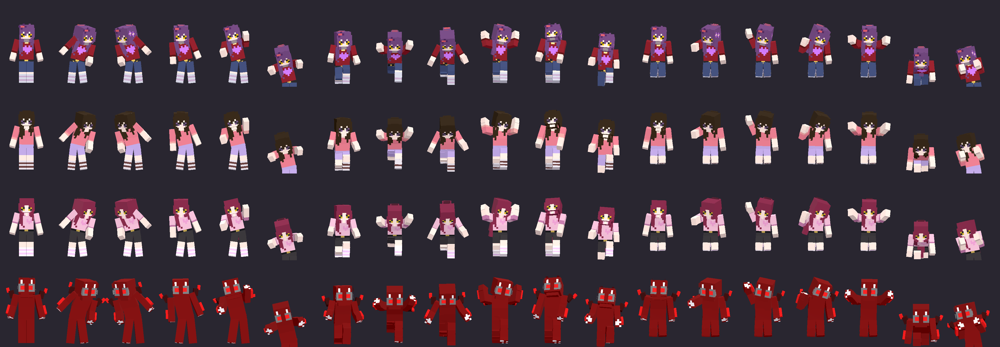

# Night Watch poses

A shared animation library for Night Watch hunters on the identical blocky rig. The poses are DATA: no hunter `.glb` / `.bbmodel` is edited (`git diff assets/hunters_blocky/<hunter>/*.glb` is empty).

- Authoring: `python3 tools/blocky_hunters/nw_poses.py` writes `assets/hunters_blocky/night_watch_poses.json` (per-bone rotation/offset keys as deltas from the rest pose, per-bone limits, L/R `mirrored()` helper, easing, loop/once, blend time, `layers` flag, the state table, an optional per-hunter `hunter_offsets` table: `{id: {"scale_pos": f, "bone_rot": {bone: [x, y, z]}}}`).
- Runtime: `NightWatchPoses` (`src/game_3d/night_watch_poses.gd`) compiles the JSON into an `AnimationLibrary` per hunter model (cached) and `HunterView3D` adds it to every hunter's `AnimationPlayer` at load as library `nw` (clips are `nw/<pose>`). Offsets scale with the hunter's leg length (pelvis rest height), so tall and short bodies keep their feet down.
- Procedural layers (`NightWatchPoseLayers`, off unless `view.nw_layers = true`): breathing, a slow sway and a lean into turns, additive on Pelvis/Belly/Chest; the head look from HUNTER HEADS (`HunterFacing`) already sits on the head; while `nw_layers` is on, walk/chase/sprint playback speed follows the real pace (`NW_STRIDE_REF`). Poses with `layers: false` (lunge, crawl, twitch, flinch) switch the layers off. A stun always wins over a pose.

## Integration (the hook for the Night Watch lane)

```gdscript
NightWatchPoses.play(hunter_view, "door_lurk")                  # loops until stop()
NightWatchPoses.play(hunter_view, "flinch", {"speed": 1.2})     # one-shot: ends by itself, normal clips resume
NightWatchPoses.play_state(hunter_view, "at_door")              # by Night Watch hunter state (table below)
NightWatchPoses.stop(hunter_view)
hunter_view.nw_layers = true                                    # once, when the hunter is placed in the building
```

`play` also works on any node that holds a hunter model (it installs the library on first use). Options: `speed`, `blend` (seconds).

## Poses

| Pose | Mode | Length | Blend | Note |
|---|---|---|---|---|
| `door_lurk` | loop | 3.2 s | 0.45 s | lit doorway, hunched, breathing sway |
| `peek_left` | loop | 2.4 s | 0.35 s | lean left, head only past the corner |
| `peek_right` | loop | 2.4 s | 0.35 s | mirror of peek_left |
| `stare_camera` | loop | 5 s | 0.6 s | head locked front, slow tilt |
| `door_pound` | loop | 0.8 s | 0.25 s | arms swing like hammering |
| `press_glass` | loop | 3 s | 0.5 s | palms on the glass, leaning in |
| `creep_walk` | loop | 1.6 s | 0.4 s | low slow walk, knees bent |
| `sprint_lunge` | loop | 0.9 s | 0.12 s | leaping lunge, arms reaching |
| `retreat` | loop | 1 s | 0.3 s | backing away, hands up |
| `flinch` | once | 1.1 s | 0.08 s | hands up against the light, one-shot |
| `twitch` | loop | 2 s | 0.1 s | jitter bursts, deterministic seed |
| `kneel` | loop | 3 s | 0.55 s | one knee down, head bowed |
| `slump` | loop | 4 s | 0.7 s | tired idle |
| `point_office` | loop | 2 s | 0.3 s | pointing straight ahead |
| `wave` | loop | 1.2 s | 0.3 s | right hand wave |
| `listen` | loop | 3 s | 0.45 s | head cocked, hand to the ear |
| `reach_out` | loop | 2.2 s | 0.4 s | both arms reaching forward |
| `vent_crawl` | loop | 1.4 s | 0.35 s | all fours, hips low |
| `lean_wall` | loop | 4 s | 0.5 s | arms folded, waiting |

## Night Watch state -> pose

| State | Pose |
|---|---|
| `idle` | `door_lurk` |
| `doorway` | `door_lurk` |
| `at_door` | `door_pound` |
| `door_grace` | `door_lurk` |
| `peek_left` | `peek_left` |
| `peek_right` | `peek_right` |
| `camera` | `stare_camera` |
| `monitor` | `stare_camera` |
| `glass` | `press_glass` |
| `vent` | `vent_crawl` |
| `approach` | `creep_walk` |
| `attack` | `sprint_lunge` |
| `retreat` | `retreat` |
| `light_flinch` | `flinch` |
| `glitch` | `twitch` |
| `kneel` | `kneel` |
| `tired` | `slump` |
| `point_office` | `point_office` |
| `greet` | `wave` |
| `listening` | `listen` |
| `reaching` | `reach_out` |
| `waiting` | `lean_wall` |

## Checks

- Suite `nw_poses` (`scripts/validate_nw_poses.gd`): every pose is a clip on every one of the 49 models on the rig (38 hunters, tall variants, the mannequin), every track resolves to a rig bone, key rotations stay inside the per-bone limits, no joint turns faster than 1100 deg/s between keys (twitch/flinch excepted), loops close, blend times sane, forward kinematics on each model's real rest pose keeps both feet above the floor (and at least one on it for grounded poses) and keeps hands out of the torso, the `HunterView3D` hook plays, ends one-shots, yields to stun and returns to idle on `stop`, and the layers do not drift.
- Gallery: `tools/look/pose_gallery.tscn` (windowed, on the mini) writes one sheet per pose with all hunters plus `overview.png`; the committed overview is  (rows: Kathy, Dovelle, Aki, Void Red; columns in the table's order).

## Verrine's vent crawl

`vent_crawl_verrine` is a low belly crawl on hands and knees for Night Watch vent shafts: hips dropped to knee height, torso pitched far forward, head low and cocked, elbows bent, arms and knees alternating in a shuffle, the whole body under 0.67 m (the shaft is about 0.8 m). `vent_drop_verrine` (stand -> crawl, 0.8 s) and `vent_rise_verrine` (crawl -> stand) are the one-shot transitions and start/end exactly on the crawl's first frame. Other hunters keep the generic `vent_crawl`; the choice is per hunter through the `hunter_states` table in the data, so nothing else changes.

The crawl is a travelling pose (`travel` lists the nodes that touch the floor): its playback speed is the real ground speed divided by the reference speed in the generated stride table (`nw/vent_crawl_verrine`, about 0.44 m/s at 1.0), and it holds still when she does, so hands and knees do not slide. Pass `{"speed": x}` to force a speed.

```gdscript
NightWatchPoses.play_state(hunter_view, "vent_enter")   # drop to the crawl (one-shot; Verrine only, others have no vent_enter)
NightWatchPoses.play_state(hunter_view, "vent")         # loop the crawl; speed follows how fast the view actually moves
NightWatchPoses.play_state(hunter_view, "vent_exit")    # rise to standing
NightWatchPoses.stop(hunter_view)
```

`play_state` reads the hunter from the view (`HunterView3D.shown_id()`) or from `opts["hunter_id"]`. Captures: `docs/crawl_side.png` and `docs/crawl_front.png` (top row the drop, bottom row the crawl loop); `tools/look/crawl_views.tscn` makes them and `tools/look/pose_probe.tscn` prints the heights. Suite `nw_poses` checks the crawl stays under 0.8 m, nothing goes through the floor, the transitions meet the crawl, the stride table has a forward-stepping entry, and the state mapping is Verrine-only.

Note on head angles: positive x on the Head tips it BACK (looks up); bows are negative (the first version had several bows with the wrong sign: door_lurk, peek, creep_walk, kneel and slump are fixed).
