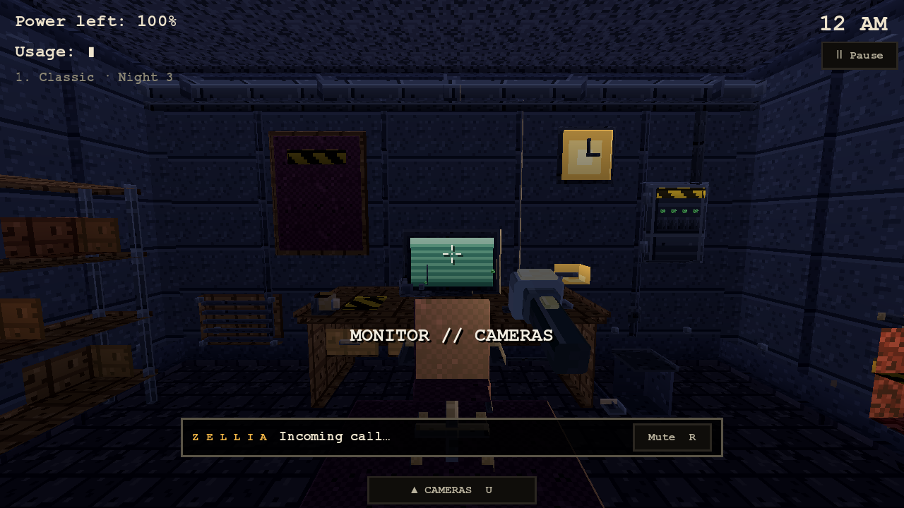
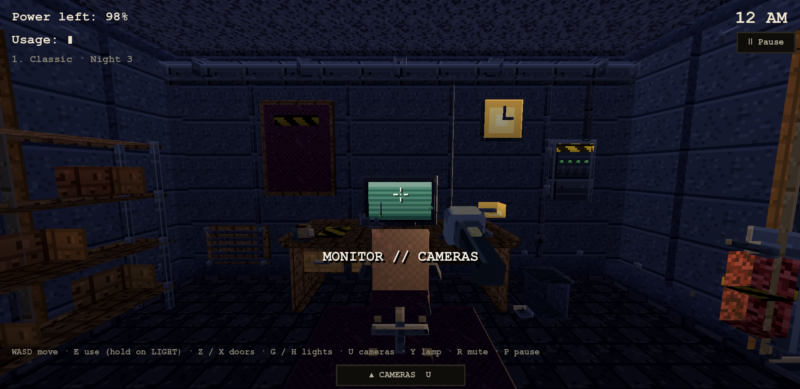
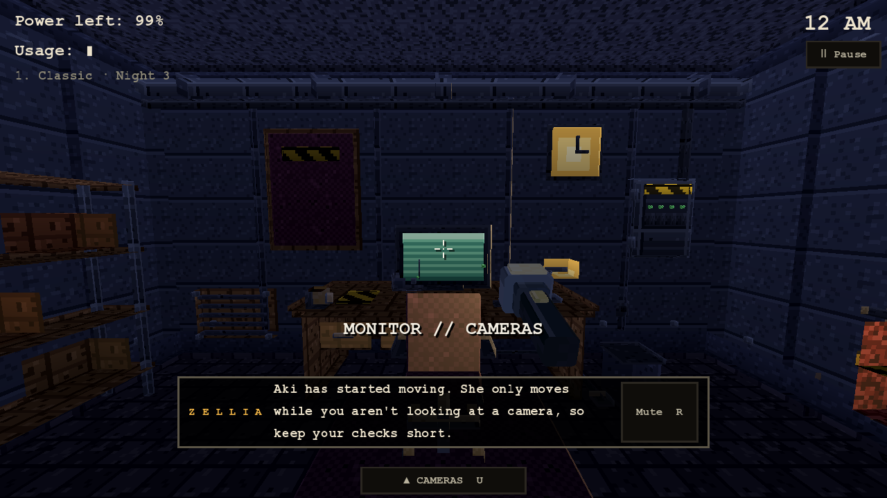
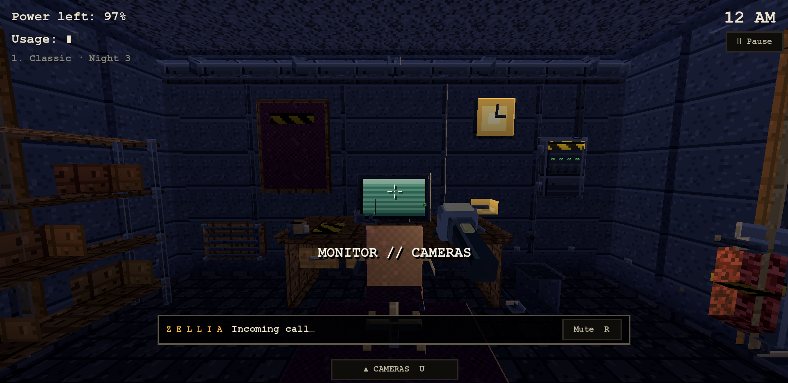

# Night Watch: Zellia's call and the shift HUD, 3D against the 2D game

Source of truth: `games/night-watch/src/core/callbox.js`, the `.ncall` rules in `styles.css`, `core/scene.js` (pause and end cards), each mode's
`*-data.js` `CALLS`, and the shift HUD in `index.html`. 2D screens were inspected in the built-in browser with the repo's preview server (as for the
menus, `docs/NIGHT_WATCH_MENUS.md`); the 2D page is text and layout notes here, the Godot side has captures.

## Zellia's call

* **Table:** `src/night_watch/night_watch_calls_data.gd` is the 2D `CALLS` of all eight modes, verbatim (108 lines; Classic nights 1-7 including Kathy's,
  Masked Hours, Dead Air, Bedtime, The Facility, The Descent, Salvage Run, Open Air; none for Mixed Shift or a Custom Night, as in 2D). It is generated from
  the 2D source by `tools/nightwatch/extract_2d_calls.mjs` into the golden file `scripts/data/night_watch_2d_calls.json`; suite `night_watch_calls` compares
  mode by mode, level by level, ring time and every line.
* **Behaviour:** `NightWatchCallScript` is `createCall` ported: rings `at` seconds into the night (the ring sound), "Incoming call…" for 2.2 s, each line typed
  a word every 250 ms with a talk blip on every second word, a line stays 1.8 s + 0.38 s per word, the box closes after the last line; Mute ends the call
  for the shift. The validator steps it at 50 ms and checks ring time, closing time, blip count, the three-words-at-750-ms moment and Mute.
* **Box:** centred, 60% wide, bottom at 10% of the height, black 78% fill, `#5a5446` border, amber letter-spaced ZELLIA, the typed text, a Mute button
  (the 2D key is N; here the shared radio key R). Checked at 480x270, 1280x720 and 1920x1080 for position and that it covers no HUD label.

| | 1280x720 | 1920x1080 |
|---|---|---|
| ringing |  |  |
| typed line |  |  |

Intentional differences: the 2D lines name the 2D keys (A / D doors, Q / E lights, Space cameras, K to meet Kathy); the 3D lines are the 2D text unchanged, so
those key names are stale in 3D (open question for KT: keep verbatim or swap the key names per game); the call sound is the shared `control` office cue,
not a synthesized blip; the key hint line is hidden while the call box is up (they share the bottom of the screen).

## Parity checklist (shift HUD)

| 2D element | 3D node | Status |
|---|---|---|
| Clock top right, `12 AM` format | `NightWatchHud.clock_label` | matched (position, format); the 2D font is a typewriter serif, the 3D theme font differs |
| `Power left: 100%` | `power_label` | matched wording |
| `Usage: ▮` bars (more bars per device) | `usage_label` | matched wording |
| `1. Classic · Night 1` mode line | `night_label` (set by `NightWatchMode`) | matched wording |
| Ⅱ Pause button (top right) | `pause_button` | matched (opens the same pause card) |
| `▲ CAMERAS SPACE` bar, bottom centre | `cameras_button` (`▲ CAMERAS  U`) | matched; the key is U (Space is the shared jump) |
| Key hint line `A / D doors · hold Q / E lights · Space cameras …` | `hint_label` | intentionally different keys (3D keys), same `·` format |
| Pause card `PAUSED` / `RESUME ESC` / `QUIT TO HUB BACKSPACE` | `NightWatchHud.pause_root` | matched (suite `night_watch_menus`) |
| Win card `6:00 AM` / `NIGHT n COMPLETE` / `Next night ENTER` / `Menu ESC` | `end_root` | matched wording and keys |
| Death card `CAUGHT`, line, `Retry ENTER` / `Menu ESC` | `end_root` | matched wording and keys; the death line comes from the shared `DeathLines` |
| Camera monitor frame: `● REC`, camera name and number, static on a switch, map | monitor panel in `NightWatchHud` | matched in content; layout is the 3D monitor's own (live 3D feed instead of a picture) |
| Door / light state indicators (panel lamps) | wall panels in `NightWatchOffice` | intentionally different: the indicators are on the 3D panels you walk to |
| Calm mode (no lamp flicker or glitching) | `Settings.reduced_motion` (flash_static skips) | matched for static; lamp flicker not yet gated |
| Scare Full / Short / Off | `NightWatchSave.scare()` | setting saved; Off does not yet skip the death moment (to do) |
| Shop / progress screens | none in Classic | n/a (Salvage Run's shop is its lane's) |

Not yet matched pixel-for-pixel: the typewriter font, the 2D scanline/dither overlay, and the 2D HUD's exact proportions for the usage bars. These are
cosmetic and listed so a later pass can take them one by one.
