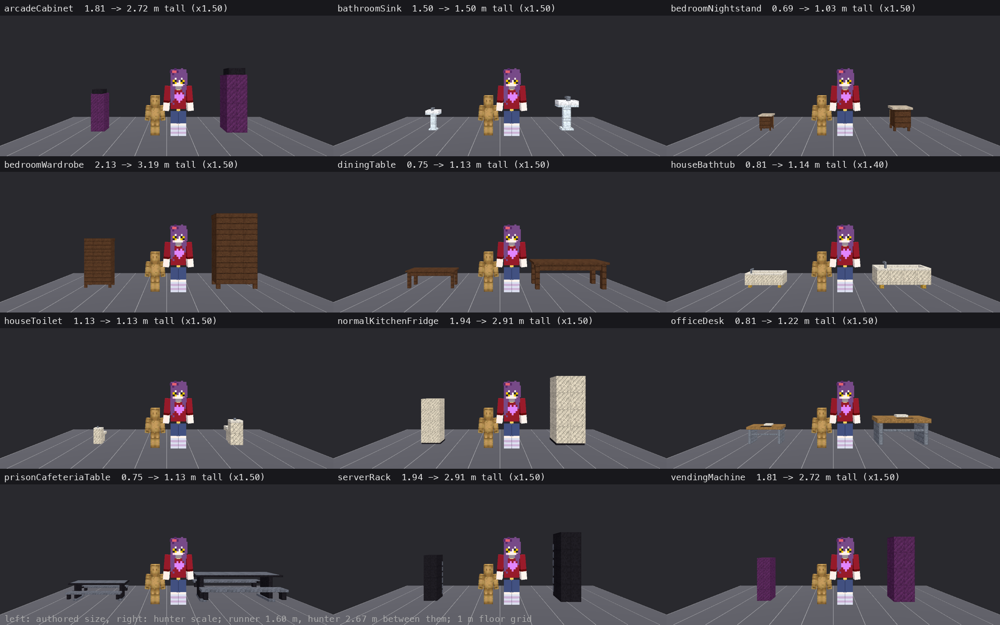

# Prop sizes (every catalog prop at hunter scale)

KT: "do a size check for all props". The world is built for a normal hunter (2.67 m; see
[SCALE_FIT.md](SCALE_FIT.md)), so a prop's real-world size is judged at 1.5x. Sizes are the spawned model's bounds
(x by height by z, metres), with `PropModelCatalog.HUNTER_SCALE` applied. Ranges come from
`data/scale/prop_size_ranges.json` (person range x 1.5). **fix** is the extra uniform scale on top of the current one.
Generated by `tools/props/prop_size_table.py` from `tools/props/dump_prop_sizes.tscn`.

Summary: 69 exempt, 274 ok.

The sheet comes from `tools/look/prop_size_sheet.tscn` and `tools/props/prop_size_sheet.py`. The toilet and the sink
were already at hunter scale (1dc73afb), which is why their captions show no change.

## What changed with the rescale

- **Every person-sized prop people use is now at 1.5x** (`PropModelCatalog.HUNTER_SCALE`): tables and desks,
  nightstands, wardrobes, bookcases, fridges, shelving, arcade and vending machines, carts and medical stands. Seven are
  scaled less, to land inside their range.
- **Finish copies:** the "...Mansion" copies spawn under their base type, so they already took the base's scale. Their
  own entries only keep the audits consistent.
- **Lockers stay person-sized:** you hide inside one and look out of its door slats at the runner's eye height
  (`keep_person_size` in the ranges file).
- **Things standing on furniture:** a lamp on a dresser or a computer on a desk rises with its parent's scale
  (`StreamedRouteGenerator.scale_surface_mounts`, `RoomCatalog.surface_height`).
- **Placement changes** for the bigger furniture:
  - Recipe props claim in order of their real (hunter-scale) footprint, so a table comes before its chairs.
  - A chair that hits its table slides back up to 1.2 m (`_nudge_seat_clear`).
  - The door-row rule now uses the side of the prop that actually faces the door. Before, a long table along the back
    wall counted as reaching the entrance, and every dining table was dropped.
  - Prison cafeterias: the serving counter and the tray return claim first, and the table rows are respaced.
  - Server halls leave a wider end aisle.
  - A lamp whose nightstand gave way to a bed goes with it.
- **Fewer props in small rooms:** a 5-deep prison wing (3x3 inside) holds the serving line and the tray return but no
  table.
- **Strict:** `scale_fit` measures every catalog prop against `data/scale/prop_size_ranges.json` and fails on any prop
  out of range or without a category. That includes props a mod pack adds through the DATA registry.

## Rescaled in this pass (103)

| prop | category | before (x, h, z) | after (x, h, z) | scale |
| --- | --- | --- | --- | --- |
| arcadeCabinet | arcade_vending | 0.63, 1.81, 0.75 | 0.94, 2.72, 1.13 | 1.50 |
| arcadeCabinetCyanMagenta | arcade_vending | 0.63, 1.81, 0.75 | 0.94, 2.72, 1.13 | 1.50 |
| arcadeTokenChanger | arcade_vending | 0.88, 1.88, 0.81 | 1.31, 2.81, 1.22 | 1.50 |
| autopsyTable | work_bench | 0.88, 0.94, 2.00 | 1.31, 1.41, 3.00 | 1.50 |
| backstageRepairStand | work_bench | 1.25, 1.13, 0.75 | 1.56, 1.41, 0.94 | 1.25 |
| bakeryRack | tall_storage | 1.00, 1.88, 0.56 | 1.50, 2.81, 0.84 | 1.50 |
| bathroomStall | stall | 0.75, 1.75, 0.63 | 1.13, 2.63, 0.94 | 1.50 |
| bathroomVanityMansion | vanity | 0.88, 1.69, 0.50 | 1.31, 2.53, 0.75 | 1.50 |
| bedroomBench | bench | 1.00, 0.50, 0.38 | 1.50, 0.75, 0.56 | 1.50 |
| bedroomBenchMansion | bench | 1.00, 0.50, 0.38 | 1.50, 0.75, 0.56 | 1.50 |
| bedroomDresserMansion | counter | 1.25, 1.06, 0.56 | 1.88, 1.59, 0.84 | 1.50 |
| bedroomNightstand | nightstand | 0.63, 0.69, 0.50 | 0.94, 1.03, 0.75 | 1.50 |
| bedroomNightstandMansion | nightstand | 0.63, 0.69, 0.50 | 0.94, 1.03, 0.75 | 1.50 |
| bedroomVanity | vanity | 1.00, 1.81, 0.50 | 1.50, 2.72, 0.75 | 1.50 |
| bedroomVanityMansion | vanity | 1.00, 1.81, 0.50 | 1.50, 2.72, 0.75 | 1.50 |
| bedroomWardrobe | tall_storage | 1.25, 2.13, 0.63 | 1.88, 3.19, 0.94 | 1.50 |
| bedroomWardrobeMansion | tall_storage | 1.25, 2.13, 0.63 | 1.88, 3.19, 0.94 | 1.50 |
| breakerCabinet | tall_storage | 0.88, 1.63, 0.69 | 1.31, 2.44, 1.03 | 1.50 |
| cinemaSeats | seat | 2.38, 1.01, 0.79 | 3.56, 1.51, 1.19 | 1.50 |
| circusPedestal | game_table | 1.63, 0.75, 1.63 | 2.44, 1.13, 2.44 | 1.50 |
| coldStorageUnit | tall_storage | 1.38, 2.13, 0.88 | 2.06, 3.19, 1.31 | 1.50 |
| diningChairCushionMansion | seat_cushioned | 0.50, 0.94, 0.44 | 0.75, 1.41, 0.66 | 1.50 |
| diningChairMansion | seat | 0.50, 0.94, 0.44 | 0.75, 1.41, 0.66 | 1.50 |
| diningSideboardMansion | counter | 1.50, 1.06, 0.69 | 2.25, 1.59, 1.03 | 1.50 |
| diningTable | table | 2.25, 0.75, 0.88 | 3.38, 1.13, 1.31 | 1.50 |
| diningTableMansion | table | 2.25, 0.75, 0.88 | 3.38, 1.13, 1.31 | 1.50 |
| diveHeadsetShelf | low_storage | 1.88, 0.38, 0.38 | 2.81, 0.56, 0.56 | 1.50 |
| donutFryer | counter | 1.25, 1.25, 0.75 | 1.56, 1.56, 0.94 | 1.25 |
| doubleBedMansion | bed | 1.88, 1.06, 2.25 | 2.81, 1.59, 3.38 | 1.50 |
| dryerStack | tall_storage | 0.75, 2.06, 0.75 | 1.13, 3.09, 1.13 | 1.50 |
| duckPond | game_table | 1.63, 0.75, 1.63 | 2.44, 1.13, 2.44 | 1.50 |
| floorLampMansion | floor_lamp | 0.38, 1.75, 0.38 | 0.56, 2.63, 0.56 | 1.50 |
| foodCourtTable | table | 1.75, 0.81, 1.75 | 2.63, 1.22, 2.63 | 1.50 |
| fumeHood | tall_storage | 1.50, 2.38, 0.88 | 1.80, 2.85, 1.05 | 1.20 |
| gardenPlanterBench | work_bench | 2.13, 0.88, 1.50 | 3.19, 1.31, 2.25 | 1.50 |
| gothicDresser | counter | 1.38, 1.13, 0.63 | 2.06, 1.69, 0.94 | 1.50 |
| gothicKitchenCounter | counter | 1.50, 1.00, 0.69 | 2.25, 1.50, 1.03 | 1.50 |
| gothicKitchenFridge | tall_storage | 0.88, 1.94, 0.81 | 1.31, 2.91, 1.22 | 1.50 |
| gothicKitchenIsland | counter | 1.63, 0.94, 0.88 | 2.44, 1.41, 1.31 | 1.50 |
| gothicKitchenSink | sink | 1.25, 1.13, 0.69 | 1.88, 1.69, 1.03 | 1.50 |
| gothicKitchenStove | counter | 0.88, 0.94, 0.69 | 1.31, 1.41, 1.03 | 1.50 |
| gothicPedestalTable | table | 0.75, 0.75, 0.75 | 1.13, 1.13, 1.13 | 1.50 |
| gothicPedestalTableMansion | table | 0.75, 0.75, 0.75 | 1.13, 1.13, 1.13 | 1.50 |
| gothicVanityStool | stool | 0.38, 0.44, 0.38 | 0.56, 0.66, 0.56 | 1.50 |
| gothicWritingDesk | table | 1.38, 0.88, 0.63 | 2.06, 1.31, 0.94 | 1.50 |
| houseBathtub | bath | 1.75, 0.81, 0.75 | 2.45, 1.14, 1.05 | 1.40 |
| instrumentTrolley | cart | 0.88, 1.00, 0.50 | 1.31, 1.50, 0.75 | 1.50 |
| ivDripStand | medical_stand | 0.38, 1.88, 0.38 | 0.56, 2.81, 0.56 | 1.50 |
| ivStand | medical_stand | 0.50, 1.81, 0.50 | 0.75, 2.72, 0.75 | 1.50 |
| labCoolingUnit | tall_storage | 1.00, 2.13, 0.88 | 1.50, 3.19, 1.31 | 1.50 |
| lavaPipeManifold | machine | 1.25, 1.13, 0.56 | 1.88, 1.69, 0.84 | 1.50 |
| loungeCouchMansion | couch | 1.75, 0.88, 0.94 | 2.63, 1.33, 1.41 | 1.50 |
| loungeCouchWideMansion | couch | 2.44, 0.89, 1.00 | 3.66, 1.33, 1.50 | 1.50 |
| luxuryKitchenFridge | tall_storage | 0.88, 1.94, 0.81 | 1.31, 2.91, 1.22 | 1.50 |
| maintenanceToolCabinet | tall_storage | 0.88, 1.63, 0.69 | 1.31, 2.44, 1.03 | 1.50 |
| mansionBookshelf | tall_storage | 0.88, 2.06, 0.63 | 1.31, 3.09, 0.94 | 1.50 |
| mansionBookshelfMansion | tall_storage | 0.88, 2.06, 0.63 | 1.31, 3.09, 0.94 | 1.50 |
| mansionChaiseLounge | couch | 1.75, 1.06, 0.75 | 2.63, 1.59, 1.13 | 1.50 |
| mansionChaiseLoungeMansion | couch | 1.75, 1.06, 0.75 | 2.63, 1.59, 1.13 | 1.50 |
| mansionCoatRack | tall_storage | 0.50, 1.81, 0.50 | 0.75, 2.72, 0.75 | 1.50 |
| mansionConsoleTable | table | 1.25, 0.88, 0.44 | 1.88, 1.31, 0.66 | 1.50 |
| mansionConsoleTableMansion | table | 1.25, 0.88, 0.44 | 1.88, 1.31, 0.66 | 1.50 |
| mansionDisplayCabinet | tall_storage | 1.25, 2.25, 0.44 | 1.56, 2.81, 0.55 | 1.25 |
| mansionDisplayCabinetMansion | tall_storage | 1.25, 2.25, 0.44 | 1.56, 2.81, 0.55 | 1.25 |
| mansionGrandfatherClock | tall_storage | 0.75, 2.06, 0.50 | 1.13, 3.09, 0.75 | 1.50 |
| mansionRockingChair | seat | 0.50, 1.00, 0.88 | 0.75, 1.50, 1.33 | 1.50 |
| mansionTeaCart | cart | 1.13, 1.06, 0.56 | 1.69, 1.59, 0.84 | 1.50 |
| mansionTeaCartMansion | cart | 1.13, 1.06, 0.56 | 1.69, 1.59, 0.84 | 1.50 |
| medicalCart | cart | 0.75, 1.00, 0.50 | 1.13, 1.50, 0.75 | 1.50 |
| medicalSupplyRack | tall_storage | 1.25, 1.88, 0.56 | 1.88, 2.81, 0.84 | 1.50 |
| morgueCabinet | tall_storage | 2.00, 2.13, 1.00 | 3.00, 3.19, 1.50 | 1.50 |
| normalBookcase | tall_storage | 1.00, 1.81, 0.44 | 1.50, 2.72, 0.66 | 1.50 |
| normalBookcaseMansion | tall_storage | 1.00, 1.81, 0.44 | 1.50, 2.72, 0.66 | 1.50 |
| normalCoffeeTableMansion | coffee_table | 1.25, 0.50, 0.75 | 1.88, 0.75, 1.13 | 1.50 |
| normalEntryBench | bench | 1.25, 0.94, 0.44 | 1.88, 1.41, 0.66 | 1.50 |
| normalKitchenFridge | tall_storage | 0.88, 1.94, 0.81 | 1.31, 2.91, 1.22 | 1.50 |
| officeCornerWorkstation | table | 1.88, 0.88, 1.44 | 2.81, 1.31, 2.16 | 1.50 |
| officeDesk | table | 1.63, 0.81, 0.75 | 2.44, 1.22, 1.13 | 1.50 |
| officePhotocopier | appliance | 1.00, 1.13, 0.94 | 1.50, 1.69, 1.41 | 1.50 |
| operatingTable | work_bench | 0.75, 1.00, 1.94 | 1.13, 1.50, 2.91 | 1.50 |
| pharmacyShelf | tall_storage | 1.63, 2.00, 0.50 | 2.44, 3.00, 0.75 | 1.50 |
| prisonCafeteriaTable | table | 2.63, 0.75, 1.75 | 3.94, 1.13, 2.63 | 1.50 |
| prisonKitchenRack | tall_storage | 1.38, 1.81, 0.63 | 2.06, 2.72, 0.94 | 1.50 |
| prizeClawMachine | arcade_vending | 0.88, 1.88, 0.81 | 1.31, 2.81, 1.22 | 1.50 |
| readingTable | table | 1.50, 0.75, 0.88 | 2.25, 1.13, 1.31 | 1.50 |
| seedlingRack | tall_storage | 1.25, 1.94, 0.50 | 1.88, 2.91, 0.75 | 1.50 |
| serverRack | tall_storage | 0.63, 1.94, 0.81 | 0.94, 2.91, 1.22 | 1.50 |
| shopFridge | tall_storage | 1.00, 2.13, 0.75 | 1.50, 3.19, 1.13 | 1.50 |
| shopShelf | tall_storage | 1.25, 1.88, 0.50 | 1.88, 2.81, 0.75 | 1.50 |
| singleBedMansion | bed | 1.13, 1.06, 2.25 | 1.69, 1.59, 3.38 | 1.50 |
| storageShelving | tall_storage | 1.25, 1.94, 0.50 | 1.88, 2.91, 0.75 | 1.50 |
| utilityCart | cart | 1.25, 1.13, 0.75 | 1.56, 1.41, 0.94 | 1.25 |
| vanityStool | stool | 0.38, 0.44, 0.38 | 0.56, 0.66, 0.56 | 1.50 |
| vanityStoolMansion | stool | 0.38, 0.44, 0.38 | 0.56, 0.66, 0.56 | 1.50 |
| vendingMachine | arcade_vending | 0.63, 1.81, 0.81 | 0.94, 2.72, 1.22 | 1.50 |
| vitalsMonitor | medical_stand | 0.50, 1.63, 0.50 | 0.75, 2.44, 0.75 | 1.50 |
| washingMachine | appliance | 0.75, 1.13, 0.75 | 1.13, 1.69, 1.13 | 1.50 |
| wateringCart | cart | 1.00, 0.94, 0.56 | 1.50, 1.41, 0.84 | 1.50 |
| woodenChairCushionMansion | seat_cushioned | 0.50, 0.94, 0.50 | 0.75, 1.41, 0.75 | 1.50 |
| woodenChairMansion | seat | 0.50, 0.94, 0.50 | 0.75, 1.41, 0.75 | 1.50 |
| woodenDresserSideboardMansion | counter | 1.25, 0.94, 0.63 | 1.88, 1.41, 0.94 | 1.50 |
| woodenTable | table | 1.25, 0.75, 0.75 | 1.88, 1.13, 1.13 | 1.50 |
| woodenTableMansion | table | 1.25, 0.75, 0.75 | 1.88, 1.13, 1.13 | 1.50 |

## Out of range

| prop | category | size now (x, h, z) | scale now | out of range (wants) | fix |
| --- | --- | --- | --- | --- | --- |

## Uncategorised

None.

## In range or exempt

| prop | category | size (x, h, z) | scale | status |
| --- | --- | --- | --- | --- |
| apartmentCarpet | flat | 2.00, 0.06, 1.50 | 1.00 | exempt: floor dressing: rugs, carpets and mats only need a footprint |
| arcadeBasketballHoop | booth_stall | 1.13, 2.06, 1.75 | 1.00 | ok |
| arcadeCabinet | arcade_vending | 0.94, 2.72, 1.13 | 1.50 | ok |
| arcadeCabinetCyanMagenta | arcade_vending | 0.94, 2.72, 1.13 | 1.50 | ok |
| arcadeCarpetCircle | flat | 1.88, 0.06, 1.88 | 1.00 | exempt: floor dressing: rugs, carpets and mats only need a footprint |
| arcadeCarpetRunner | flat | 1.13, 0.06, 3.25 | 1.00 | exempt: floor dressing: rugs, carpets and mats only need a footprint |
| arcadeTokenChanger | arcade_vending | 1.31, 2.81, 1.22 | 1.50 | ok |
| autopsyTable | work_bench | 1.31, 1.41, 3.00 | 1.50 | ok |
| backstageRepairStand | work_bench | 1.56, 1.41, 0.94 | 1.25 | ok |
| bakeryRack | tall_storage | 1.50, 2.81, 0.84 | 1.50 | ok |
| bananaPlant | plant | 1.10, 1.81, 0.94 | 1.00 | ok |
| barberChair | seat | 1.13, 1.85, 1.53 | 1.50 | ok |
| barberStation | stand_decor | 1.25, 1.88, 0.50 | 1.00 | ok |
| basaltPillar | architecture | 0.50, 1.88, 0.50 | 1.00 | exempt: sized to the level geometry (doors, stairs, ladders, gates, sewer works, columns) |
| basaltRubble | set_piece | 1.13, 0.38, 1.13 | 1.00 | exempt: room-scale set pieces and landscape (rides, pools, stages, screens, trees) |
| bathroomMirror | stand_decor | 0.75, 1.19, 0.19 | 1.00 | ok |
| bathroomSink | sink | 0.94, 1.50, 0.56 | 1.50 | ok |
| bathroomStall | stall | 1.13, 2.63, 0.94 | 1.50 | ok |
| bathroomVanity | vanity | 1.31, 2.53, 0.75 | 1.50 | ok |
| bathroomVanityMansion | vanity | 1.31, 2.53, 0.75 | 1.50 | ok |
| beachChair | seat | 0.94, 1.13, 1.49 | 1.50 | ok |
| beachMat | flat | 1.38, 0.06, 0.88 | 1.00 | exempt: floor dressing: rugs, carpets and mats only need a footprint |
| beachUmbrella | stand_decor | 1.88, 2.63, 1.88 | 1.00 | ok |
| bedroomBench | bench | 1.50, 0.75, 0.56 | 1.50 | ok |
| bedroomBenchMansion | bench | 1.50, 0.75, 0.56 | 1.50 | ok |
| bedroomDresser | counter | 1.88, 1.59, 0.84 | 1.50 | ok |
| bedroomDresserMansion | counter | 1.88, 1.59, 0.84 | 1.50 | ok |
| bedroomNightstand | nightstand | 0.94, 1.03, 0.75 | 1.50 | ok |
| bedroomNightstandMansion | nightstand | 0.94, 1.03, 0.75 | 1.50 | ok |
| bedroomRug | flat | 1.75, 0.06, 1.13 | 1.00 | exempt: floor dressing: rugs, carpets and mats only need a footprint |
| bedroomRugMansion | flat | 1.75, 0.06, 1.13 | 1.00 | exempt: floor dressing: rugs, carpets and mats only need a footprint |
| bedroomVanity | vanity | 1.50, 2.72, 0.75 | 1.50 | ok |
| bedroomVanityMansion | vanity | 1.50, 2.72, 0.75 | 1.50 | ok |
| bedroomWallClock | wall_sign | 0.38, 0.81, 0.13 | 1.00 | ok |
| bedroomWardrobe | tall_storage | 1.88, 3.19, 0.94 | 1.50 | ok |
| bedroomWardrobeMansion | tall_storage | 1.88, 3.19, 0.94 | 1.50 | ok |
| bedsideLamp | surface_item | 0.25, 0.69, 0.25 | 1.00 | ok |
| biohazardBin | container | 0.50, 0.88, 0.50 | 1.00 | ok |
| breakerCabinet | tall_storage | 1.31, 2.44, 1.03 | 1.50 | ok |
| brokenAquarium | machine | 1.38, 1.63, 0.75 | 1.00 | ok |
| bunkBed | bed | 1.50, 2.81, 3.00 | 1.50 | ok |
| cactusCluster | set_piece | 1.00, 1.00, 1.00 | 1.00 | exempt: room-scale set pieces and landscape (rides, pools, stages, screens, trees) |
| carnivalCarousel | set_piece | 4.50, 3.63, 4.50 | 1.00 | exempt: room-scale set pieces and landscape (rides, pools, stages, screens, trees) |
| carnivalTicketBooth | booth_stall | 1.75, 2.31, 1.25 | 1.00 | ok |
| carouselCenterpiece | set_piece | 5.50, 6.44, 5.50 | 1.00 | exempt: room-scale set pieces and landscape (rides, pools, stages, screens, trees) |
| ceilingFan | light_fixture | 1.88, 0.31, 2.00 | 1.00 | exempt: ceiling and wall light fittings hang from the room, not sized to a person |
| ceilingLight | light_fixture | 0.63, 0.31, 0.63 | 1.00 | exempt: ceiling and wall light fittings hang from the room, not sized to a person |
| charredSupplyCrate | container | 0.75, 0.63, 0.69 | 1.00 | ok |
| checkoutCounter | counter_with_top | 2.63, 1.97, 1.13 | 1.50 | ok |
| cinemaScreen | set_piece | 4.25, 2.19, 0.13 | 1.00 | exempt: room-scale set pieces and landscape (rides, pools, stages, screens, trees) |
| cinemaSeats | seat | 3.56, 1.51, 1.19 | 1.50 | ok |
| circusPedestal | game_table | 2.44, 1.13, 2.44 | 1.50 | ok |
| clothesRack | clothes_rack | 2.25, 2.44, 0.56 | 1.50 | ok |
| coffeeStation | counter | 1.25, 1.56, 0.63 | 1.00 | ok |
| coldStorageUnit | tall_storage | 2.06, 3.19, 1.31 | 1.50 | ok |
| compostBins | container | 1.38, 1.00, 0.75 | 1.00 | ok |
| concessionCounter | counter_with_top | 3.38, 2.53, 1.13 | 1.50 | ok |
| containmentCell | architecture | 2.25, 2.63, 1.75 | 1.00 | exempt: sized to the level geometry (doors, stairs, ladders, gates, sewer works, columns) |
| controlConsole | machine | 2.38, 1.38, 1.00 | 1.00 | ok |
| corridorCarpet | flat | 2.38, 0.06, 3.38 | 1.00 | exempt: floor dressing: rugs, carpets and mats only need a footprint |
| deconShower | shower | 1.97, 3.75, 1.97 | 1.50 | ok |
| dinerBooth | couch | 2.44, 1.69, 2.25 | 1.50 | ok |
| dinerStool | stool | 0.56, 1.22, 0.56 | 1.50 | ok |
| diningChair | seat | 0.75, 1.41, 0.66 | 1.50 | ok |
| diningChairCushion | seat_cushioned | 0.75, 1.41, 0.66 | 1.50 | ok |
| diningChairCushionMansion | seat_cushioned | 0.75, 1.41, 0.66 | 1.50 | ok |
| diningChairMansion | seat | 0.75, 1.41, 0.66 | 1.50 | ok |
| diningChandelier | light_fixture | 0.75, 0.56, 0.75 | 1.00 | exempt: ceiling and wall light fittings hang from the room, not sized to a person |
| diningChandelierMansion | light_fixture | 0.75, 0.56, 0.75 | 1.00 | exempt: ceiling and wall light fittings hang from the room, not sized to a person |
| diningSideboard | counter | 2.25, 1.59, 1.03 | 1.50 | ok |
| diningSideboardMansion | counter | 2.25, 1.59, 1.03 | 1.50 | ok |
| diningTable | table | 3.38, 1.13, 1.31 | 1.50 | ok |
| diningTableMansion | table | 3.38, 1.13, 1.31 | 1.50 | ok |
| displayCase | machine | 1.44, 1.25, 0.75 | 1.00 | ok |
| diveConsole | machine | 2.00, 1.25, 0.75 | 1.00 | ok |
| diveHeadsetShelf | low_storage | 2.81, 0.56, 0.56 | 1.50 | ok |
| diveHeadsetStand | stand_decor | 0.25, 1.19, 0.25 | 1.00 | ok |
| divePod | machine | 0.88, 1.78, 2.19 | 1.00 | ok |
| divePodFilm | machine | 0.88, 1.78, 2.19 | 1.00 | ok |
| divePodLit | machine | 0.88, 1.78, 2.19 | 1.00 | ok |
| domeFountain | set_piece | 2.50, 1.63, 2.50 | 1.00 | exempt: room-scale set pieces and landscape (rides, pools, stages, screens, trees) |
| donutFryer | counter | 1.56, 1.56, 0.94 | 1.25 | ok |
| donutSign | wall_sign | 1.25, 1.25, 0.31 | 1.00 | ok |
| doubleBed | bed | 2.81, 1.97, 3.38 | 1.50 | ok |
| doubleBedMansion | bed | 2.81, 1.59, 3.38 | 1.50 | ok |
| dryerStack | tall_storage | 1.13, 3.09, 1.13 | 1.50 | ok |
| duckPond | game_table | 2.44, 1.13, 2.44 | 1.50 | ok |
| dungeonCage | architecture | 2.50, 2.50, 2.56 | 1.00 | exempt: sized to the level geometry (doors, stairs, ladders, gates, sewer works, columns) |
| emberBrazier | stand_decor | 0.50, 0.88, 0.50 | 1.00 | ok |
| filingCabinet | low_storage | 0.94, 1.88, 1.03 | 1.50 | ok |
| floorLamp | floor_lamp | 0.56, 2.63, 0.56 | 1.50 | ok |
| floorLampMansion | floor_lamp | 0.56, 2.63, 0.56 | 1.50 | ok |
| flowerBlue | plant | 0.38, 0.75, 0.38 | 1.00 | ok |
| flowerCenterpiece | surface_item | 0.38, 0.94, 0.25 | 1.00 | ok |
| flowerRose | plant | 0.38, 0.75, 0.38 | 1.00 | ok |
| flowerStand | plant | 1.25, 1.19, 0.63 | 1.00 | ok |
| flowerSun | plant | 0.38, 0.75, 0.38 | 1.00 | ok |
| flowerViolet | plant | 0.38, 0.75, 0.38 | 1.00 | ok |
| foodCourtTable | table | 2.63, 1.22, 2.63 | 1.50 | ok |
| framedWallPortrait | wall_sign | 0.88, 1.19, 0.19 | 1.00 | ok |
| frozenBeachHut | set_piece | 2.13, 2.81, 1.81 | 1.00 | exempt: room-scale set pieces and landscape (rides, pools, stages, screens, trees) |
| frozenTidelinePool | set_piece | 6.50, 0.25, 5.25 | 1.00 | exempt: room-scale set pieces and landscape (rides, pools, stages, screens, trees) |
| fumeHood | tall_storage | 1.80, 2.85, 1.05 | 1.20 | ok |
| gardenPlanterBench | work_bench | 3.19, 1.31, 2.25 | 1.50 | ok |
| gasCylinderRack | tall_storage | 1.50, 2.44, 0.75 | 1.50 | ok |
| giantTree | set_piece | 2.38, 3.94, 2.25 | 1.00 | exempt: room-scale set pieces and landscape (rides, pools, stages, screens, trees) |
| gothicBedroomBench | bench | 1.69, 0.75, 0.56 | 1.50 | ok |
| gothicBedroomRug | flat | 2.25, 0.06, 1.38 | 1.00 | exempt: floor dressing: rugs, carpets and mats only need a footprint |
| gothicBedsideCandelabra | surface_item | 0.38, 0.81, 0.13 | 1.00 | ok |
| gothicBookcase | tall_storage | 1.38, 2.44, 0.50 | 1.00 | ok |
| gothicCoffinChest | container | 1.00, 0.63, 0.56 | 1.00 | ok |
| gothicDoubleBed | bed | 2.96, 3.52, 3.42 | 1.48 | ok |
| gothicDoubleRoomDoor | architecture | 2.27, 2.88, 1.06 | 1.00 | exempt: sized to the level geometry (doors, stairs, ladders, gates, sewer works, columns) |
| gothicDresser | counter | 2.06, 1.69, 0.94 | 1.50 | ok |
| gothicFloorCandelabra | floor_lamp | 1.13, 2.72, 0.56 | 1.50 | ok |
| gothicHighbackChair | seat | 0.75, 1.97, 0.93 | 1.50 | ok |
| gothicKitchenCounter | counter | 2.25, 1.50, 1.03 | 1.50 | ok |
| gothicKitchenFridge | tall_storage | 1.31, 2.91, 1.22 | 1.50 | ok |
| gothicKitchenIsland | counter | 2.44, 1.41, 1.31 | 1.50 | ok |
| gothicKitchenSink | sink | 1.88, 1.69, 1.03 | 1.50 | ok |
| gothicKitchenStove | counter | 1.31, 1.41, 1.03 | 1.50 | ok |
| gothicKitchenWallCabinet | low_storage | 1.25, 0.88, 0.44 | 1.00 | ok |
| gothicNightstand | nightstand | 0.63, 0.81, 0.56 | 1.00 | ok |
| gothicPaintingFrameEmpty | wall_sign | 1.25, 1.88, 0.13 | 1.00 | ok |
| gothicPedestalTable | table | 1.13, 1.13, 1.13 | 1.50 | ok |
| gothicPedestalTableMansion | table | 1.13, 1.13, 1.13 | 1.50 | ok |
| gothicPictureFrameEmpty | wall_sign | 0.75, 1.06, 0.13 | 1.00 | ok |
| gothicRoomDoor | architecture | 1.25, 2.88, 1.01 | 1.00 | exempt: sized to the level geometry (doors, stairs, ladders, gates, sewer works, columns) |
| gothicVanity | vanity | 1.13, 2.13, 0.50 | 1.00 | ok |
| gothicVanityStool | stool | 0.56, 0.66, 0.56 | 1.50 | ok |
| gothicWardrobe | tall_storage | 1.38, 2.50, 0.75 | 1.00 | ok |
| gothicWritingDesk | table | 2.06, 1.31, 0.94 | 1.50 | ok |
| grandFoyerStaircase | architecture | 4.80, 2.82, 5.44 | 1.00 | exempt: sized to the level geometry (doors, stairs, ladders, gates, sewer works, columns) |
| grandStaircase | architecture | 1.80, 2.03, 5.02 | 1.00 | exempt: sized to the level geometry (doors, stairs, ladders, gates, sewer works, columns) |
| grassFern | set_piece | 0.88, 0.19, 0.75 | 1.00 | exempt: room-scale set pieces and landscape (rides, pools, stages, screens, trees) |
| greenhouseBench | bench | 2.44, 1.31, 0.87 | 1.50 | ok |
| hangingVines | light_fixture | 0.63, 1.25, 0.63 | 1.00 | exempt: ceiling and wall light fittings hang from the room, not sized to a person |
| hazardSign | wall_sign | 0.63, 0.63, 0.06 | 1.00 | ok |
| heavyMansionDrapes | architecture | 1.50, 2.06, 0.13 | 1.00 | exempt: sized to the level geometry (doors, stairs, ladders, gates, sewer works, columns) |
| hospitalBed | bed | 1.50, 1.59, 3.19 | 1.50 | ok |
| hospitalCurtain | architecture | 2.00, 2.38, 0.13 | 1.00 | exempt: sized to the level geometry (doors, stairs, ladders, gates, sewer works, columns) |
| hospitalWardSign | wall_sign | 1.00, 0.38, 0.06 | 1.00 | ok |
| hotelCarpet | flat | 2.25, 0.06, 1.38 | 1.00 | exempt: floor dressing: rugs, carpets and mats only need a footprint |
| houseBathMat | flat | 0.88, 0.06, 0.63 | 1.00 | exempt: floor dressing: rugs, carpets and mats only need a footprint |
| houseBathroomShelf | low_storage | 0.88, 1.00, 0.25 | 1.00 | ok |
| houseBathtub | bath | 2.45, 1.14, 1.05 | 1.40 | ok |
| houseMedicineCabinet | low_storage | 0.75, 0.81, 0.31 | 1.00 | ok |
| houseShowerEnclosure | shower | 1.50, 3.28, 1.50 | 1.50 | ok |
| houseToilet | toilet | 0.56, 1.13, 1.03 | 1.50 | ok |
| houseTowelRack | low_storage | 0.88, 0.50, 0.19 | 1.00 | ok |
| infernoAltar | stand_decor | 1.25, 1.31, 0.88 | 1.00 | ok |
| infernoChainLantern | light_fixture | 0.25, 1.31, 0.25 | 1.00 | exempt: ceiling and wall light fittings hang from the room, not sized to a person |
| instrumentTrolley | cart | 1.31, 1.50, 0.75 | 1.50 | ok |
| irrigationManifold | machine | 1.44, 1.75, 0.56 | 1.00 | ok |
| ivDripStand | medical_stand | 0.56, 2.81, 0.56 | 1.50 | ok |
| ivStand | medical_stand | 0.75, 2.72, 0.75 | 1.50 | ok |
| labBench | work_bench | 2.00, 1.44, 0.75 | 1.00 | ok |
| labCoolingUnit | tall_storage | 1.50, 3.19, 1.31 | 1.50 | ok |
| labGlassPartition | architecture | 2.00, 2.50, 0.13 | 1.00 | exempt: sized to the level geometry (doors, stairs, ladders, gates, sewer works, columns) |
| labMicroscope | surface_item | 0.25, 0.45, 0.31 | 1.00 | ok |
| labStool | stool | 0.56, 1.13, 0.56 | 1.50 | ok |
| labWhiteboard | wall_sign | 1.75, 1.13, 0.13 | 1.00 | ok |
| laundryHamper | container | 0.50, 0.81, 0.50 | 1.00 | ok |
| lavaPipeManifold | machine | 1.88, 1.69, 0.84 | 1.50 | ok |
| lavaVent | set_piece | 0.63, 0.38, 0.63 | 1.00 | exempt: room-scale set pieces and landscape (rides, pools, stages, screens, trees) |
| libraryGlobe | stand_decor | 0.63, 1.00, 0.50 | 1.00 | ok |
| locker | kept | 0.63, 2.00, 0.69 | 1.00 | exempt: kept person-sized: you hide inside it and look out of its door slats at the runner's 1.44 m eye height |
| loungeCouch | couch | 2.63, 1.33, 1.41 | 1.50 | ok |
| loungeCouchMansion | couch | 2.63, 1.33, 1.41 | 1.50 | ok |
| loungeCouchWide | couch | 3.66, 1.33, 1.50 | 1.50 | ok |
| loungeCouchWideMansion | couch | 3.66, 1.33, 1.50 | 1.50 | ok |
| luxuryDoubleRoomDoor | architecture | 2.27, 2.75, 1.06 | 1.00 | exempt: sized to the level geometry (doors, stairs, ladders, gates, sewer works, columns) |
| luxuryKitchenCounter | counter | 2.25, 1.50, 1.03 | 1.50 | ok |
| luxuryKitchenFridge | tall_storage | 1.31, 2.91, 1.22 | 1.50 | ok |
| luxuryKitchenIsland | counter | 2.44, 1.50, 1.31 | 1.50 | ok |
| luxuryKitchenSink | sink | 1.88, 1.69, 1.03 | 1.50 | ok |
| luxuryKitchenStove | counter | 1.31, 1.41, 1.03 | 1.50 | ok |
| luxuryKitchenWallCabinet | low_storage | 1.25, 0.88, 0.44 | 1.00 | ok |
| luxuryPaintingFrameEmpty | wall_sign | 1.50, 1.69, 0.19 | 1.00 | ok |
| luxuryPictureFrameEmpty | wall_sign | 1.00, 1.06, 0.19 | 1.00 | ok |
| luxuryRoomDoor | architecture | 1.25, 2.75, 1.01 | 1.00 | exempt: sized to the level geometry (doors, stairs, ladders, gates, sewer works, columns) |
| magazineRack | low_storage | 0.63, 1.06, 0.50 | 1.00 | ok |
| magmaCrystalCluster | set_piece | 0.50, 1.06, 0.50 | 1.00 | exempt: room-scale set pieces and landscape (rides, pools, stages, screens, trees) |
| maintenanceCleaningCart | stand_decor | 1.25, 1.81, 0.75 | 1.00 | ok |
| maintenanceToolCabinet | tall_storage | 1.31, 2.44, 1.03 | 1.50 | ok |
| mallBench | bench | 2.63, 0.84, 0.94 | 1.50 | ok |
| mallPlanter | plant | 1.25, 2.38, 1.25 | 1.00 | ok |
| mansionAreaRug | flat | 2.63, 0.06, 1.63 | 1.00 | exempt: floor dressing: rugs, carpets and mats only need a footprint |
| mansionAreaRugMansion | flat | 2.63, 0.06, 1.63 | 1.00 | exempt: floor dressing: rugs, carpets and mats only need a footprint |
| mansionBookshelf | tall_storage | 1.31, 3.09, 0.94 | 1.50 | ok |
| mansionBookshelfMansion | tall_storage | 1.31, 3.09, 0.94 | 1.50 | ok |
| mansionBustPedestal | stand_decor | 0.50, 2.00, 0.50 | 1.00 | ok |
| mansionChaiseLounge | couch | 2.63, 1.59, 1.13 | 1.50 | ok |
| mansionChaiseLoungeMansion | couch | 2.63, 1.59, 1.13 | 1.50 | ok |
| mansionCoatRack | tall_storage | 0.75, 2.72, 0.75 | 1.50 | ok |
| mansionConsoleTable | table | 1.88, 1.31, 0.66 | 1.50 | ok |
| mansionConsoleTableMansion | table | 1.88, 1.31, 0.66 | 1.50 | ok |
| mansionDisplayCabinet | tall_storage | 1.56, 2.81, 0.55 | 1.25 | ok |
| mansionDisplayCabinetMansion | tall_storage | 1.56, 2.81, 0.55 | 1.25 | ok |
| mansionFireplace | machine | 1.00, 1.50, 0.69 | 1.00 | ok |
| mansionGrandfatherClock | tall_storage | 1.13, 3.09, 0.75 | 1.50 | ok |
| mansionMarbleColumn | architecture | 0.50, 2.25, 0.50 | 1.00 | exempt: sized to the level geometry (doors, stairs, ladders, gates, sewer works, columns) |
| mansionPorcelainVase | stand_decor | 0.38, 0.94, 0.50 | 1.00 | ok |
| mansionRockingChair | seat | 0.75, 1.50, 1.33 | 1.50 | ok |
| mansionRoomDivider | architecture | 1.88, 1.94, 0.19 | 1.00 | exempt: sized to the level geometry (doors, stairs, ladders, gates, sewer works, columns) |
| mansionTeaCart | cart | 1.69, 1.59, 0.84 | 1.50 | ok |
| mansionTeaCartMansion | cart | 1.69, 1.59, 0.84 | 1.50 | ok |
| mansionUprightPiano | machine | 1.50, 1.63, 0.94 | 1.00 | ok |
| mascotStatue | stand_decor | 1.00, 1.94, 1.00 | 1.00 | ok |
| medicalCart | cart | 1.13, 1.50, 0.75 | 1.50 | ok |
| medicalSupplyRack | tall_storage | 1.88, 2.81, 0.84 | 1.50 | ok |
| menuBoard | wall_sign | 1.50, 0.88, 0.06 | 1.00 | ok |
| mistingPost | stand_decor | 0.31, 2.50, 0.38 | 1.00 | ok |
| monitorWall | set_piece | 2.38, 1.38, 0.06 | 1.00 | exempt: room-scale set pieces and landscape (rides, pools, stages, screens, trees) |
| morgueCabinet | tall_storage | 3.00, 3.19, 1.50 | 1.50 | ok |
| normalBookcase | tall_storage | 1.50, 2.72, 0.66 | 1.50 | ok |
| normalBookcaseMansion | tall_storage | 1.50, 2.72, 0.66 | 1.50 | ok |
| normalCoffeeTable | coffee_table | 1.88, 0.75, 1.13 | 1.50 | ok |
| normalCoffeeTableMansion | coffee_table | 1.88, 0.75, 1.13 | 1.50 | ok |
| normalDoubleRoomDoor | architecture | 2.27, 2.63, 1.06 | 1.00 | exempt: sized to the level geometry (doors, stairs, ladders, gates, sewer works, columns) |
| normalEntryBench | bench | 1.88, 1.41, 0.66 | 1.50 | ok |
| normalKitchenCounter | counter | 2.25, 1.50, 1.03 | 1.50 | ok |
| normalKitchenFridge | tall_storage | 1.31, 2.91, 1.22 | 1.50 | ok |
| normalKitchenIsland | counter | 2.44, 1.41, 1.31 | 1.50 | ok |
| normalKitchenSink | sink | 1.88, 1.69, 1.03 | 1.50 | ok |
| normalKitchenStove | counter | 1.31, 1.41, 1.03 | 1.50 | ok |
| normalKitchenWallCabinet | low_storage | 1.25, 0.88, 0.44 | 1.00 | ok |
| normalPaintingFrameEmpty | wall_sign | 1.25, 1.56, 0.13 | 1.00 | ok |
| normalPictureFrameEmpty | wall_sign | 0.75, 0.94, 0.13 | 1.00 | ok |
| normalRoomDoor | architecture | 1.25, 2.63, 1.01 | 1.00 | exempt: sized to the level geometry (doors, stairs, ladders, gates, sewer works, columns) |
| normalTvConsole | machine | 1.38, 1.50, 0.50 | 1.00 | ok |
| normalTvConsoleMansion | machine | 1.38, 1.50, 0.50 | 1.00 | ok |
| nursesStation | counter | 2.38, 1.31, 1.00 | 1.00 | ok |
| officeChair | seat | 0.94, 1.97, 0.94 | 1.50 | ok |
| officeCornerWorkstation | table | 2.81, 1.31, 2.16 | 1.50 | ok |
| officeCrtSecurityConsole | machine | 1.63, 1.25, 0.69 | 1.00 | ok |
| officeCubiclePartition | architecture | 2.13, 1.75, 0.38 | 1.00 | exempt: sized to the level geometry (doors, stairs, ladders, gates, sewer works, columns) |
| officeDesk | table | 2.44, 1.22, 1.13 | 1.50 | ok |
| officeFileBoxes | container | 1.06, 0.88, 0.38 | 1.00 | ok |
| officePhotocopier | appliance | 1.50, 1.69, 1.41 | 1.50 | ok |
| officePrinter | surface_item | 0.75, 0.50, 0.88 | 1.00 | ok |
| officeShredder | appliance | 0.50, 1.38, 0.50 | 1.00 | ok |
| officeWaterCooler | appliance | 0.50, 1.63, 0.56 | 1.00 | ok |
| operatingTable | work_bench | 1.13, 1.50, 2.91 | 1.50 | ok |
| overgrowthPatch | set_piece | 1.63, 0.38, 1.25 | 1.00 | exempt: room-scale set pieces and landscape (rides, pools, stages, screens, trees) |
| palmTree | set_piece | 2.38, 3.69, 2.38 | 1.00 | exempt: room-scale set pieces and landscape (rides, pools, stages, screens, trees) |
| pharmacyShelf | tall_storage | 2.44, 3.00, 0.75 | 1.50 | ok |
| popcornCart | machine | 1.75, 1.81, 0.69 | 1.00 | ok |
| pottedPalm | plant | 1.36, 2.75, 1.35 | 1.00 | ok |
| pottedPlant | plant | 0.50, 1.25, 0.50 | 1.00 | ok |
| pottingBench | work_bench | 1.63, 1.44, 0.75 | 1.00 | ok |
| prisonBunk | bed | 1.41, 2.53, 2.91 | 1.50 | ok |
| prisonCafeteriaTable | table | 3.94, 1.13, 2.63 | 1.50 | ok |
| prisonCellGate | architecture | 3.00, 2.81, 0.44 | 1.00 | exempt: sized to the level geometry (doors, stairs, ladders, gates, sewer works, columns) |
| prisonKitchenRack | tall_storage | 2.06, 2.72, 0.94 | 1.50 | ok |
| prisonServingCounter | counter_with_top | 3.75, 2.63, 1.50 | 1.50 | ok |
| prisonTrayReturn | counter | 1.00, 1.44, 1.00 | 1.00 | ok |
| privacyCurtain | architecture | 1.00, 2.38, 0.13 | 1.00 | exempt: sized to the level geometry (doors, stairs, ladders, gates, sewer works, columns) |
| prizeClawMachine | arcade_vending | 1.31, 2.81, 1.22 | 1.50 | ok |
| prizeCounter | booth_stall | 1.13, 1.88, 0.81 | 1.00 | ok |
| publicBabyChangeStation | wall_sign | 0.88, 0.69, 0.69 | 1.00 | ok |
| publicHandDryer | wall_sign | 0.38, 0.44, 0.25 | 1.00 | ok |
| publicMensRoomSign | wall_sign | 0.50, 0.75, 0.13 | 1.00 | ok |
| publicMensShowerStall | shower | 1.31, 3.28, 1.41 | 1.50 | ok |
| publicMensUrinal | toilet | 0.56, 1.50, 0.56 | 1.50 | ok |
| publicPaperTowelDispenser | wall_sign | 0.38, 0.69, 0.25 | 1.00 | ok |
| publicRestroomToilet | toilet | 0.56, 1.13, 1.03 | 1.50 | ok |
| publicSanitaryBin | container | 0.38, 0.69, 0.44 | 1.00 | ok |
| publicShowerBench | bench | 1.88, 0.56, 0.56 | 1.50 | ok |
| publicSinkBank | sink | 1.63, 1.31, 0.50 | 1.00 | ok |
| publicSoapDispenser | wall_sign | 0.25, 0.38, 0.25 | 1.00 | ok |
| publicWomensRoomSign | wall_sign | 0.50, 0.75, 0.13 | 1.00 | ok |
| publicWomensShowerStall | shower | 1.31, 3.28, 1.41 | 1.50 | ok |
| raisedPlanter | plant | 2.00, 1.06, 0.88 | 1.00 | ok |
| readingTable | table | 2.25, 1.13, 1.31 | 1.50 | ok |
| receptionDesk | counter | 3.00, 1.69, 1.31 | 1.50 | ok |
| restaurantPartyTable | stand_decor | 2.63, 2.25, 1.00 | 1.00 | ok |
| restraintChair | seat | 0.75, 1.38, 0.84 | 1.00 | ok |
| retroComputerCompact | surface_item | 1.25, 0.81, 0.75 | 1.00 | ok |
| retroComputerDesktop | surface_item | 1.13, 0.81, 0.75 | 1.00 | ok |
| retroComputerTerminal | surface_item | 1.00, 0.81, 0.69 | 1.00 | ok |
| retroComputerTower | surface_item | 1.25, 0.75, 0.75 | 1.00 | ok |
| ringTossStall | booth_stall | 2.50, 2.63, 1.69 | 1.00 | ok |
| saguaroCactus | set_piece | 0.75, 2.19, 0.63 | 1.00 | exempt: room-scale set pieces and landscape (rides, pools, stages, screens, trees) |
| sandCastle | set_piece | 0.81, 0.88, 0.75 | 1.00 | exempt: room-scale set pieces and landscape (rides, pools, stages, screens, trees) |
| seedlingRack | tall_storage | 1.88, 2.91, 0.75 | 1.50 | ok |
| serverRack | tall_storage | 0.94, 2.91, 1.22 | 1.50 | ok |
| sewerBridge | architecture | 3.00, 0.73, 3.80 | 1.00 | exempt: sized to the level geometry (doors, stairs, ladders, gates, sewer works, columns) |
| sewerFloorGrate | architecture | 1.00, 0.87, 1.21 | 1.00 | exempt: sized to the level geometry (doors, stairs, ladders, gates, sewer works, columns) |
| sewerGrateDeck | architecture | 3.00, 0.38, 3.00 | 1.00 | exempt: sized to the level geometry (doors, stairs, ladders, gates, sewer works, columns) |
| sewerLadder | architecture | 0.67, 3.20, 0.16 | 1.00 | exempt: sized to the level geometry (doors, stairs, ladders, gates, sewer works, columns) |
| sewerLadderTop | architecture | 0.69, 1.98, 0.19 | 1.00 | exempt: sized to the level geometry (doors, stairs, ladders, gates, sewer works, columns) |
| sewerLamp | architecture | 0.24, 0.30, 0.23 | 1.00 | exempt: sized to the level geometry (doors, stairs, ladders, gates, sewer works, columns) |
| sewerManhole | architecture | 1.00, 0.05, 1.86 | 1.00 | exempt: sized to the level geometry (doors, stairs, ladders, gates, sewer works, columns) |
| sewerOverflowGrate | architecture | 3.14, 0.90, 0.22 | 1.00 | exempt: sized to the level geometry (doors, stairs, ladders, gates, sewer works, columns) |
| sewerPipeRun | architecture | 2.00, 0.53, 0.33 | 1.00 | exempt: sized to the level geometry (doors, stairs, ladders, gates, sewer works, columns) |
| sewerPump | architecture | 1.30, 1.49, 0.90 | 1.00 | exempt: sized to the level geometry (doors, stairs, ladders, gates, sewer works, columns) |
| sewerValveWheel | architecture | 0.45, 0.48, 0.63 | 1.00 | exempt: sized to the level geometry (doors, stairs, ladders, gates, sewer works, columns) |
| shootingGallery | booth_stall | 2.50, 2.63, 1.69 | 1.00 | ok |
| shopFridge | tall_storage | 1.50, 3.19, 1.13 | 1.50 | ok |
| shopShelf | tall_storage | 1.88, 2.81, 0.75 | 1.50 | ok |
| singleBed | bed | 1.69, 1.97, 3.38 | 1.50 | ok |
| singleBedMansion | bed | 1.69, 1.59, 3.38 | 1.50 | ok |
| snackKiosk | booth_stall | 1.13, 1.88, 0.81 | 1.00 | ok |
| specimenTank | machine | 1.00, 2.31, 1.00 | 1.00 | ok |
| stagePlatform | set_piece | 2.88, 0.75, 2.25 | 1.00 | exempt: room-scale set pieces and landscape (rides, pools, stages, screens, trees) |
| stageSpeaker | machine | 0.88, 1.56, 0.88 | 1.00 | ok |
| standingMirror | stand_decor | 0.63, 1.75, 0.38 | 1.00 | ok |
| storageBarrel | container | 0.63, 0.94, 0.63 | 1.00 | ok |
| storageShelving | tall_storage | 1.88, 2.91, 0.75 | 1.50 | ok |
| strengthTester | arcade_vending | 1.31, 2.88, 0.81 | 1.00 | ok |
| supplyCrates | container | 0.78, 0.94, 0.66 | 1.00 | ok |
| surfboardRack | tall_storage | 2.06, 2.44, 0.94 | 1.50 | ok |
| surgicalLight | light_fixture | 1.38, 0.69, 0.63 | 1.00 | exempt: ceiling and wall light fittings hang from the room, not sized to a person |
| tableCandelabra | surface_item | 0.63, 0.81, 0.13 | 1.00 | ok |
| tableLamp | surface_item | 0.38, 0.69, 0.38 | 1.00 | ok |
| tableLampMansion | surface_item | 0.38, 0.69, 0.38 | 1.00 | ok |
| ticketBooth | booth_stall | 1.75, 2.38, 1.25 | 1.00 | ok |
| tikiBar | booth_stall | 1.50, 2.31, 0.94 | 1.00 | ok |
| toyChest | low_storage | 0.88, 0.56, 0.56 | 1.00 | ok |
| trashBin | container | 0.50, 0.76, 0.58 | 1.00 | ok |
| tvWall | machine | 1.63, 1.88, 0.50 | 1.00 | ok |
| utilityCart | cart | 1.56, 1.41, 0.94 | 1.25 | ok |
| vanityStool | stool | 0.56, 0.66, 0.56 | 1.50 | ok |
| vanityStoolMansion | stool | 0.56, 0.66, 0.56 | 1.50 | ok |
| vendingMachine | arcade_vending | 0.94, 2.72, 1.22 | 1.50 | ok |
| vitalsMonitor | medical_stand | 0.75, 2.44, 0.75 | 1.50 | ok |
| waitingChairs | seat | 3.00, 1.32, 0.86 | 1.50 | ok |
| wallSconce | light_fixture | 0.13, 0.69, 0.31 | 1.00 | exempt: ceiling and wall light fittings hang from the room, not sized to a person |
| washingMachine | appliance | 1.13, 1.69, 1.13 | 1.50 | ok |
| wateringCart | cart | 1.50, 1.41, 0.84 | 1.50 | ok |
| whackAMole | booth_stall | 2.50, 2.63, 1.69 | 1.00 | ok |
| wheelchair | seat | 1.03, 1.41, 1.40 | 1.50 | ok |
| woodenChair | seat | 0.75, 1.41, 0.75 | 1.50 | ok |
| woodenChairCushion | seat_cushioned | 0.75, 1.41, 0.75 | 1.50 | ok |
| woodenChairCushionMansion | seat_cushioned | 0.75, 1.41, 0.75 | 1.50 | ok |
| woodenChairMansion | seat | 0.75, 1.41, 0.75 | 1.50 | ok |
| woodenDresserSideboard | counter | 1.88, 1.41, 0.94 | 1.50 | ok |
| woodenDresserSideboardMansion | counter | 1.88, 1.41, 0.94 | 1.50 | ok |
| woodenTable | table | 1.88, 1.13, 1.13 | 1.50 | ok |
| woodenTableMansion | table | 1.88, 1.13, 1.13 | 1.50 | ok |
| xrayLightbox | wall_sign | 1.25, 0.88, 0.06 | 1.00 | ok |
| xrayMachine | machine | 1.63, 2.19, 1.25 | 1.00 | ok |
