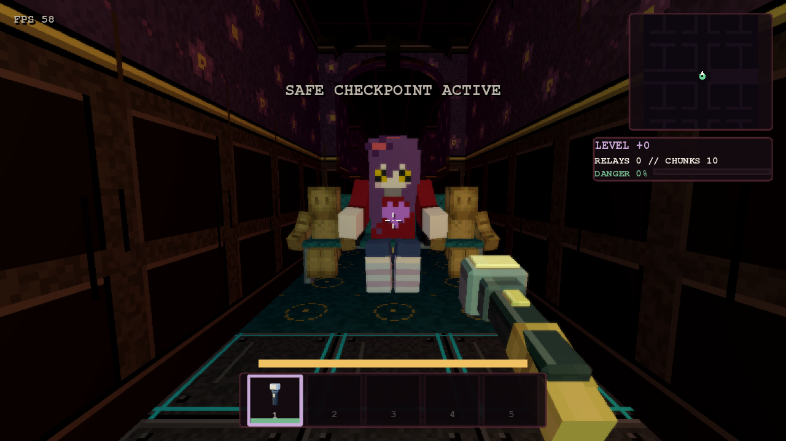
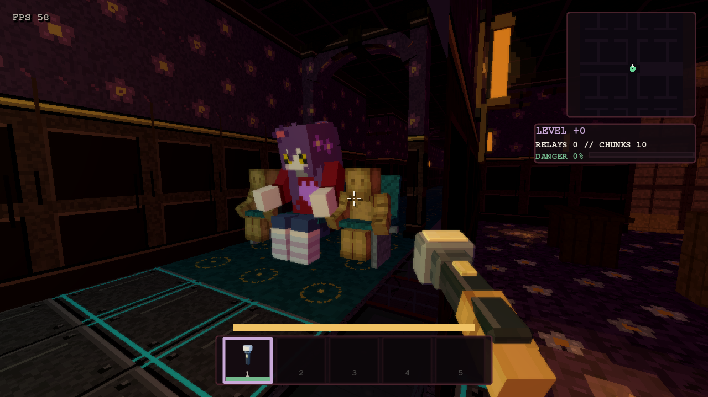
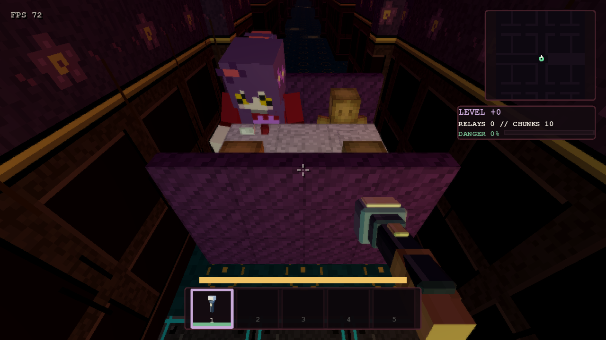

# Seating and the hunter-scale rescale

The world is built for a normal hunter (2.67 m, see [SCALE_FIT.md](SCALE_FIT.md)). Most furniture models were authored
person-sized, so a hunter would perch on a child's chair. This pass rescales them and splits multi-seats into separate
seats.

## Rescale (`PropModelCatalog.HUNTER_SCALE`)

- **What scales:** a per-type uniform factor, 1.5 for almost everything (the gothic canopy bed is 1.48, so it stays
  under the hunter-scale bed length). It covers every chair, stool, bench and sofa you can sit on, the beds, the
  counters, kitchens, sinks, toilets, urinals and showers, the racks, the filing cabinet, the floor lamps and the coffee
  table. Those are the props that were outside the hunter-scale ranges in `scale_fit`.
- **Where it applies:** `ModelSlot.instantiate_prop` scales the model's children, not its root, so the view's position
  and yaw stay as they were.
- **Who sees it:** the streamed view, the collider emitter (`tools/props/emit_collider_sizes.tscn`, which writes
  `PropColliderSizes`) and every audit read the same scaled model. Colliders, room placement and the hiding and rest
  cameras follow from that.
- **Emitter limits:** the height cap went to 3.4 m (the ceiling is 4 m), so a hunter-sized shower stall is solid all the
  way up. The worktop caps (vanity, serving counter, checkout, concession) are 1.5 times what they were.

## Separate seats (`PropModelCatalog.SEAT_COUNTS`)

| Prop | Seats |
| --- | --- |
| `dinerBooth` | 4: two per bench, the benches facing each other across the table (`SEAT_ROWS`) |
| `waitingChairs` | 3 |
| `loungeCouchWide` | 3 |
| `loungeCouch` | 2 |
| `mallBench` | 2 |
| `greenhouseBench` | 2 |
| `gothicBedroomBench` | 2 |
| `publicShowerBench` | 2 |

Everything else is one seat.

- **Interactables:** each seat is its own interactable, spaced evenly across the prop's width, with its own prompt and
  camera, so you pick a seat by looking at it.
- **For hunters:** each seat is also its own entry in the hunters' navigation (`seat_spots`). A hunter gets up out of the
  front of a seat, or out of the nearer open end of a booth bench.
- **The diner booth** was a work bench and is now sittable, at hunter scale too (1.5x). Its seat pan is measured over a
  bench, not the table.

## Who sits where (`src/game/seat_occupancy.gd`)

- **Taken seats:** each frame the route collects every occupied seat: teammates from their replicated `seat_at` (and
  `seat_top`), and hunters from their seated views. A seat within 0.35 m of an occupant offers no "SIT DOWN" and refuses
  the sit, and no hunter picks it.
- **Three on one row:** the local runner, a teammate and a hunter can each take their own seat of one row at the same
  time.
- **How peers see a seated runner:** in the mannequin's `sit` clip, lifted to the hunter-scale seat
  (`seat_top - PlayerController3D.SIT_CLIP_SEAT`).

The captures come from `tools/look/bench_seats.tscn`.

## Sitting (runner)

- **Seat height:** the view measures each seat model's pan (`StreamedFacilityView3D.seat_top`). It takes the highest
  upward face over the middle of the seat, in front of the backrest and below the backrest and arm tops, cached per
  model.
- **Eye height:** 0.70 m above that pan (`PlayerController3D.SIT_EYE_ABOVE_SEAT`). On a hunter seat (pan about 0.68 m)
  the 1.60 m runner's eye is about 1.38 m.
- **Fallback:** authored seats without a measurement (Night Watch) keep their own exact point.

## Hunters sitting (`src/game/hunter_seats.gd`)

- **Who sits down:** a patrolling hunter (wandering or idle, no runner within 14 m) now and then walks to a free seat
  within 12 m. Two hunters never pick the same seat.
- **Seated:** she faces out of the seat in the shared `sit` pose (`assets/hunters_blocky/night_watch_poses.json`,
  authored in `tools/blocky_hunters/nw_poses.py`), and stays 12 to 28 s.
- **Senses:** she is not hunting, but she still listens and looks.
- **Getting up:** a runner noise of 2 or more within 12 m, or a runner in sight within 14 m, gets her up at once. She
  then goes to look where the runner was. A hidden runner does not get her up.
- **Chance per second of patrol:** Relaxed 1.2%, Normal 0.7%, Hard 0.2%, Nightmare never. Voids and the secret
  creatures never sit.
- **Replication:** the hunter report carries `seated` and `seat_yaw`.

## Check

The `seating` suite covers:
- **Every sit type:** it is rescaled, and its seat pan is in range for its kind: chairs 0.55–0.85 m, bar stools
  0.85–1.15 m, sofas, benches and the beach lounger 0.30–0.75 m. Each seat is at least 0.6 m wide and 0.55 m
  deep, so a seated hunter fits.
- **Multi-seats:** each has the listed number of seats.
- **Generated chunks:** the navigation lists every seat, each seat lies inside its own prop, and no seat lies inside
  another solid prop (tables and desks are allowed).
- **Reachable:** every seat has open, clear floor on at least one side (in front, or beside a chair at a table).
- **Occupancy:** three on one row works, a taken seat offers no prompt and refuses the sit, the runner's state carries
  the seat, and a hunter picks only the free seat.
- **Hunter seats:** the difficulty and Void rules, walking to a free seat, two hunters on one row taking different
  seats, sitting, a far quiet runner not getting her up, and a noise or a sighting getting her up.

`rest_and_sleep` checks the runner's seated eye against each seat's measured pan.

## Prompt hitboxes, every interactable (KT: "fix prompt hitboxes for other props too", "make the reach closer")

- **Aim test:** a prompt shows only when the aim ray (the camera, or the controller ray in XR) hits the interactable's
  aim box within its kind's reach (`RouteInteractable3D.aim_box`, `AIM_REACH`). The box hugs the interactive part:
  - a door's leaf and frame;
  - the switch plate;
  - the pickup itself, with 16 cm of slack for small items;
  - a seat's own cushion (one per sit point);
  - a bed's mattress, and a locker or wardrobe body.
  Everything else gets an 8 cm margin.
- **Nearest wins:** when several boxes are on the ray, the nearest hit wins. Interactables with no known shape keep
  the old aim cone, but inside the same reach.
- **No prompt through walls:** the line-of-sight ray to the hit point must reach the interactable.
- **Reach,** measured from the eye along the ray (the runner's eye is at 1.44 m):

  | Interactable | Reach |
  | --- | --- |
  | doors and light switches | 1.4 m |
  | boards and vents | 1.5 m |
  | hiding spots, lift, safe zone, heater, music box | 1.6 m |
  | relays, batteries, coins, tools | 1.7 m |
  | furniture | 1.8 m |

- **Check:** the `interact_aim` suite runs each sampled kind (door, switch, battery, relay, vent, tool, seat, locker,
  wardrobe) through its real setup. For each one it aims at the part inside its reach, then from past the reach,
  0.2 m beside it, through a wall, and at two side by side.
