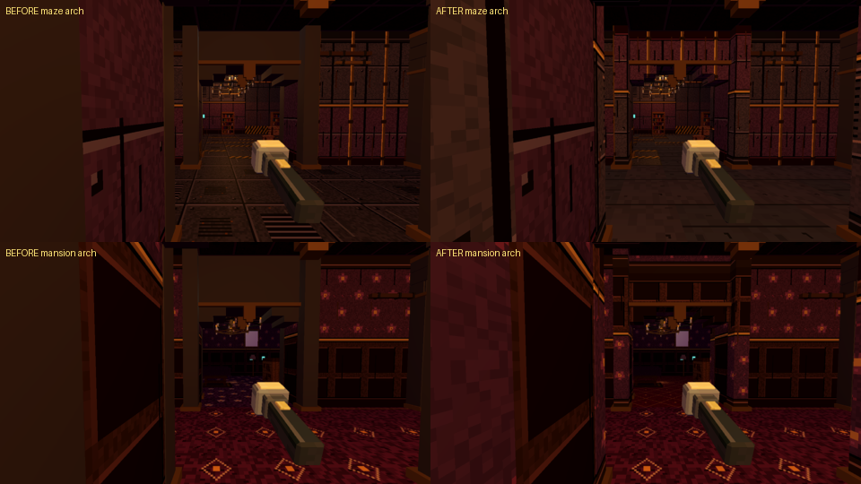
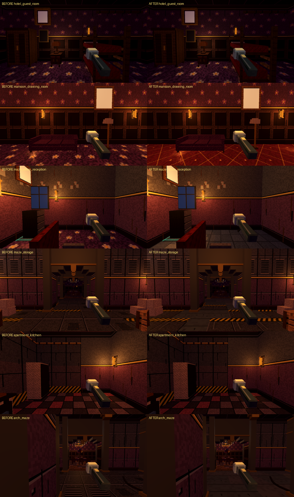

# Wall and floor themes

## The bleed (KT: room textures showing on hallway walls)

Every wall face was already themed per face, by the cell it looks into (`_ref_wall_kind`), but the map of "which cell
belongs to which room" (`StreamedFacilityView3D._room_type_map`, also used by `RefDecor`) took each room's whole rectangle,
and that rectangle includes the room's wall ring and its door cells. So door cells counted as room: the doorway floor got
the room floor, the door jambs (faces looking into the doorway) and the hall side around every door got the room's paper,
and room decor (vines, frames) could land on the hall side.

Rule now: a cell belongs to a room only inside its door line. A rect border cell that is a wall or a doorway (open, wall on
both sides along the border) belongs to the hall. Open border cells of open-plan rooms stay room. Faces, jambs, lintels,
decor and floors all follow that one map. A door between two rooms of a suite sits inside the suite's own interior and takes
the suite's theme.

## Archways

Arch headers, stepped corners and pilasters used one default stone block. They are now two-sided: the half facing the room
takes the room's wall kind, the half facing the hall the hall's (`RefLook.wall_kind`, the same function the walls, door
jambs and lintels use), with the wall's own texture mapped in world space (1 m across, 4 m wall height) so it continues on
the wall's grid. Brass trim stays as trim. Other biome builders (new biomes, sewers) should call `RefLook.wall_kind(region,
room_type, gx, gz)` and `RefDecor.arch_wall_material(kind)` for any frame or pass-through. `wall_themes` checks 112 arches:
no default block left, each side's kind is its wall's, and the material is the wall texture on the world grid.

(The capture rig's gothic arch picks look straight at a wall, so the sheet shows maze and mansion.)

## Floors by area (data: `src/look/floor_sets.gd`)

| District | Hall | Room default |
| --- | --- | --- |
| maze (offices) | bare concrete | grey carpet tiles |
| mansion | parquet + runner | parquet (drawing room: red patterned carpet) |
| hotel | teal and gold carpet | floral |
| apartment | parquet + runner | parquet / floral |
| beach | stone | stone (huts and boardwalk: planks) |
| gothic | stone + runner | red patterned carpet (archive: library green, mourning room: plum) |
| carnival | checker | star carpet |
| prison | concrete | concrete (cafeteria: checker) |
| inferno | hazard plate | plate / stone |

Rooms by purpose: kitchens, dining and cafeterias checker tile; restrooms clinic vinyl; bathrooms checker; storage and
backstage concrete; bedrooms and guest rooms floral; dining rooms parquet; private offices plum. New painted kinds:
`carpet_red`, `carpet_teal`, `carpet_green`, `carpet_plum`, `carpet_tile0/1`, `vinyl0/1`, `concrete0/1` (blocky 32 px, matte
via MaterialLook). Hall junctions and doorways use the hall floor (the runner junction rule is unchanged).

## Validator

`wall_themes` (3 seeds, 9x9 chunks each): every wall face and every floor cell is themed from the set of the space it
faces (185 515 faces, 0 mismatches), every doorway is on the hall theme, every generated room purpose (37) has its own
floor set, every district has hall and room sets and every kind is painted.

## Before / after

## Archways and hall pilasters follow the hall (KT, 2026-10-28)

* **Materials**: the jambs, headers, corner steps, pilasters and arches are the hall's own wall (the theme of the space
  each face looks into, the same paper / panel / brick / tile / concrete), never the old flat gray stone. Caps,
  mouldings and keystones take the district's accent (`RefLook.ARCH_ACCENT`): brass in the mansion, hotel, apartments
  and carnival, painted steel in the prison, lab, hospital and inferno, stone in gothic and the sewer, terrazzo in
  the mall, concrete in the maze, iron in the greenhouse. Every trim face is a textured pixel material.
* **Texture mapping** (`src/look/ref_plane_uv.gdshader`, mirrored by `RefDecor.plane_uv`): each face is mapped from its
  own plane, u along the wall in metres and v by storeys from the floor, exactly as the wall faces are. Courses line
  up with the wall beside the arch, and stay level and unstretched on an arch turned to any angle or standing on a
  ramp (jambs plumb, courses level, consistently for every theme).
* **Alignment**: a hall arch springs from the +x / +z wall's pilaster and spans pilaster face to pilaster face, centred
  on the hall's centreline (the hall is measured across the grid), under the ceiling; the three-cell archways'
  faces lie on the wall planes. The facing pilaster is placed by the opposite wall at the same position along the
  hall.
* **Check** (`wall_themes`): no default gray or gold block, trim is the district's textured accent, arch materials are
  the faced wall's texture with the plane mapping, centre offset under 2 cm, span equal to the opening, faces on the
  wall planes, top under the ceiling; and the mapping itself: identical to the wall faces on all four sides at 3.3 /
  4.0 / 5.9 m, the same texel density on arches turned 30 / 45 / 117 degrees and on a 12 degree ramp, no seam between
  blocks. (Measured on the mapping: the headless validator has no renderer.)
