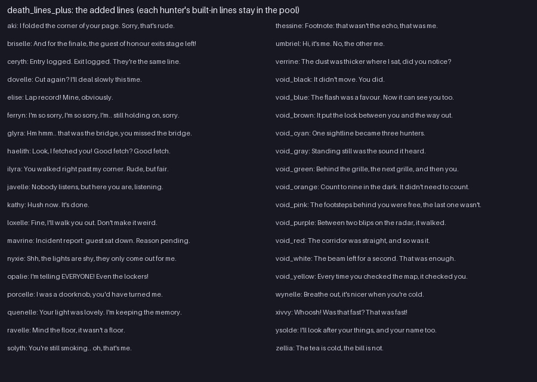

# Death Lines Plus (`examples/mods/death_lines_plus`)

Extra death-screen lines for all 38 hunters, in each hunter's own voice.



## What it contains

- One `deaths/<hunter>.json` per hunter with `mode: add`: two lines each (one for the void hunters, which speak tersely about their mechanism).
- Kathy had no lines at all; she now has three.
- Ids follow the built-in file ids (`voidblack`, not `void_black`).

## Notes

Because `add` keeps the built-in lines, the hunter's seeded pick now draws from a larger pool; the same line is still shown to everyone in the room.

## Try it

```
tools/modpack/modpack.sh validate examples/mods/death_lines_plus
cp -R examples/mods/death_lines_plus "$HOME/Library/Application Support/Godot/app_userdata/KYTTU- The Last Route/mods/"
```

Then start a private room with the pack enabled. The pack is covered by the `data_packs` suite.
