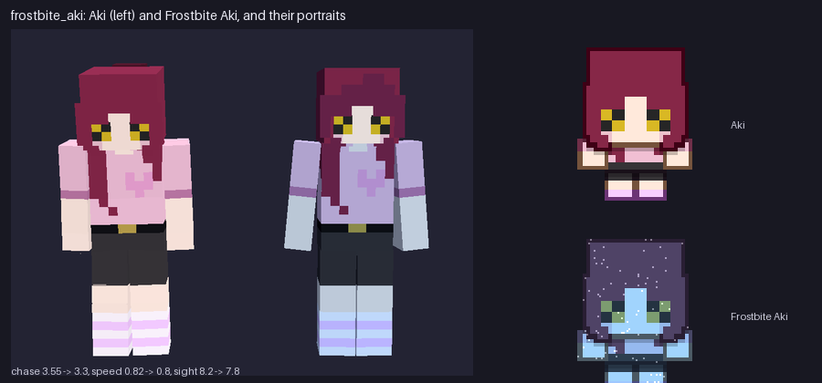

# Frostbite Aki (`examples/mods/frostbite_aki`)

An icy variant of Aki as a new hunter: tinted body and portrait, a slightly slower chase, her own death lines and shivery emote weights.



## What it contains

- Hunter `frostbite_aki_aki`: Aki's rig with icy blue material factors; chase 3.3 (Aki 3.55), speed 0.8, sight 7.8; same `reach1` chase style and `easy` tier.
- Portrait: Aki's, tinted and frosted.
- Deaths: four lines and a lore line, shy and apologetic about the cold.
- Emotes: no taunt, laugh or dance; flinch (shiver) and look-around up; stretch plays the shy clip.

## Notes

Aki herself is untouched (a variant is a new hunter), so she keeps her abilities and Frostbite Aki joins the easy tier draw.

## Try it

```
tools/modpack/modpack.sh validate examples/mods/frostbite_aki
cp -R examples/mods/frostbite_aki "$HOME/Library/Application Support/Godot/app_userdata/KYTTU- The Last Route/mods/"
```

Then start a private room with the pack enabled. The pack is covered by the `data_packs` suite.
