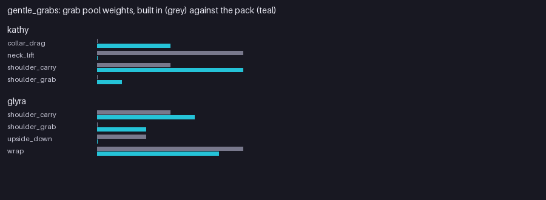

# Gentle Grabs (`examples/mods/gentle_grabs`)

A softer grab pool for Kathy and Glyra, using the existing styles with different weights.



## What it contains

- Kathy: `shoulder_carry` 6, `collar_drag` 3, `shoulder_grab` 1 (built in: `neck_lift` 6, `shoulder_carry` 3), looking after 0.8 s.
- Glyra: `wrap` 5, `shoulder_carry` 4, `shoulder_grab` 2 (built in: includes `upside_down`).

## Notes

The animations are the game's; the pack only picks which are used and how often.

## Try it

```
tools/modpack/modpack.sh validate examples/mods/gentle_grabs
cp -R examples/mods/gentle_grabs "$HOME/Library/Application Support/Godot/app_userdata/KYTTU- The Last Route/mods/"
```

Then start a private room with the pack enabled. The pack is covered by the `data_packs` suite.
