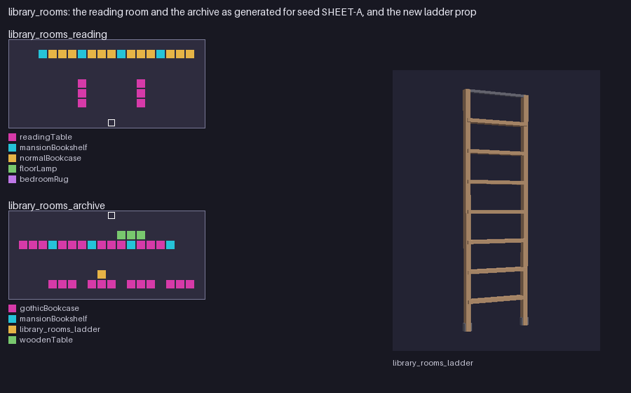

# Library Rooms (`examples/mods/library_rooms`)

A **READING ROOM** and an **ARCHIVE** for the mall, with a new rolling-ladder prop.



## What it contains

- Room `library_rooms_reading`: reading tables, bookcase row along the back, floor lamp, globe and rug.
- Room `library_rooms_archive`: stacks along the back and mid rows, a filing cabinet, a table, and the pack's own `library_rooms_ladder` leaning on the stacks.
- Prop `library_rooms_ladder`: a wood and iron rolling ladder (`assets/rolling_ladder.glb`, 0.7 x 2.3 x 0.45 m), generated by `example_assets.py`.
- The built-in games have no plain ladder prop (the sewer ladder is a level link), so this one is new.

## Notes

Overrides `regions/mall`, so it cannot load together with `neon_arcade`.

## Try it

```
tools/modpack/modpack.sh validate examples/mods/library_rooms
cp -R examples/mods/library_rooms "$HOME/Library/Application Support/Godot/app_userdata/KYTTU- The Last Route/mods/"
```

Then start a private room with the pack enabled. The pack is covered by the `data_packs` suite and `data_rooms` (generated rooms keep their entrance clear and floor reachable).
