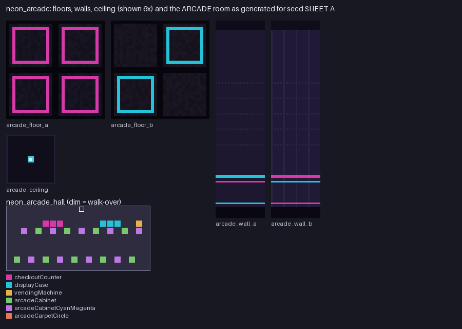

# Neon Arcade (`examples/mods/neon_arcade`)

Dark floor, wall and ceiling textures with neon trim for the mall, plus an **ARCADE** room that joins the mall's shop cycle.



## What it contains

- Floors `terrazzo0` / `terrazzo1` (32x32): dark tiles, magenta and cyan inset trim.
- Walls `mall0` / `mall1` (32x128): a neon rail at head height and a glowing baseboard.
- Ceiling `ceil1`: dark panels with small cyan lights.
- Room `neon_arcade_hall` (`rooms/arcade.json`): a prize counter (the checkout counter), prize display case and snack machine by the door, cabinet rows along the back wall, a back-to-back row in rooms deep enough, and a round carpet in wide ones. The mall region override adds it to `room_roles` with the sign `ARCADE`.

## Notes

Recipes can only place props the room generator has a footprint for. `prizeCounter`, `arcadeTokenChanger` and `arcadeBasketballHoop` have models but no footprint yet, so a recipe that names them is silently skipped; this pack uses `checkoutCounter`, `displayCase` and `vendingMachine` instead.

Overrides `regions/mall`, so it cannot load together with `library_rooms` (one pack per overridden id). Textures are drawn by `tools/modpack/example_assets.py`.

## Try it

```
tools/modpack/modpack.sh validate examples/mods/neon_arcade
cp -R examples/mods/neon_arcade "$HOME/Library/Application Support/Godot/app_userdata/KYTTU- The Last Route/mods/"
```

Then start a private room with the pack enabled. The pack is covered by the `data_packs` suite and `data_rooms` (generated rooms keep their entrance clear and floor reachable).
