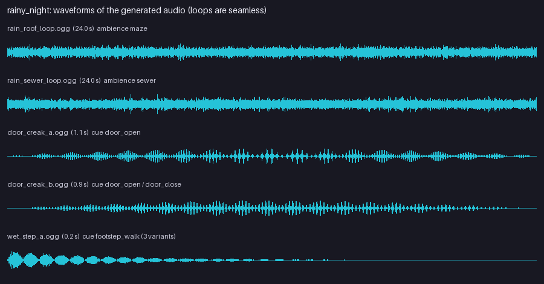

# Rainy Night (`examples/mods/rainy_night`)

Rain on the roof and far thunder over the maze, rain heard down a grate in the sewers, creaking doors and wet footsteps.



## What it contains

- Ambience `maze` (24 s loop): rain on a flat roof, two rolls of thunder.
- Ambience `sewer` (24 s loop): muffled rain, slow drips with pipe echo, one low rumble.
- Cues `door_open` (two creaks), `door_close`, `footstep_walk` (three wet steps).
- All audio is generated (band-limited noise built in the frequency domain, so the loops are seamless) and encoded as Ogg Vorbis.

## Notes

Surface-specific footstep cues (`step:<mode>:<surface>`) are not replaceable yet, so the wet step plays where the floor has no surface sound.

## Try it

```
tools/modpack/modpack.sh validate examples/mods/rainy_night
cp -R examples/mods/rainy_night "$HOME/Library/Application Support/Godot/app_userdata/KYTTU- The Last Route/mods/"
```

Then start a private room with the pack enabled. The pack is covered by the `data_packs` suite.
